# Learn Rust 🦀

<div align="center">

[](https://opensource.org/licenses/MIT)
[](https://www.rust-lang.org/)
[](https://github.com/TheLearningHubOrg/learn-rust/actions/workflows/ci.yml)
[](https://github.com/TheLearningHubOrg/learn-rust/releases)
[](https://doc.rust-lang.org/edition-guide/rust-2024/index.html)
[](https://tokio.rs/)

**From your first `cargo new` to staff-level Rust: ownership, the type system, fearless concurrency and production services.**  
Covers the Cargo toolchain, borrowing and lifetimes, enums and pattern matching, error design, traits and generics, smart pointers, threads and async with Tokio, unsafe code and FFI, and a tested axum starter service.

[Getting Started](#1-stage-1-toolchain-cargo--core-syntax) • [Ownership](#2-stage-2-ownership-borrowing--lifetimes) • [Types & Errors](#3-stage-3-structs-enums-modules--error-handling) • [Traits & Generics](#4-stage-4-traits-generics--zero-cost-abstractions) • [Smart Pointers](#5-stage-5-smart-pointers-memory-management--interior-mutability) • [Concurrency & Async](#6-stage-6-fearless-concurrency--asynchronous-rust) • [Interview Prep](#7-stage-7-staff-rust-systems-engineer-interview-handbook--cheatsheet)

<br/>

<a href="https://www.buymeacoffee.com/manthanank">
  
</a>

</div>

---

## 🗺️ 7-Stage Pedagogical Roadmap


| Stage | Focus Domain | Core Concepts & Engineering Outcomes |
| :--- | :--- | :--- |
| **Stage 1** | **Toolchain, Cargo & Core Syntax** | `rustup`, `rust-toolchain.toml`, `Cargo.toml` and `Cargo.lock`, `cargo check/build/run/test/clippy/fmt`, release profiles, integer widths and overflow modes, `as` casts, tuples, arrays, `let`/`mut`/shadowing/`const`/`static`, block and `if`/`loop`/`match` expressions, `String` vs `&str`, `format!` and `{:?}`, `#[test]`. You can build, lint, test and run the starter service. |
| **Stage 2** | **Ownership, Borrowing & Lifetimes** | Stack vs heap, move vs `Copy` vs `Clone`, `Drop` order, `&T` vs `&mut T`, NLL and two-phase borrows, slices, `'a` annotations, the three elision rules, structs that hold references, `'static` and `T: 'static`, variance, `Vec`/`String`/`HashMap` ownership, the `entry` API, borrow-checker error codes E0382, E0499, E0502, E0505, E0597, E0106. |
| **Stage 3** | **Structs, Enums, Modules & Error Handling** | Named, tuple and unit structs, newtypes, `impl` blocks and receivers, `#[derive]`, data-carrying enums, `Option` combinators, exhaustive `match`, guards, `@` bindings, `let-else`, let chains, `mod`/`pub(crate)`/`use`, `Result` and `?`, `From` conversions, `thiserror` and `anyhow`, `IntoResponse` error mapping, builders and typestate. |
| **Stage 4** | **Traits, Generics & Zero-Cost Abstractions** | Monomorphization, trait bounds and `where`, `impl Trait` vs `dyn Trait`, vtables and fat pointers, `From`/`Into`, `Deref`. |
| **Stage 5** | **Smart Pointers & Interior Mutability** | `Box`, `Rc` vs `Arc`, `RefCell` runtime borrow checks, `Weak` to break reference cycles. |
| **Stage 6** | **Fearless Concurrency & Async** | `thread::spawn` and `thread::scope`, `mpsc` channels, `Arc<Mutex<T>>` and atomics, `Send`/`Sync`, the `Future` poll model, Tokio tasks and `select!`. |
| **Masterclasses** | **Unsafe & FFI, sharded cache, thread-pool server, crate architecture, flagship axum service** | Raw pointers and the C ABI under Edition 2024 rules, lock striping with `RwLock` shards, a worker pool over channels, production `Cargo.toml` and crate selection, and a stateful REST service on Tokio and axum. |
| **Stage 7** | **Staff Interview Handbook** | 50 interview Q&As on ownership, internals, async, unsafe and design, plus a one-page cheatsheet. |

---

## 🆕 Rust Versions, What's New & Migration

Rust ships a new stable release every six weeks and supports only the latest one; there is no LTS channel. Language changes that would break old code are bundled into **editions** (2015, 2018, 2021, 2024). An edition is a per-crate setting: crates on different editions link together freely, so upgrading is never all-or-nothing across a dependency graph. The CI container used to test this repo ran rustc 1.99.1; the starter declares `rust-version = "1.85"`, the first release that understands Edition 2024.

### V.1 Release Timeline

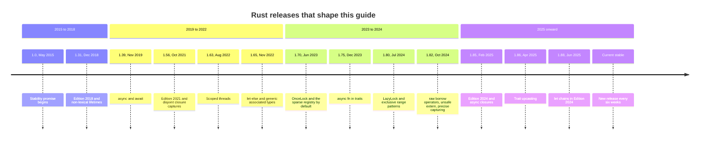

### V.2 Compatibility Matrix

| Edition | First rustc | Default Cargo resolver | What changed for everyday code |
| --- | --- | --- | --- |
| 2015 | 1.0 (May 2015) | 1 | The original language. `async`, `await`, `dyn` are plain identifiers. |
| 2018 | 1.31 (Dec 2018) | 1 | `crate::` paths, `dyn Trait` required for trait objects (warning, error in 2021), `async`/`await` reserved, NLL. |
| 2021 | 1.56 (Oct 2021) | 2 | Closures capture individual fields, arrays implement `IntoIterator` by value, `TryFrom`/`TryInto` in the prelude, `panic!` always takes a format string. |
| 2024 | 1.85 (Feb 2025) | 3 (MSRV-aware) | `impl Trait` captures all in-scope lifetimes, `unsafe extern` blocks, `unsafe` attributes, `if let` and tail-expression temporaries drop earlier, `gen` reserved, `static mut` references denied, `env::set_var` is `unsafe`, `Future`/`IntoFuture` in the prelude. |

| Component | Version used by the starter | Notes |
| --- | --- | --- |
| rustc / Cargo | 1.85 minimum, current stable recommended | Resolver 3 picks dependency versions whose `rust-version` fits yours. |
| tokio | 1.x | Stable 1.x API since 2020; enable only the features you use. |
| axum | 0.8 | Path captures use `/{id}` (0.7 used `/:id`). |
| serde / serde_json | 1.x | `derive` feature for `Serialize`/`Deserialize`. |
| thiserror | 2.x | 2.0 supports `no_std` and keeps the 1.x attribute syntax. |
| Docker build image | `rust:1-slim-bookworm` | Tracks the newest 1.x stable compiler. |

### V.3 What's New in Edition 2024 and Recent Stable Releases

#### Let chains (1.88, Edition 2024)

`&&` can now join `let` patterns and boolean conditions in one `if` or `while`, which removes the staircase of nested `if let` blocks.

```rust
struct User { admin: bool, token: Option<String> }

// Before: three levels of nesting.
fn token_before(user: Option<&User>) -> Option<&str> {
    if let Some(u) = user {
        if u.admin {
            if let Some(t) = &u.token {
                return Some(t);
            }
        }
    }
    None
}

// After (edition = "2024"): one condition, bindings flow left to right.
fn token_after(user: Option<&User>) -> Option<&str> {
    if let Some(u) = user
        && u.admin
        && let Some(t) = &u.token
    {
        return Some(t);
    }
    None
}
```

#### Async closures (1.85)

`async || { ... }` is a real closure type with the `AsyncFn`, `AsyncFnMut` and `AsyncFnOnce` traits. Before, you wrote `|| async { ... }`, a closure that returns a future, and the future could not borrow from the closure's captures.

```rust
// Before: two generic parameters and a closure that cannot lend its captures.
async fn retry_before<F, Fut>(mut op: F) -> Result<u32, String>
where
    F: FnMut() -> Fut,
    Fut: std::future::Future<Output = Result<u32, String>>,
{
    for _ in 0..2 {
        if let Ok(v) = op().await { return Ok(v); }
    }
    op().await
}

// After: one bound, and the returned future may borrow from the closure.
async fn retry_after(op: impl AsyncFn() -> Result<u32, String>) -> Result<u32, String> {
    for _ in 0..2 {
        if let Ok(v) = op().await { return Ok(v); }
    }
    op().await
}
```

#### `impl Trait` captures every in-scope lifetime (Edition 2024) and `use<..>` (1.82)

In 2021, a returned `impl Trait` captured type parameters but not lifetimes, so you added `+ '_` to say "this iterator borrows the argument". In 2024 it captures all of them by default. When you need the opposite, a `use<..>` bound lists exactly what is captured.

```rust
// Edition 2021 needed `+ '_`; Edition 2024 infers the borrow.
fn evens(values: &[u32]) -> impl Iterator<Item = u32> {
    values.iter().copied().filter(|v| v % 2 == 0)
}

// Opt out: the result borrows `names` but not `scratch`, so the caller
// may reuse `scratch` while the iterator is still alive.
fn lengths<'a>(names: &'a [String], scratch: &mut Vec<u8>) -> impl Iterator<Item = usize> + use<'a> {
    scratch.clear();
    names.iter().map(|n| n.len())
}
```

#### `unsafe extern` blocks and `unsafe(...)` attributes (1.82, required in Edition 2024)

Declaring a foreign function is a promise the compiler cannot check, so the block itself is now marked `unsafe`. Items inside can be declared `safe` when calling them is always sound. Attributes that can cause undefined behaviour (`no_mangle`, `export_name`, `link_section`) must be wrapped in `unsafe(...)`.

```rust
// Before (2021)
// extern "C" { fn abs(x: i32) -> i32; }
// #[no_mangle] pub extern "C" fn add(a: i32, b: i32) -> i32 { a + b }

// After (2024)
unsafe extern "C" {
    pub safe fn abs(x: i32) -> i32; // calling it needs no unsafe block
}

#[unsafe(no_mangle)]
pub extern "C" fn add(a: i32, b: i32) -> i32 {
    a + b
}

fn main() {
    println!("{} {}", abs(-4), add(2, 3));
}
```

#### `if let` temporaries drop before `else` (Edition 2024)

In 2021, a temporary created in an `if let` scrutinee, such as a `MutexGuard`, lived until the end of the whole `if let ... else` statement. Locking again in the `else` branch deadlocked. In 2024 the temporary is dropped before `else` runs.

```rust
use std::sync::Mutex;

fn get_or_init(cache: &Mutex<Option<u32>>) -> u32 {
    if let Some(n) = *cache.lock().unwrap() {
        n
    } else {
        // 2021: the first guard is still alive here, so this second lock
        // deadlocks or panics (std leaves the choice to the platform).
        // 2024: the first guard was dropped, so this works.
        *cache.lock().unwrap() = Some(42);
        42
    }
}

fn main() {
    let cache = Mutex::new(None);
    assert_eq!(get_or_init(&cache), 42);
    assert_eq!(get_or_init(&cache), 42);
}
```

#### Trait upcasting (1.86)

A `&dyn Sub` now coerces to `&dyn Super` when `Super` is a supertrait. Before, you added an `as_debug(&self) -> &dyn Debug` helper method to every implementation.

```rust
use std::fmt::Debug;

trait Shape: Debug {
    fn area(&self) -> f64;
}

#[derive(Debug)]
struct Square(f64);
impl Shape for Square {
    fn area(&self) -> f64 { self.0 * self.0 }
}

fn log(shape: &dyn Shape) {
    let as_debug: &dyn Debug = shape; // upcast, no helper method needed
    println!("{as_debug:?} has area {}", shape.area());
}

fn main() {
    log(&Square(3.0));
}
```

#### `LazyLock` and `OnceLock` replace `lazy_static` (1.70 and 1.80)

```rust
// Before: a macro from a crate.
// lazy_static::lazy_static! { static ref LIMITS: Vec<u32> = load(); }

// After: the standard library.
use std::sync::LazyLock;

static LIMITS: LazyLock<Vec<u32>> = LazyLock::new(|| {
    // runs once, on first access, even if many threads race to read it
    vec![10, 100, 1_000]
});

fn main() {
    println!("{:?}", *LIMITS);
}
```

### V.4 Migration Guide (Edition 2021 → 2024)

```bash
# 1. Update the compiler; Edition 2024 needs 1.85 or newer.
rustup update stable

# 2. Let Cargo rewrite code whose meaning would change. The crate stays on 2021
#    while this runs, so commit first and review the diff afterwards.
cargo fix --edition --all-targets --all-features

# 3. Switch the edition (and declare your minimum compiler) in Cargo.toml:
#    edition = "2024"
#    rust-version = "1.85"

# 4. Rebuild, test, then accept idiom suggestions and reformat.
cargo build --all-targets
cargo test
cargo clippy --fix --all-targets --allow-dirty
cargo fmt --all   # the 2024 style edition sorts imports differently
```

Workspaces run the same commands from the root with `--workspace`. Each member can move separately, because editions are per crate.

Two framework changes came with the same upgrade in this repo. axum 0.8 replaced `/:id` with `/{id}` (old syntax panics when the router is built), and custom extractors no longer need `#[async_trait]` because Rust 1.75 supports `async fn` in traits.

### V.5 Deprecations & Breaking Changes

| Version | Deprecated / removed | Replacement | What breaks and how to fix it |
| --- | --- | --- | --- |
| Edition 2024 | `extern "C" { ... }` | `unsafe extern "C" { ... }` | Hard error. `cargo fix --edition` adds the keyword. |
| Edition 2024 | `#[no_mangle]`, `#[export_name]`, `#[link_section]` | `#[unsafe(no_mangle)]` and friends | Hard error; wrap the attribute. |
| Edition 2024 | References to `static mut` | Atomics, `Mutex`, `LazyLock`, or `&raw mut STATIC` | `static_mut_refs` is deny-by-default. Replace the global with a synchronised type. |
| Edition 2024 | Safe `std::env::set_var` / `remove_var` | Call inside `unsafe { }` | Hard error. These race with other threads reading the environment; set config before spawning threads, or pass values explicitly. |
| Edition 2024 | `gen` as an identifier | `r#gen` | Reserved for generator blocks. `cargo fix` renames uses. |
| Edition 2024 | `impl Trait + '_` capture trick | Default capture, or `use<..>` to narrow | Still compiles; the extra bound is now redundant. |
| Edition 2024 | Never-type fallback to `()` | Fallback to `!` | Code relying on `()` inference (often `unsafe` transmute or `Default` calls) needs an explicit type. |
| 1.42 | `Error::description()` | `Display` impl / `to_string()` | Deprecated; implement `Display` instead. |
| 1.39 | `std::mem::uninitialized()` | `std::mem::MaybeUninit` | Deprecated and almost always UB; use `MaybeUninit`. |
| Edition 2018 | `try!(expr)` | `expr?` | `try` became a reserved keyword; use `?`. |
| axum 0.8 | `/:param` and `/*rest` routes | `/{param}` and `/{*rest}` | Router panics at build time with a message naming the new syntax. |

---

## 📋 Table of Contents

- [🆕 Rust Versions, What's New & Migration](#-rust-versions-whats-new--migration)
- [1. Stage 1: Toolchain, Cargo & Core Syntax](#1-stage-1-toolchain-cargo--core-syntax)
  - [1.1 What Rust Is and the Problem It Solves](#11-what-rust-is-and-the-problem-it-solves)
  - [1.2 Installing the Toolchain with rustup](#12-installing-the-toolchain-with-rustup)
  - [1.3 Creating a Project and Reading Cargo.toml](#13-creating-a-project-and-reading-cargotoml)
  - [1.4 The Build Cycle: check, build, run, test, clippy, fmt](#14-the-build-cycle-check-build-run-test-clippy-fmt)
  - [1.5 Line-by-Line Breakdown of the Starter Project](#15-line-by-line-breakdown-of-the-starter-project)
  - [1.6 Scalar Types, Sizes and Integer Overflow](#16-scalar-types-sizes-and-integer-overflow)
  - [1.7 Compound Types: Tuples and Arrays](#17-compound-types-tuples-and-arrays)
  - [1.8 Variables, Mutability, Shadowing, const and static](#18-variables-mutability-shadowing-const-and-static)
  - [1.9 Functions, Statements and Expressions](#19-functions-statements-and-expressions)
  - [1.10 Control Flow as Expressions](#110-control-flow-as-expressions)
  - [1.11 Strings at a Glance: String, &str and UTF-8](#111-strings-at-a-glance-string-str-and-utf-8)
  - [1.12 Formatting, Printing and Debug Output](#112-formatting-printing-and-debug-output)
  - [1.13 Testing from Day One](#113-testing-from-day-one)
  - [1.14 Pitfalls](#114-pitfalls)
  - [1.15 Best Practices](#115-best-practices)
  - [1.16 Hands-on Exercise](#116-hands-on-exercise)
- [2. Stage 2: Ownership, Borrowing & Lifetimes](#2-stage-2-ownership-borrowing--lifetimes)
  - [2.1 Stack, Heap and Why Ownership Exists](#21-stack-heap-and-why-ownership-exists)
  - [2.2 The Three Ownership Rules and Move Semantics](#22-the-three-ownership-rules-and-move-semantics)
  - [2.3 Copy, Clone and Drop](#23-copy-clone-and-drop)
  - [2.4 Ownership Across Function Boundaries](#24-ownership-across-function-boundaries)
  - [2.5 References and the Aliasing XOR Mutability Rule](#25-references-and-the-aliasing-xor-mutability-rule)
  - [2.6 Non-Lexical Lifetimes and Two-Phase Borrows](#26-non-lexical-lifetimes-and-two-phase-borrows)
  - [2.7 Slices: Borrowed Views into Strings and Arrays](#27-slices-borrowed-views-into-strings-and-arrays)
  - [2.8 Lifetime Annotations in Function Signatures](#28-lifetime-annotations-in-function-signatures)
  - [2.9 Lifetime Elision Rules](#29-lifetime-elision-rules)
  - [2.10 Structs That Borrow: the Words Iterator](#210-structs-that-borrow-the-words-iterator)
  - [2.11 'static, T: 'static and Variance](#211-static-t-static-and-variance)
  - [2.12 Collections and Ownership: Vec, String and HashMap](#212-collections-and-ownership-vec-string-and-hashmap)
  - [2.13 Reading Borrow-Checker Errors](#213-reading-borrow-checker-errors)
  - [2.14 Pitfalls](#214-pitfalls)
  - [2.15 Best Practices](#215-best-practices)
  - [2.16 Hands-on Exercise](#216-hands-on-exercise)
- [3. Stage 3: Structs, Enums, Modules & Error Handling](#3-stage-3-structs-enums-modules--error-handling)
  - [3.1 Structs: Named, Tuple, Unit and Newtypes](#31-structs-named-tuple-unit-and-newtypes)
  - [3.2 Methods, Associated Functions and Receivers](#32-methods-associated-functions-and-receivers)
  - [3.3 Deriving Common Traits](#33-deriving-common-traits)
  - [3.4 Enums as Algebraic Data Types](#34-enums-as-algebraic-data-types)
  - [3.5 Option: Replacing Null](#35-option-replacing-null)
  - [3.6 Pattern Matching in Depth](#36-pattern-matching-in-depth)
  - [3.7 if let, while let, let-else, let chains and matches!](#37-if-let-while-let-let-else-let-chains-and-matches)
  - [3.8 Modules, Visibility and Crate Layout](#38-modules-visibility-and-crate-layout)
  - [3.9 Result and the ? Operator](#39-result-and-the--operator)
  - [3.10 Designing Library Errors with thiserror](#310-designing-library-errors-with-thiserror)
  - [3.11 Application Errors with anyhow](#311-application-errors-with-anyhow)
  - [3.12 Mapping Domain Errors to HTTP Responses](#312-mapping-domain-errors-to-http-responses)
  - [3.13 Panics vs Errors](#313-panics-vs-errors)
  - [3.14 Builders and the Typestate Pattern](#314-builders-and-the-typestate-pattern)
  - [3.15 Pitfalls](#315-pitfalls)
  - [3.16 Best Practices](#316-best-practices)
  - [3.17 Hands-on Exercise](#317-hands-on-exercise)
- [4. Stage 4: Traits, Generics & Zero-Cost Abstractions](#4-stage-4-traits-generics--zero-cost-abstractions)
  - [4.1 Generics & Zero-Cost Monomorphization](#41-generics--zero-cost-monomorphization)
  - [4.2 Traits, Trait Bounds & where Clauses](#42-traits-trait-bounds--where-clauses)
  - [4.3 Static vs Dynamic Dispatch: dyn Trait & Vtables](#43-static-vs-dynamic-dispatch-dyn-trait--vtables)
  - [4.4 Standard Library Traits: From, Into & Deref](#44-standard-library-traits-from-into--deref)
- [5. Stage 5: Smart Pointers, Memory Management & Interior Mutability](#5-stage-5-smart-pointers-memory-management--interior-mutability)
  - [5.1 Box: Heap Allocation & Recursive Data Types](#51-box-heap-allocation--recursive-data-types)
  - [5.2 Reference Counting: Rc vs Arc](#52-reference-counting-rc-vs-arc)
  - [5.3 Interior Mutability with RefCell](#53-interior-mutability-with-refcell)
  - [5.4 Preventing Memory Leaks with Weak](#54-preventing-memory-leaks-with-weak)
- [6. Stage 6: Fearless Concurrency & Asynchronous Rust](#6-stage-6-fearless-concurrency--asynchronous-rust)
  - [6.1 Native Threads & Scoped Threads](#61-native-threads--scoped-threads)
  - [6.2 Message-Passing Concurrency with mpsc](#62-message-passing-concurrency-with-mpsc)
  - [6.3 Shared-State Concurrency: Arc, Mutex & Atomics](#63-shared-state-concurrency-arc-mutex--atomics)
  - [6.4 Compile-Time Thread Safety: Send & Sync](#64-compile-time-thread-safety-send--sync)
  - [6.5 Asynchronous Rust & The Tokio Runtime](#65-asynchronous-rust--the-tokio-runtime)
- [M1. Masterclass: Unsafe Rust & FFI](#m1-masterclass-unsafe-rust--ffi)
  - [M1.1 Unsafe Rust: The Five Superpowers](#m11-unsafe-rust-the-five-superpowers)
  - [M1.2 Foreign Function Interface: C ABI Interoperability](#m12-foreign-function-interface-c-abi-interoperability)
- [M2. Masterclass: Sharded Concurrent Cache](#m2-masterclass-sharded-concurrent-cache)
  - [M2.1 Sharded Cache Implementation](#m21-sharded-cache-implementation)
  - [M2.2 Verifying Thread Safety at Compile Time](#m22-verifying-thread-safety-at-compile-time)
- [M3. Masterclass: Thread-Pool TCP Server](#m3-masterclass-thread-pool-tcp-server)
  - [M3.1 Worker Pool and Connection Handler](#m31-worker-pool-and-connection-handler)
- [M4. Masterclass: Production Crate Architecture & Release Builds](#m4-masterclass-production-crate-architecture--release-builds)
  - [M4.1 Production Architecture Matrix](#m41-production-architecture-matrix)
  - [M4.2 Production Cargo.toml Reference](#m42-production-cargotoml-reference)
- [M5. Masterclass: Flagship Blueprint: Async REST Microservice with Tokio & Axum](#m5-masterclass-flagship-blueprint-async-rest-microservice-with-tokio--axum)
  - [M5.1 Shared State, Handlers and Router](#m51-shared-state-handlers-and-router)
- [7. Stage 7: Staff Rust Systems Engineer Interview Handbook & Cheatsheet](#7-stage-7-staff-rust-systems-engineer-interview-handbook--cheatsheet)
  - [7.1 Core Concepts (Q1-Q10)](#71-core-concepts-q1-q10)
  - [7.2 Internals & Performance (Q11-Q20)](#72-internals--performance-q11-q20)
  - [7.3 Low-Level Concurrency & Unsafe (Q21-Q30)](#73-low-level-concurrency--unsafe-q21-q30)
  - [7.4 Advanced Systems Questions (Q31-Q50)](#74-advanced-systems-questions-q31-q50)
  - [7.5 Staff Cheatsheet](#75-staff-cheatsheet)
- [🧪 Example Projects](#-example-projects)
- [📝 Cheat Sheets](#-cheat-sheets)
- [📚 Resources](#-resources)
- [🤝 Contributing](#-contributing)
- [📄 License](#-license)
- [🙏 Acknowledgments](#-acknowledgments)
- [🌐 Connect with me](#-connect-with-me)
- [☕ Support](#-support)

---

## 1. Stage 1: Toolchain, Cargo & Core Syntax

This stage installs the toolchain, explains what Cargo does on every build, and covers the syntax you need before ownership makes sense: scalar and compound types, variables, functions, expressions, control flow, strings, formatting and tests. No prior Rust is assumed; some experience with any compiled or scripting language helps. At the end you can clone the starter service, run it, change it, and keep `cargo fmt`, `cargo clippy` and `cargo test` green.

Every example in this guide is Rust, and the starter project is a Rust crate tested with `cargo test`. Rust is the only sensible choice here: the guide teaches the language itself, and its tooling (Cargo, rustfmt, Clippy, rustdoc) is part of what you are learning.

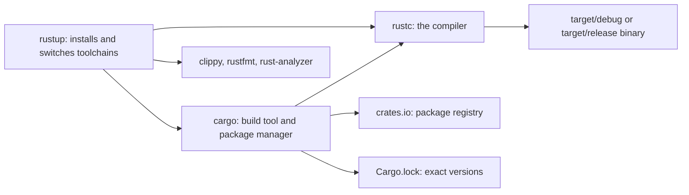

### 1.1 What Rust Is and the Problem It Solves

Rust is a compiled systems language that gives you control over memory layout and allocation, the way C and C++ do, but checks at compile time that you never read freed memory, write through two aliases at once, or share unsynchronised data between threads. It does this with an ownership system (Stage 2) instead of a garbage collector, so there are no GC pauses and no runtime to ship. A Rust binary starts as fast as a C binary and can be a single static file.

The cost is paid at compile time and in learning: the compiler rejects programs that might be correct but that it cannot prove correct, and you learn to structure code so that the proof is easy.

| Concern | C / C++ | Go | Java / C# | Rust |
| :--- | :--- | :--- | :--- | :--- |
| Memory management | Manual, or RAII in C++ | Tracing GC | Tracing GC | Ownership and RAII, checked by the compiler |
| Use-after-free, double free | Possible, common CVE source | Prevented by GC | Prevented by GC | Compile error in safe code |
| Data races | Possible | Possible (race detector at test time) | Possible | Compile error in safe code (`Send`/`Sync`) |
| Null | Null pointers | `nil` | `null` (nullable refs in C#) | No null; `Option<T>` |
| Errors | Return codes, exceptions | Multiple return values | Exceptions | `Result<T, E>` values and `?` |
| Runtime | None | Scheduler and GC | VM and JIT | None (async runtimes are libraries) |
| Generics | Templates | Type parameters | Erased (Java), reified (C#) | Monomorphized, zero runtime cost |
| Typical use | OS, engines, embedded | Network services, CLIs | Enterprise apps | OS components, CLIs, services, WebAssembly, embedded |

Pick something else when compile times matter more than runtime speed during rapid prototyping, when the team must ship this week without Rust experience, or when a GC language's ecosystem already solves the problem. Pick Rust when correctness under concurrency, predictable latency, low memory use or a small deployable matter.

### 1.2 Installing the Toolchain with rustup

`rustup` installs `rustc`, `cargo` and the standard library per toolchain, and switches between them per project.

```bash
# Linux, macOS, WSL
curl --proto '=https' --tlsv1.2 -sSf https://sh.rustup.rs | sh

# Windows: download and run rustup-init.exe from https://rustup.rs.
# It needs the MSVC build tools (the "Desktop development with C++" workload).

# Verify
rustc --version
cargo --version

# Update to the newest stable release (every six weeks)
rustup update stable

# Developer components
rustup component add clippy rustfmt rust-src rust-analyzer

# Extra targets, for example a static Linux binary or WebAssembly
rustup target add x86_64-unknown-linux-musl wasm32-unknown-unknown

# Inspect what is installed
rustup show
```

Pin a toolchain per repository with a `rust-toolchain.toml` at the root. `rustup` reads it automatically, so every developer and CI job uses the same compiler:

```toml
# rust-toolchain.toml
[toolchain]
channel = "stable"            # or an exact version such as "1.88.0"
components = ["clippy", "rustfmt"]
profile = "minimal"
```

| Channel | What it is | Use it for |
| :--- | :--- | :--- |
| `stable` | Released every six weeks after six weeks of beta | Everything in production |
| `beta` | The next stable | Testing your crate against the upcoming release in CI |
| `nightly` | Built every night, allows `#![feature(...)]` | Unstable features, `miri`, some sanitizers |

This repository does not pin a toolchain: it tracks stable and declares its minimum in `Cargo.toml` with `rust-version = "1.85"`.

### 1.3 Creating a Project and Reading Cargo.toml

```bash
cargo new my_service          # binary crate: src/main.rs
cargo new my_lib --lib        # library crate: src/lib.rs
cargo init                    # turn the current directory into a crate
```

A crate that is both a library and a binary (the shape of the starter) looks like this:

```text
my_service/
├── Cargo.toml          # manifest: metadata, dependencies, profiles
├── Cargo.lock          # exact resolved versions; commit it
├── src/
│   ├── main.rs         # binary crate root, fn main()
│   ├── lib.rs          # library crate root, the testable code
│   └── config.rs       # a module declared by `pub mod config;` in lib.rs
├── tests/              # integration tests; each file is its own crate
│   └── http_api.rs
├── benches/            # benchmarks (for example with Criterion)
└── examples/           # `cargo run --example name`
```

A manifest with the parts you will touch most:

```toml
[package]
name = "telemetry_ingest"
version = "0.1.0"
edition = "2024"
rust-version = "1.85"       # oldest compiler you support; Cargo warns on older ones
description = "Asynchronous telemetry ingest service"
license = "MIT"

[dependencies]
tokio = { version = "1", features = ["macros", "rt-multi-thread", "net"] }
serde = { version = "1", features = ["derive"] }
serde_json = "1"
tracing = "0.1"

[dev-dependencies]          # only for tests, examples and benches
criterion = "0.5"

[features]
default = []
metrics = []                # enable with `cargo build --features metrics`

# Debug builds: fast to compile, slow to run, overflow checks on.
[profile.dev]
opt-level = 0
debug = true

# Release builds: slow to compile, fast to run.
[profile.release]
opt-level = 3
lto = "fat"                 # link-time optimisation across all crates
codegen-units = 1           # fewer parallel units, better optimisation, slower build
panic = "abort"             # no unwinding tables; a panic kills the process
strip = true                # remove symbols from the binary
```

Version requirements are SemVer ranges: `"1"` means `>=1.0.0, <2.0.0`, and `"0.8"` means `>=0.8.0, <0.9.0`, because for 0.x crates the minor number is the breaking one. `Cargo.lock` records the exact version chosen for every crate in the graph. Commit it for applications (and, since Cargo's 2023 guidance change, it is fine for libraries too) so that CI and production build the same code; `cargo build --locked` fails instead of silently changing it.

`panic = "abort"` trades two things for a smaller binary: `std::panic::catch_unwind` can no longer catch panics, and destructors do not run when a thread panics. Leave it at the default `unwind` until you know you want that.

### 1.4 The Build Cycle: check, build, run, test, clippy, fmt

```bash
cargo check                    # type-check and borrow-check only; fastest feedback
cargo build                    # debug binary in target/debug/
cargo build --release          # optimised binary in target/release/
cargo run                      # build then run the binary
cargo run -- --verbose         # arguments after -- go to your program
cargo test                     # unit, integration and doc tests
cargo test tasks::             # only tests whose path contains "tasks::"
cargo test -- --nocapture      # show println! output from passing tests
cargo clippy --all-targets -- -D warnings   # lints; warnings fail the build
cargo fmt --all                # format; add --check in CI
cargo doc --open               # build and open API docs, yours and your deps'
cargo tree -d                  # dependency graph, duplicates only
cargo update -p serde          # move one dependency within its SemVer range
cargo add thiserror            # edit Cargo.toml from the command line
```

Under `cargo build`, `rustc` runs a pipeline per crate. The borrow checker runs on MIR, after type checking and before LLVM; that is why `cargo check`, which stops before code generation, reports every ownership error at a fraction of the cost of a full build.

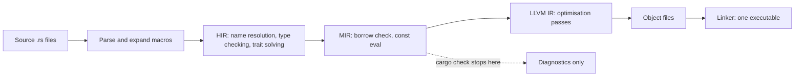

| Command | What it compiles | When to use it |
| :--- | :--- | :--- |
| `cargo check` | Up to MIR, no code generation | While editing; rust-analyzer runs it for you |
| `cargo build` | Debug profile | Running locally, debugging with a debugger |
| `cargo build --release` | Release profile | Benchmarks, Docker images, anything you measure |
| `cargo test` | Test profile (debug + `cfg(test)`) | Before every commit |
| `cargo clippy` | Like `check`, plus several hundred extra lints | Before every commit and in CI |

### 1.5 Line-by-Line Breakdown of the Starter Project

The repository root is the starter: a library crate with all the logic and a thin binary that serves it over HTTP with [axum](https://github.com/tokio-rs/axum) on the Tokio runtime.

```text
learn-rust/
├── Cargo.toml / Cargo.lock
├── Dockerfile                 # multi-stage: rust:1-slim-bookworm -> debian:bookworm-slim
├── src/
│   ├── main.rs                # reads config, binds 0.0.0.0:PORT, graceful shutdown
│   ├── lib.rs                 # declares modules, SystemMetric
│   ├── config.rs              # Stage 1: parse PORT into a u16 with Result
│   ├── text.rs                # Stage 2: borrowed slices, lifetimes, an iterator struct
│   ├── tasks.rs               # Stage 3: structs, enums, state machine, error enum
│   ├── app.rs                 # axum routes and error-to-HTTP mapping
│   ├── memory.rs              # Stage 5 preview: Arc<Mutex<i64>>
│   └── concurrency.rs         # Stage 6 preview: bounded tokio::mpsc channel
└── tests/
    ├── integration_tests.rs   # public API tests
    └── http_api.rs            # in-process HTTP tests with tower::ServiceExt::oneshot
```

Run it:

```bash
git clone https://github.com/TheLearningHubOrg/learn-rust.git
cd learn-rust
cargo test                          # 31 tests: unit, integration and HTTP
cargo run                           # listening on http://0.0.0.0:8080

# in a second terminal (on Windows PowerShell use curl.exe)
curl -s localhost:8080/health
# {"status":"ok","version":"1.0.0"}
curl -s -X POST localhost:8080/api/v1/tasks \
  -H 'content-type: application/json' \
  -d '{"title":"read stage 2","priority":"high"}'
# {"id":1,"title":"read stage 2","priority":"high","status":{"state":"todo"}}
curl -s -X POST localhost:8080/api/v1/text/stats \
  -H 'content-type: application/json' -d '{"text":"to be or not to be","top":2}'

PORT=9000 cargo run                 # the port comes from the environment
docker build -t learn-rust . && docker run --rm -p 8080:8080 learn-rust
```

| Method | Path | Handler | Demonstrates |
| :--- | :--- | :--- | :--- |
| GET | `/health` | `health` | `env!` compile-time macro, JSON response |
| GET | `/api/v1/metrics` | `metrics` | `Vec` of a derived `Serialize` struct |
| POST | `/api/v1/text/stats` | `text_stats` | Borrowed-slice text processing (Stage 2) |
| GET, POST | `/api/v1/tasks` | `list_tasks`, `create_task` | Query parsing with `FromStr`, validation errors (Stage 3) |
| GET, DELETE | `/api/v1/tasks/{id}` | `get_task`, `delete_task` | `Path<u64>` extraction, `404` mapping |
| POST | `/api/v1/tasks/{id}/actions` | `apply_action` | Enum state machine, `409` on an invalid transition |

`src/main.rs` is short on purpose:

```rust
use learn_rust::app;
use learn_rust::config::Config;
use tokio::net::TcpListener;

#[tokio::main]
async fn main() -> Result<(), Box<dyn std::error::Error>> {
    tracing_subscriber::fmt().with_target(false).init();

    let config = Config::from_env()?;
    let addr = config.socket_addr();
    let listener = TcpListener::bind(addr).await?;
    tracing::info!("listening on http://{addr}");

    axum::serve(listener, app::router())
        .with_graceful_shutdown(shutdown_signal())
        .await?;
    tracing::info!("server stopped");
    Ok(())
}
```

| Line / API | Role | What happens at runtime |
| :--- | :--- | :--- |
| `use learn_rust::app;` | Imports from the library crate of the same package | The package name `learn-rust` becomes the crate name `learn_rust` (hyphens turn into underscores). |
| `#[tokio::main]` | Attribute macro | Rewrites `async fn main` into a normal `fn main` that builds a multi-threaded Tokio runtime and blocks on the body. |
| `-> Result<(), Box<dyn std::error::Error>>` | `main` may return an error | If `main` returns `Err`, the process prints the error's `Debug` form and exits with status 1. |
| `tracing_subscriber::fmt()...init()` | Installs a log subscriber | `tracing::info!` events are formatted to stdout from here on. |
| `Config::from_env()?` | Reads `PORT` | `?` returns early with the `ConfigError` (boxed) if the value is invalid. |
| `TcpListener::bind(addr).await?` | Opens the socket | Fails with an `io::Error` if the port is taken; `?` propagates it. |
| `axum::serve(listener, app::router())` | Starts the HTTP server | Accepts connections and runs each request through the router on the runtime's worker threads. |
| `.with_graceful_shutdown(shutdown_signal())` | Stop condition | When the future resolves (Ctrl+C or SIGTERM), the server stops accepting and lets in-flight requests finish. |

`src/config.rs` is the Stage 1 module. It turns an optional string into a validated `u16` (excerpt; the full file adds the imports, the `ConfigError` enum, `from_env` and the tests):

```rust
pub const DEFAULT_PORT: u16 = 8080;

#[derive(Debug, Clone, Copy, PartialEq, Eq)]
pub struct Config {
    pub port: u16,
}

impl Config {
    pub fn from_port_var(raw: Option<&str>) -> Result<Self, ConfigError> {
        let port = match raw.map(str::trim) {
            None | Some("") => DEFAULT_PORT,
            Some(text) => match text.parse::<u16>() {
                Ok(0) | Err(_) => return Err(ConfigError::InvalidPort(text.to_string())),
                Ok(port) => port,
            },
        };
        Ok(Self { port })
    }

    pub fn socket_addr(&self) -> SocketAddr {
        SocketAddr::new(IpAddr::V4(Ipv4Addr::UNSPECIFIED), self.port)
    }
}
```

| Line / API | Role | What happens at runtime |
| :--- | :--- | :--- |
| `pub const DEFAULT_PORT: u16` | Compile-time constant | Inlined at each use; no memory address of its own. |
| `#[derive(..., Copy, ...)]` | `Config` is two bytes | Passing a `Config` copies it; no move semantics to think about. |
| `raw.map(str::trim)` | `Option<&str>` to `Option<&str>` | `trim` returns a sub-slice of the same string: no allocation. |
| `None \| Some("")` | Or-pattern with a string literal | Unset and blank both fall back to the default. |
| `text.parse::<u16>()` | `FromStr` via turbofish | Returns `Err` for non-digits and for values above 65 535. |
| `Ok(0) \| Err(_) => return Err(...)` | Early return from inside a `match` | Port 0 parses but means "pick any port", which is wrong for a server. |
| `Ipv4Addr::UNSPECIFIED` | `0.0.0.0` | Listens on every interface, so the container port mapping works. |

The function takes `Option<&str>` rather than reading the environment itself, so the unit tests in the same file can call it with any input without touching process-wide state (in Edition 2024, `std::env::set_var` is `unsafe` for exactly that reason).

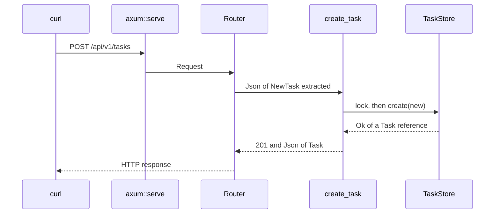

### 1.6 Scalar Types, Sizes and Integer Overflow

Rust is statically typed with local type inference. Every value has a size known at compile time unless it is behind a pointer (Stage 2 covers the exceptions such as `str` and `[T]`).

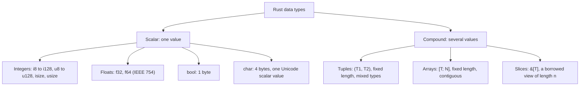

```rust
fn main() {
    // Integers: explicit signedness and width
    let port: u16 = 8080;                 // 0 to 65_535
    let offset: i32 = -142_500;           // underscores are only for readability
    let index: usize = 1024;              // pointer-sized: 8 bytes on 64-bit targets

    // Floats: f64 is the default for literals like 3.14
    let cpu_load: f32 = 0.85;
    let ratio = 2.0 / 3.0;                // inferred f64

    // bool and char
    let is_active = true;
    let symbol: char = '🦀';              // any Unicode scalar value, always 4 bytes

    // Arrays live inline (on the stack here)
    let packet: [u8; 4] = [0x7F, 0x00, 0x00, 0x01];
    println!("len {}, first {:#04X}", packet.len(), packet[0]);

    // Tuples group values of different types
    let socket: (u16, &str, bool) = (443, "TLS", true);
    let (p, protocol, enabled) = socket; // destructuring
    println!("{protocol} on {p} (active: {enabled})");

    // Slices borrow part of an array
    let data = [10, 20, 30, 40, 50];
    let middle: &[i32] = &data[1..4];     // [20, 30, 40]
    println!("sum {}", middle.iter().sum::<i32>());

    println!("{port} {offset} {index} {cpu_load} {ratio:.3} {is_active} {symbol}");
}
```

Integer overflow is a bug in Rust, and the profile decides what happens. In debug builds the program panics with `attempt to add with overflow`. In release builds (where `overflow-checks` defaults to off) the value wraps silently. Neither is what you want for input you do not control, so say what you mean with the explicit methods:

```rust
fn main() {
    let level: u8 = 250;
    println!("{:?}", level.checked_add(10));     // None
    println!("{}", level.wrapping_add(10));      // 4
    println!("{}", level.saturating_add(10));    // 255
    println!("{:?}", level.overflowing_add(10)); // (4, true)

    // `as` never fails: it truncates, sign-reinterprets or saturates.
    let big: i32 = 300;
    println!("{}", big as u8);                   // 44 (keeps the low 8 bits)
    println!("{}", -1_i32 as u32);               // 4294967295
    println!("{}", 3.99_f64 as i32);             // 3 (rounds toward zero)
    println!("{}", 1e20_f64 as i32);             // 2147483647 (float casts saturate)
    println!("{}", f64::NAN as i32);             // 0

    // TryFrom reports values that do not fit.
    println!("{:?}", u8::try_from(big));         // Err(TryFromIntError(PosOverflow))
    println!("{:?}", u8::try_from(200_i32));     // Ok(200)
}
```

| Type | Size (64-bit target) | Notes |
| :--- | :--- | :--- |
| `bool` | 1 byte | Only `0x00` and `0x01` are valid; any other byte is undefined behaviour. |
| `char` | 4 bytes | Not a byte. A `String` stores UTF-8, so `char` and `u8` differ. |
| `usize` / `isize` | 8 bytes | The type of indexes and lengths. |
| `()` | 0 bytes | The unit type: "no meaningful value". |
| `[u8; 4]` | 4 bytes | Arrays have no header; length is part of the type. |
| `&str`, `&[T]` | 16 bytes | Pointer plus length (a fat pointer). |
| `String`, `Vec<T>` | 24 bytes | Pointer, capacity, length; contents on the heap. |
| `Option<&T>`, `Option<Box<T>>` | 8 bytes | `None` uses the null value a reference can never have. |

Check any of these with `std::mem::size_of::<T>()`.

### 1.7 Compound Types: Tuples and Arrays

Tuples are anonymous structs with positional fields, accessed as `.0`, `.1` or by destructuring. A function can return several values as a tuple. The empty tuple `()` is the unit type that functions without a return value produce.

Arrays have a length fixed at compile time and are stored inline, so `[u8; 1024]` inside a struct makes the struct 1 KB larger. Indexing is bounds-checked: an out-of-range index panics with `index out of bounds: the len is 4 but the index is 9`. Use `.get(i)`, which returns `Option<&T>`, when the index comes from outside.

```rust
fn min_max(values: &[i32]) -> Option<(i32, i32)> {
    let first = *values.first()?;          // `?` on Option returns None early
    let mut lo = first;
    let mut hi = first;
    for &v in values {
        lo = lo.min(v);
        hi = hi.max(v);
    }
    Some((lo, hi))
}

fn main() {
    let readings = [17, -3, 42, 8];
    if let Some((lo, hi)) = min_max(&readings) {
        println!("range {lo}..={hi}");
    }

    let grid = [[0u8; 3]; 2];              // 2 rows of 3 zeros
    println!("{grid:?}");                  // [[0, 0, 0], [0, 0, 0]]

    let maybe = readings.get(9);           // None instead of a panic
    println!("{maybe:?}");

    for (i, r) in readings.iter().enumerate() {
        print!("{i}={r} ");
    }
    println!();
}
```

Arrays of any length implement `Debug`, `PartialEq`, `IntoIterator` and `Default` (for `Default`, up to length 32) through const generics, which is why `[[0u8; 3]; 2]` prints with `{:?}`.

### 1.8 Variables, Mutability, Shadowing, const and static

| Feature | `let` | `let mut` | Shadowing (`let x = ...` again) | `const` | `static` |
|---|---|---|---|---|---|
| Can the value change? | No | Yes | A new variable replaces the old name | No | Only `static mut` (needs `unsafe`) or interior mutability |
| Can the type change? | No | No | Yes | No | No |
| Type annotation | Optional | Optional | Optional | Required | Required |
| Evaluated | Runtime | Runtime | Runtime | Compile time | Compile time (or lazily via `LazyLock`) |
| Storage | Stack slot or register | Stack slot or register | New stack slot | Inlined at every use | One fixed address for the whole program |

```rust
// Constants: typed, evaluated at compile time, inlined where used.
const MAX_CONNECTIONS: usize = 100_000;
const BUFFER_BYTES: usize = 64 * 1024;

// A static has exactly one address. Use it for data you want to reference, such as
// a lookup table, and for global state wrapped in a synchronised type.
static BANNER: &str = "learn-rust";

fn main() {
    let request_count = 10;
    // request_count = 11; // error[E0384]: cannot assign twice to immutable variable

    let mut active_sessions = 5;
    active_sessions += 1;

    // Shadowing reuses a name for a transformed value, even of a new type.
    let header = "   Authorization: Bearer xyz123   ";
    let header = header.trim();   // &str
    let header = header.len();    // usize
    println!("{BANNER}: {request_count} {active_sessions} {header} {MAX_CONNECTIONS} {BUFFER_BYTES}");
}
```

Immutability is the default because most variables never change, and the compiler can then tell you about the few that do. Shadowing is idiomatic for parse-and-validate steps (`let port: u16 = port.parse()?;`) because it removes the unvalidated name from scope.

### 1.9 Functions, Statements and Expressions

Almost everything in Rust is an expression that produces a value. A statement performs an action and produces `()`. `let` bindings are statements, and adding `;` to an expression turns it into a statement that discards the value.

```rust
fn buffer_bytes(requested_mb: usize) -> usize {
    // A block is an expression: its value is the final expression without `;`.
    let allocated = {
        let with_headroom = requested_mb + 2;
        with_headroom * 1024 * 1024
    };
    allocated // no semicolon: this is the return value
}

fn validate(age: i32) -> Result<u8, String> {
    if !(0..=150).contains(&age) {
        return Err(format!("age {age} out of range")); // early return
    }
    Ok(age as u8) // safe: range checked above
}

fn fail(msg: &str) -> ! {
    // `!` (never) is the type of expressions that do not return.
    panic!("fatal: {msg}");
}

fn main() {
    println!("{}", buffer_bytes(1));
    println!("{:?} {:?}", validate(42), validate(200));
    let ready = true;
    let n: u32 = if ready { 7 } else { fail("not ready") }; // `!` fits any type
    println!("{n}");
}
```

Function signatures must spell out parameter and return types; inference works only inside bodies. That keeps errors local and makes signatures the documentation. Parameters can be patterns: `fn area((w, h): (u32, u32)) -> u32`.

### 1.10 Control Flow as Expressions

`if`, `match`, `loop` and blocks all produce values, so you rarely need a mutable variable to carry a result out of a branch.

```rust
fn main() {
    let priority = 2;

    // if/else as an expression: both arms must have the same type.
    let capacity = if priority > 1 { 10_000 } else { 1_000 };

    // match must cover every case; `_` is the catch-all.
    let label = match priority {
        0 => "low",
        1 | 2 => "normal",
        3..=9 => "high",
        _ => "invalid",
    };

    // loop returns a value through break.
    let mut attempts = 0;
    let token = loop {
        attempts += 1;
        if attempts == 3 {
            break format!("token-{attempts}");
        }
    };

    // Labels let an inner loop break or continue an outer one.
    let mut found = None;
    'rows: for row in 0..10 {
        for col in 0..10 {
            if row * col == 42 {
                found = Some((row, col));
                break 'rows;
            }
        }
    }

    // while and while let
    let mut countdown = 3;
    while countdown > 0 {
        countdown -= 1;
    }
    let mut stack = vec![1, 2, 3];
    while let Some(top) = stack.pop() {
        print!("{top} ");
    }
    println!();

    // for iterates anything that implements IntoIterator
    for step in (1..=4).rev() {
        print!("{step} ");
    }
    println!("\n{capacity} {label} {token} {found:?}");
}
```

A `for` loop over a range compiles to the same machine code as a C-style counting loop. There is no `for (i = 0; ...; i++)` form; ranges and iterator adaptors (`.rev()`, `.step_by(2)`, `.enumerate()`) cover those cases without off-by-one mistakes.

### 1.11 Strings at a Glance: String, &str and UTF-8

Rust has two main string types. `String` owns a growable, heap-allocated buffer. `&str` is a borrowed view (pointer and length) into UTF-8 bytes that live somewhere else: inside a `String`, in the binary for literals, or anywhere else. Both are always valid UTF-8. Stage 2 explains the ownership side; this section covers the behaviour that surprises newcomers.

```rust
fn main() {
    let word = String::from("naïve");
    println!("{} bytes, {} chars", word.len(), word.chars().count()); // 6 bytes, 5 chars

    let prefix: &str = &word[0..2];          // byte range; must fall on char boundaries
    // let bad = &word[0..3];               // panics: byte index 3 is not a char boundary
    println!("{prefix}");

    for (i, c) in word.char_indices() {
        print!("{i}:{c} ");                   // 0:n 1:a 2:ï 4:v 5:e
    }
    println!();

    let mut greeting = String::with_capacity(16);
    greeting.push_str("hello");
    greeting.push(',');
    greeting += " world";                     // String + &str appends in place
    let shout = greeting.to_uppercase();      // allocates a new String

    let literal: &'static str = "stored in the binary";
    let owned: String = literal.to_owned();   // copy onto the heap
    let borrowed: &str = &owned;              // &String coerces to &str
    println!("{greeting} | {shout} | {borrowed}");
}
```

| Operation | Works? | Why |
| :--- | :--- | :--- |
| `s[0]` | No: `the type 'str' cannot be indexed by '{integer}'` | A byte index might land inside a multi-byte character, and "the first character" is ambiguous. |
| `&s[0..2]` | Yes, if both ends are char boundaries | Panics otherwise. Use `s.get(0..2)` for an `Option`. |
| `s.chars().nth(3)` | Yes | O(n): UTF-8 has variable-width characters. |
| `s.len()` | Yes | Bytes, not characters. |
| `a + &b` | Yes | Moves `a`, appends `b`, returns the same buffer. |
| `format!("{a}{b}")` | Yes | Allocates a new `String`; neither input is moved. |

### 1.12 Formatting, Printing and Debug Output

`println!`, `format!`, `write!` and `eprintln!` are macros checked at compile time: a missing argument or a type without the needed trait is a compile error, not a runtime crash.

| Specifier | Meaning | Example output |
| :--- | :--- | :--- |
| `{}` | `Display`, for users | `42` |
| `{:?}` / `{:#?}` | `Debug`, compact / pretty-printed | `Point { x: 1, y: 2 }` |
| `{name}` | Inline capture of a variable in scope | `{port}` |
| `{:>8}` `{:<8}` `{:^8}` | Right, left, centre in width 8 | `"      42"` |
| `{:08.3}` | Zero-pad to width 8, 3 decimals | `0003.142` |
| `{:x}` `{:#x}` `{:#b}` `{:e}` | Hex, hex with `0x`, binary with `0b`, scientific | `ff`, `0xff`, `0b101`, `1.5e3` |
| `{:width$}` / `{:.prec$}` | Width or precision from a variable | `{:w$}` with `w = 6` |

```rust
use std::fmt;

#[derive(Debug)]
struct Point {
    x: i32,
    y: i32,
}

struct Celsius(f64);

impl fmt::Display for Celsius {
    fn fmt(&self, f: &mut fmt::Formatter<'_>) -> fmt::Result {
        write!(f, "{:.1} C", self.0)
    }
}

fn main() {
    let p = Point { x: 1, y: 2 };
    let temp = Celsius(21.456);
    let w = 6;
    println!("{p:?} | {temp} | [{:>w$}] | {:#x}", 42, 255);
    println!("{p:#?}");
    let doubled = dbg!(p.x * 2);   // prints "[src/main.rs:LINE:COL] p.x * 2 = 2" to stderr, returns 2
    eprintln!("diagnostics go to stderr: {doubled}");
}
```

Derive `Debug` on nearly every type; it costs nothing until used and makes `{:?}`, `dbg!` and `assert_eq!` failures readable. Implement `Display` by hand only for types end users see. `dbg!` is for local debugging; Clippy's `dbg_macro` lint (enable it in CI) stops it from being committed.

### 1.13 Testing from Day One

Tests are built in. A unit test is a function marked `#[test]`, usually in a `tests` module compiled only under `cfg(test)`, so it can reach private functions. Integration tests in `tests/` see only the public API. Code blocks in `///` doc comments are compiled and run as doc tests, so examples in documentation cannot rot.

```rust
/// Clamps any integer into 0..=100.
///
/// ```
/// assert_eq!(my_crate::clamp_percent(150), 100);
/// ```
pub fn clamp_percent(value: i32) -> u8 {
    value.clamp(0, 100) as u8
}

#[cfg(test)]
mod tests {
    use super::*;

    #[test]
    fn clamps_both_ends() {
        assert_eq!(clamp_percent(150), 100);
        assert_eq!(clamp_percent(-5), 0);
        assert_eq!(clamp_percent(42), 42, "values in range pass through");
    }

    #[test]
    #[should_panic(expected = "index out of bounds")]
    fn indexing_past_the_end_panics() {
        let v = vec![1];
        let value = v[3];
        assert_eq!(value, 0);
    }

    #[test]
    fn can_return_result() -> Result<(), std::num::ParseIntError> {
        let n: i32 = "17".parse()?;
        assert_eq!(n, 17);
        Ok(())
    }
}
```

The starter has three kinds: unit tests at the bottom of each `src/*.rs`, public API tests in `tests/integration_tests.rs`, and HTTP tests in `tests/http_api.rs` that call the router in memory (no network port). `cargo test` runs all of them; tests within one binary run on parallel threads, so tests must not share mutable global state.

```bash
cargo test                              # everything
cargo test config                       # names containing "config"
cargo test --test http_api              # one integration test file
cargo test -- --test-threads=1          # serial, for tests that share a resource
cargo test --doc                        # doc tests only
```

### 1.14 Pitfalls

| Pitfall | Symptom | Fix |
| --- | --- | --- |
| Assigning to a `let` binding | `error[E0384]: cannot assign twice to immutable variable 'x'` | Declare `let mut x`, or shadow with a new `let`. |
| Integer overflow on untrusted input | Debug: `attempt to add with overflow` panic. Release: silently wrong numbers | Use `checked_*`, `saturating_*` or `wrapping_*`, or enable `overflow-checks = true` in `[profile.release]`. |
| Narrowing with `as` | `300_i32 as u8` is `44`, no warning | Use `u8::try_from(x)` and handle the `Err`. |
| Semicolon after the tail expression | `error[E0308]: mismatched types ... expected 'usize', found '()'` with "remove this semicolon" | Delete the `;` on the value you mean to return. |
| `if` without `else` used as a value | `error[E0317]: 'if' may be missing an 'else' clause` | Add an `else` arm of the same type. |
| Indexing a string by position | `error[E0277]: the type 'str' cannot be indexed by '{integer}'` | Use `.chars()`, `.as_bytes()[i]`, or a byte range on a char boundary. |
| Slicing inside a multi-byte character | Panic: `byte index 3 is not a char boundary` | Find boundaries with `char_indices()`, or use `s.get(a..b)`. |
| Printing a type without `Display` | `error[E0277]: 'Point' doesn't implement 'std::fmt::Display'` | `#[derive(Debug)]` and print with `{:?}`, or implement `Display`. |
| Binding `127.0.0.1` inside Docker | Container runs, but `curl` from the host gets `Connection reset by peer` | Bind `0.0.0.0` (see `Config::socket_addr`). |
| Benchmarking a debug build | Code runs many times slower than expected | Measure with `cargo build --release` or `cargo run --release`. |
| Unpinned dependencies in CI | Build that passed yesterday fails after a new crate release | Commit `Cargo.lock`, build with `--locked`. |

### 1.15 Best Practices

- **Run `cargo clippy --all-targets -- -D warnings` in CI**: Clippy catches hundreds of correctness and performance mistakes that compile fine.
- **Run `cargo fmt --check` in CI**: formatting debates end, and diffs show only real changes.
- **Declare `rust-version`**: users with an older compiler get a clear message instead of a cryptic syntax error, and resolver 3 picks compatible dependencies.
- **Commit `Cargo.lock` and build with `--locked`**: CI, Docker and your laptop compile the same dependency versions.
- **Keep `main.rs` thin and put logic in `lib.rs`**: integration tests and benchmarks can only import from the library crate.
- **Prefer explicit integer methods over `as`**: `try_from` and `checked_add` turn silent corruption into handled errors.
- **Parse at the boundary, then use precise types**: convert strings to `u16`, enums or newtypes once, the way `Config::from_port_var` does, so the rest of the code cannot see invalid values.
- **Use `cargo check` while editing**: it is the fastest loop and catches all type and borrow errors.
- **Enable only the dependency features you use**: `tokio = { features = ["full"] }` compiles code you never call; the starter lists five features instead.

### 1.16 Hands-on Exercise

**Task.** In `src/config.rs`, replace the body of `Config::from_port_var` with `todo!()`, run `cargo test config` (four tests fail), then implement the function again so that:

1. `None` and a blank string give port 8080.
2. Surrounding whitespace is ignored: `" 3000 "` gives 3000.
3. `"0"`, `"65536"`, `"-1"` and `"eighty"` return `Err(ConfigError::InvalidPort(...))` holding the trimmed input.

**Expected output.**

```text
running 4 tests
test config::tests::missing_or_blank_port_falls_back_to_default ... ok
test config::tests::out_of_range_zero_and_text_are_rejected ... ok
test config::tests::socket_addr_binds_all_interfaces ... ok
test config::tests::valid_port_is_parsed_and_trimmed ... ok

test result: ok. 4 passed; 0 failed; 0 ignored; 0 measured; 17 filtered out
```

**Solution.** The reference implementation is `Config::from_port_var` in [`src/config.rs`](src/config.rs). Stretch goal: add a `HOST` variable that accepts an `IpAddr` (parse with `"127.0.0.1".parse::<IpAddr>()`), with unit tests for valid and invalid values.

[Back to top ⤴️](#-table-of-contents)

---

## 2. Stage 2: Ownership, Borrowing & Lifetimes

Ownership is how Rust frees memory without a garbage collector and prevents data races without a runtime. This stage covers where values live, who frees them, how borrowing works, what lifetimes actually express, and how to read the borrow checker's errors. It assumes Stage 1. Afterwards you can write functions and structs that borrow instead of copy, as `src/text.rs` in the starter does, and fix the common borrow errors without reaching for `.clone()`.

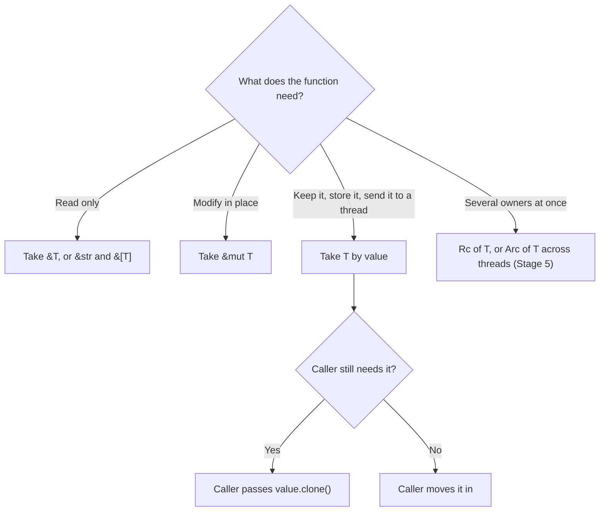

### 2.1 Stack, Heap and Why Ownership Exists

Every value lives somewhere. Local variables live in the current function's **stack frame**, which is reclaimed in one instruction when the function returns. Data whose size is unknown at compile time or that must outlive the frame lives on the **heap**, which must be freed explicitly by someone.

| | Stack | Heap |
| :--- | :--- | :--- |
| Allocation cost | Move the stack pointer | Allocator call (`malloc`-like), possibly a system call |
| Size | Known at compile time | Decided at runtime, can grow |
| Lifetime | Ends when the function returns | Until someone frees it |
| Examples | `i32`, `[u8; 4]`, `(u16, bool)`, the 24-byte header of a `String` | The bytes of a `String`, the elements of a `Vec`, a `Box`'s contents |

The hard problem is the heap: free it too early and you get use-after-free; free it twice and the allocator is corrupted; never free it and memory leaks. C makes the programmer track this by hand. Java, Go and C# run a garbage collector. Rust gives every heap allocation exactly one **owner** variable and frees it when that owner goes out of scope, and checks at compile time that no reference outlives the owner.

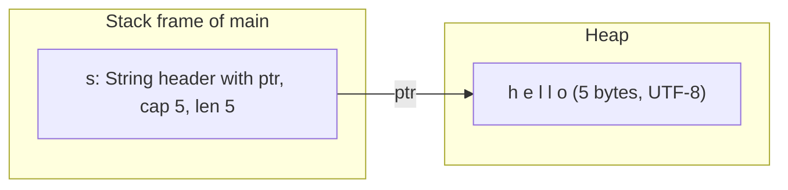

### 2.2 The Three Ownership Rules and Move Semantics

1. Each value has exactly one owner.
2. Ownership can be transferred (moved), but there is never more than one owner at a time.
3. When the owner goes out of scope, the value is dropped and its resources are freed.

Assigning a heap-owning value to another variable, passing it to a function, or returning it **moves** it. A move copies the small stack header (pointer, capacity, length) and marks the source as unusable. The heap buffer is not copied, and since only one variable owns it, it is freed exactly once.

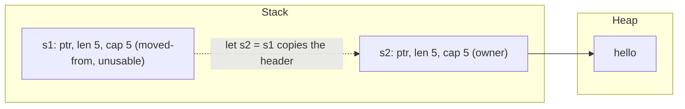

```rust
fn main() {
    // Copy types: duplicated bit for bit, both stay valid.
    let x = 42;
    let y = x;
    println!("x = {x}, y = {y}");

    // Heap-owning types move.
    let s1 = String::from("payload");
    let s2 = s1;
    // println!("{s1}"); // error[E0382]: borrow of moved value: `s1`
    println!("s2 owns the buffer: {s2}");

    // A deep copy is always explicit.
    let s3 = s2.clone(); // second heap allocation
    println!("{s2} and {s3}");
} // s3 dropped, then s2: two buffers freed, each exactly once.
```

Moves are checked statically, per variable and per control-flow path. If a value is moved on only one branch, it is treated as moved after the branch; the compiler inserts a hidden drop flag to know at runtime whether to drop it at the end of the scope.

### 2.3 Copy, Clone and Drop

`Copy` is a marker trait for types whose bitwise duplicate is a full, independent value: integers, floats, `bool`, `char`, shared references `&T`, and tuples, arrays and structs made only of `Copy` types (if you derive it). `Clone` is an explicit `.clone()` that may do anything, typically a deep copy with allocation. Every `Copy` type is also `Clone`.

A type that implements `Drop` cannot be `Copy`: if a bitwise copy of a file handle were allowed, both copies would close the file. Values are dropped in a fixed order: local variables in reverse order of declaration, struct fields in declaration order, and a temporary at the end of the statement that created it.

```rust
struct Noisy(&'static str);

impl Drop for Noisy {
    fn drop(&mut self) {
        println!("drop {}", self.0);
    }
}

fn main() {
    let _a = Noisy("a");
    let _b = Noisy("b");
    {
        let _c = Noisy("c");
    } // "drop c": inner scope ends
    let d = Noisy("d");
    drop(d); // "drop d": std::mem::drop takes ownership and lets it go
    let _ = Noisy("e"); // "drop e" right away: `_` is not a binding
    println!("end of main");
} // "drop b", then "drop a": reverse declaration order
```

Output:

```text
drop c
drop d
drop e
end of main
drop b
drop a
```

This is RAII (resource acquisition is initialisation): a `MutexGuard` unlocks, a `File` closes and a `TcpStream` shuts down in their `Drop`, so cleanup cannot be forgotten on any return path, including `?` and panics. The `let _ = ...` versus `let _guard = ...` difference matters: `let _ = mutex.lock()` releases the lock immediately.

### 2.4 Ownership Across Function Boundaries

The parameter type is a contract. The table lists the common choices in order of preference for read-only data:

| Parameter | Caller passes | Function may | Use when |
| :--- | :--- | :--- | :--- |
| `&str`, `&[T]` | `&s`, `&v`, a literal, a sub-slice | Read | Reading text or a sequence; accepts the most inputs |
| `&T` | `&value` | Read | Reading any other type |
| `&mut T` | `&mut value` | Read and modify in place | Appending, sorting, updating |
| `T` | `value` (moved) or `value.clone()` | Keep, store, send to a thread | The function stores or consumes the value |
| `impl Into<String>` | `"literal"` or a `String` | Get an owned `String` with no extra copy when given one | Constructors that store a string |

```rust
fn consume(s: String) -> usize {
    s.len()
} // s is dropped here

fn inspect(s: &str) -> usize {
    s.len()
}

fn append(s: &mut String) {
    s.push('!');
}

struct Batch {
    items: Vec<String>,
}

impl Batch {
    /// Takes the items out through `&mut self` without cloning, leaving an empty Vec.
    fn flush(&mut self) -> Vec<String> {
        std::mem::take(&mut self.items)
    }
}

fn main() {
    let mut msg = String::from("hi");
    append(&mut msg);
    println!("{}", inspect(&msg)); // &String coerces to &str
    let n = consume(msg);
    // println!("{msg}"); // error[E0382]: borrow of moved value: `msg`
    println!("{n}");

    let mut batch = Batch { items: vec!["a".into(), "b".into()] };
    let sent = batch.flush();
    println!("sent {sent:?}, left {}", batch.items.len()); // sent ["a", "b"], left 0
}
```

You cannot move a field out of a value you only borrow (`error[E0507]: cannot move out of 'self.items' which is behind a mutable reference`). `std::mem::take` (puts `Default::default()` back), `std::mem::replace` (puts a value you choose back) and `Option::take` (puts `None` back) are the standard ways around that.

### 2.5 References and the Aliasing XOR Mutability Rule

A reference borrows a value without owning it. At any point in the program, for a given value you may have either:

- any number of shared references `&T`, or
- exactly one exclusive reference `&mut T`,

but never both. This single rule prevents iterator invalidation, use-after-free through reallocation, and (combined with `Send`/`Sync` in Stage 6) data races.

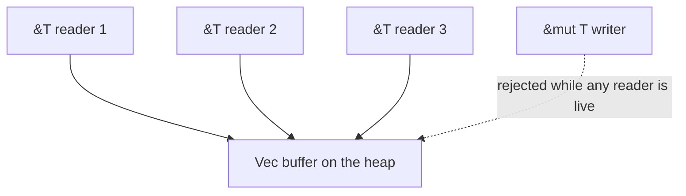

Why it matters in practice: pushing to a `Vec` may reallocate its buffer. Any reference into the old buffer would then dangle.

```rust
fn main() {
    let mut scores = vec![1, 2, 3];

    let first = &scores[0];
    // scores.push(4);
    // error[E0502]: cannot borrow `scores` as mutable because it is also borrowed as immutable
    println!("first = {first}"); // last use of `first`

    scores.push(4); // fine: no shared borrow is live any more

    // Many readers at once are fine.
    let r1 = &scores;
    let r2 = &scores;
    println!("{} {}", r1.len(), r2[0]);

    // One writer at a time.
    let w = &mut scores;
    w.push(5);
    println!("{scores:?}");
}
```

`&mut T` is better read as "exclusive reference" than "mutable reference". Types such as `Mutex` and `RefCell` (Stage 5) allow mutation through a shared `&T` by enforcing exclusivity at runtime instead.

### 2.6 Non-Lexical Lifetimes and Two-Phase Borrows

Before Rust 2018, a borrow lasted until the end of the enclosing `{}` block. With **non-lexical lifetimes (NLL)** the borrow checker works on the control-flow graph, and a borrow ends at its last use. That is why the `scores.push(4)` above compiles once `first` is no longer used.

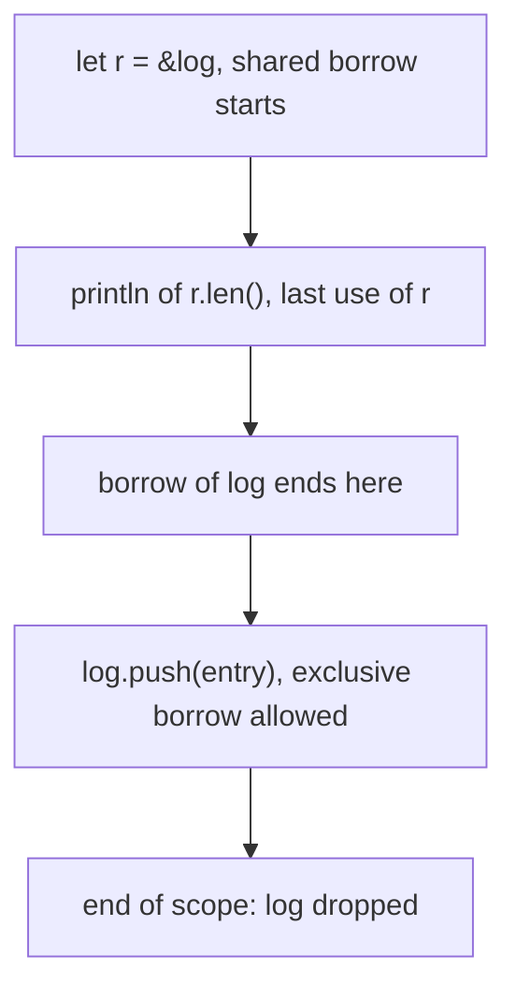

```rust
fn main() {
    let mut log: Vec<String> = Vec::new();

    let view = &log;
    println!("entries: {}", view.len()); // last use of `view`
    log.push(String::from("boot ok"));   // allowed under NLL

    // Two-phase borrows: `log.len()` reads while `log.push` has reserved
    // a mutable borrow that has not been activated yet.
    let mut lens = vec![0usize];
    lens.push(lens.len());
    println!("{log:?} {lens:?}");
}
```

NLL still rejects a few correct programs. The best known is returning a borrow from one branch and mutating on the other:

```rust
use std::collections::HashMap;

// Does not compile. error[E0502] on `map.insert`: the borrow returned
// from the first branch is considered live for the whole function.
fn get_or_default(map: &mut HashMap<u32, String>, key: u32) -> &String {
    if let Some(v) = map.get(&key) {
        return v;
    }
    map.insert(key, String::new());
    map.get(&key).unwrap()
}
```

The idiomatic fix is the entry API, which does one lookup and returns the right borrow:

```rust
use std::collections::HashMap;

fn get_or_default(map: &mut HashMap<u32, String>, key: u32) -> &String {
    map.entry(key).or_default()
}

fn main() {
    let mut map = HashMap::new();
    map.insert(1, String::from("one"));
    println!("{}", get_or_default(&mut map, 1));
    println!("{:?}", get_or_default(&mut map, 2)); // inserted an empty String
}
```

The next-generation borrow checker, Polonius, is designed to accept the first version; until it ships on stable, restructure the code as above.

### 2.7 Slices: Borrowed Views into Strings and Arrays

A slice is a reference to a contiguous run of elements: `&str` for UTF-8 text, `&[T]` for anything else. It is a fat pointer (address plus length), so creating one never copies data. `&String` and `&Vec<T>` coerce to `&str` and `&[T]` automatically, which is why functions should take slices: they then accept owned values, literals, arrays and sub-slices alike.

From the starter's `src/text.rs`:

```rust
/// Returns the first whitespace-separated word of `input`.
pub fn first_word(input: &str) -> &str {
    input.split_whitespace().next().unwrap_or("")
}
```

| Expression | Type | Copies data? |
| :--- | :--- | :--- |
| `&s[2..5]` | `&str` | No; panics unless 2 and 5 are char boundaries |
| `&v[..3]`, `&v[3..]`, `&v[..]` | `&[T]` | No; panics if out of range |
| `v.get(1..4)` | `Option<&[T]>` | No; `None` instead of a panic |
| `v.split_at(mid)` | `(&[T], &[T])` | No |
| `v.chunks(3)`, `v.windows(2)` | Iterators of `&[T]` | No |
| `s.split(',')`, `s.lines()`, `s.trim()` | Iterators of / single `&str` | No |
| `s.to_lowercase()`, `v.to_vec()` | `String`, `Vec<T>` | Yes, a new allocation |

```rust
fn average(values: &[f64]) -> Option<f64> {
    if values.is_empty() {
        return None;
    }
    Some(values.iter().sum::<f64>() / values.len() as f64)
}

fn main() {
    let owned: Vec<f64> = vec![1.0, 2.0, 3.0, 4.0];
    let fixed: [f64; 3] = [10.0, 20.0, 30.0];
    println!("{:?}", average(&owned));       // &Vec<f64> coerces to &[f64]
    println!("{:?}", average(&fixed));       // &[f64; 3] coerces to &[f64]
    println!("{:?}", average(&owned[2..]));  // a sub-slice
    for pair in owned.windows(2) {
        print!("{} ", pair[1] - pair[0]);
    }
    println!();
}
```

Because a slice borrows its source, the borrow checker stops you from mutating or freeing the source while the slice is in use. The classic bug of keeping an index into a string after clearing it cannot happen with slices:

```rust
// Does not compile: shown for the error.
let mut line = String::from("hello world");
let word = first_word(&line);
line.clear(); // error[E0502]: cannot borrow `line` as mutable because it is also borrowed as immutable
println!("{word}");
```

### 2.8 Lifetime Annotations in Function Signatures

A lifetime annotation such as `'a` does not change how long anything lives. It names a region of the program so that a signature can state how the output borrow relates to the input borrows. The compiler then checks every caller against that statement.

```rust
/// From src/text.rs: the result is valid only while both inputs are.
pub fn longest<'a>(left: &'a str, right: &'a str) -> &'a str {
    if right.len() > left.len() { right } else { left }
}

fn main() {
    let outer = String::from("long string");
    {
        let inner = String::from("xyz");
        let result = longest(&outer, &inner);
        println!("{result}"); // fine: both are alive here
    }
}
```

Moving the use outside the inner block breaks the contract, and the error names the value that dies too early:

```rust
// Does not compile: shown for the error.
let outer = String::from("long string");
let result;
{
    let inner = String::from("xyz");
    result = longest(&outer, &inner);
} // error[E0597]: `inner` does not live long enough
println!("{result}");
```

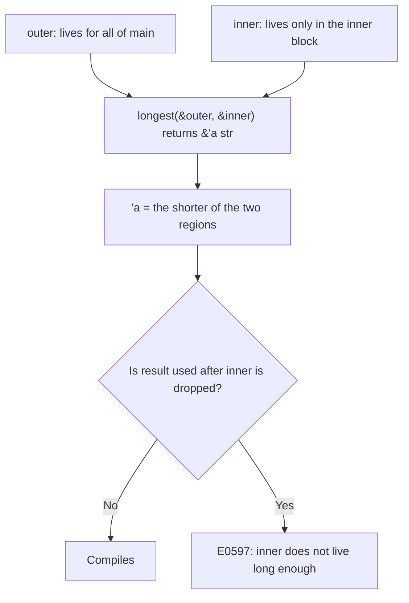

If the output can only ever come from one parameter, annotate only that one: `fn prefix<'a>(s: &'a str, _sep: &str) -> &'a str`. Callers then have more freedom, because the second argument may die early.

### 2.9 Lifetime Elision Rules

Most signatures need no annotations because the compiler applies three elision rules to fill them in:

1. Each elided input lifetime gets its own parameter: `fn f(x: &i32, y: &i32)` means `fn f<'a, 'b>(x: &'a i32, y: &'b i32)`.
2. If there is exactly one input lifetime, it is assigned to all elided output lifetimes: `fn first(x: &[i32]) -> &i32` means `fn first<'a>(x: &'a [i32]) -> &'a i32`.
3. In a method, if one input is `&self` or `&mut self`, its lifetime is assigned to all elided outputs.

| Written | Expanded | Rule |
| :--- | :--- | :--- |
| `fn first_word(s: &str) -> &str` | `fn first_word<'a>(s: &'a str) -> &'a str` | 2 |
| `fn name(&self) -> &str` | `fn name<'a>(&'a self) -> &'a str` | 3 |
| `fn get(&self, key: &str) -> &str` | Output tied to `self`, not `key` | 3 |
| `fn longest(a: &str, b: &str) -> &str` | Not expandable | `error[E0106]: missing lifetime specifier` |
| `fn new(s: &str) -> Parser` (struct with a lifetime) | Works, but hides a borrow | Write `Parser<'_>` (lint `elided_lifetimes_in_paths`) |

When rule 3 picks the wrong input (the result really borrows from `key`, not `self`), write the annotation yourself.

### 2.10 Structs That Borrow: the Words Iterator

A struct can hold references if it declares a lifetime parameter. The struct then cannot outlive the data it borrows. This is how zero-copy parsers, tokenizers and views are built.

From `src/text.rs`:

```rust
fn is_word_char(c: char) -> bool {
    c.is_alphanumeric() || c == '\''
}

pub struct Words<'a> {
    rest: &'a str,
}

impl<'a> Words<'a> {
    pub fn new(text: &'a str) -> Self {
        Self { rest: text }
    }
}

impl<'a> Iterator for Words<'a> {
    type Item = &'a str;

    fn next(&mut self) -> Option<Self::Item> {
        let start = self.rest.find(is_word_char)?;
        let tail = &self.rest[start..];
        let len = tail.find(|c: char| !is_word_char(c)).unwrap_or(tail.len());
        let (word, rest) = tail.split_at(len);
        self.rest = rest;
        Some(word)
    }
}
```

| Line / API | Role | What happens at runtime |
| :--- | :--- | :--- |
| `struct Words<'a> { rest: &'a str }` | Borrowing struct | 16 bytes: a pointer into the caller's text and a length. |
| `type Item = &'a str` | Items borrow the original text, not the iterator | A word can be kept after the iterator is dropped, as long as the text lives. |
| `self.rest.find(is_word_char)?` | Byte offset of the next word, or end | `?` on `Option` returns `None` and ends iteration. |
| `tail.find(\|c: char\| !is_word_char(c))` | End of the word | Byte offsets from `find` always fall on char boundaries, so slicing cannot panic. |
| `tail.split_at(len)` | Two sub-slices | No allocation; `self.rest` moves forward. |

If `Item` were tied to `&mut self` instead of `'a`, every word would be invalidated by the next call to `next()`, and `collect()` would not compile. Tying it to `'a` is what makes `Words::new(text).fold("", longest)` in `text::stats` work: `fold` keeps a `&'a str` across iterations.

The same pattern for a binary protocol frame:

```rust
struct Frame<'a> {
    channel: &'a str,
    payload: &'a [u8],
    sequence: u64,
}

impl<'a> Frame<'a> {
    /// Parses "channel|seq|payload" without copying the channel or payload.
    fn parse(raw: &'a [u8]) -> Option<Frame<'a>> {
        let mut parts = raw.splitn(3, |&b| b == b'|');
        let channel = std::str::from_utf8(parts.next()?).ok()?;
        let sequence = std::str::from_utf8(parts.next()?).ok()?.parse().ok()?;
        let payload = parts.next()?;
        Some(Frame { channel, payload, sequence })
    }
}

fn main() {
    let packet = b"metrics|42|cpu=0.7".to_vec();
    let frame = Frame::parse(&packet).expect("valid frame");
    println!("{} #{} {} bytes", frame.channel, frame.sequence, frame.payload.len());
}
```

### 2.11 'static, T: 'static and Variance

`'static` appears in two forms that mean different things:

| Form | Meaning | Examples |
| :--- | :--- | :--- |
| `&'static T` | A reference valid for the rest of the program | String literals (stored in the binary), `static` items, `Box::leak` results |
| `T: 'static` | The type contains no borrows shorter than `'static` | `String`, `Vec<u8>`, `i32`, `Arc<Mutex<T>>`, and `&'static str`; not `&'a str` for a local |

`thread::spawn` and `tokio::spawn` require `F: 'static` because the new thread or task may outlive the function that spawned it. An owned `String` satisfies that bound even though it is freed later: the bound is about borrows, not about living forever.

```rust
const VERSION: &str = "2.4.0"; // &'static str: lives in the binary

fn leak(text: String) -> &'static str {
    // Gives up the allocation forever. Fine for config loaded once at startup;
    // a leak if called repeatedly.
    Box::leak(text.into_boxed_str())
}

fn spawn_logger(message: String) -> std::thread::JoinHandle<()> {
    // `message` is owned, so the closure is 'static and may outlive this call.
    std::thread::spawn(move || println!("{message}"))
}

fn main() {
    let name: &'static str = leak(format!("service-{VERSION}"));
    spawn_logger(name.to_string()).join().unwrap();
}
```

**Variance** says when a type with a longer lifetime may be used where a shorter one is expected. `&'long T` can stand in for `&'short T` (covariance), which is what makes passing a `&'static str` to `longest` work. Mutable references are stricter:

| Type | Variance in `'a` | Variance in `T` |
| :--- | :--- | :--- |
| `&'a T` | Covariant | Covariant |
| `&'a mut T` | Covariant | **Invariant** |
| `Cell<T>`, `RefCell<T>`, `UnsafeCell<T>` | n/a | Invariant |
| `fn(T) -> U` | n/a | Contravariant in `T`, covariant in `U` |
| `Box<T>`, `Vec<T>`, `Option<T>` | n/a | Covariant |

Invariance of `T` in `&mut T` is what stops you writing a short-lived reference into a slot that promises a long-lived one:

```rust
// Does not compile: shown for the error.
fn assign<'a>(slot: &mut &'a str, value: &'a str) {
    *slot = value;
}

fn main() {
    let mut keep: &'static str = "static";
    let local = String::from("short-lived");
    assign(&mut keep, &local); // error[E0597]: `local` does not live long enough
    println!("{keep}");
}
```

If `&mut &'static str` were allowed to shrink to `&mut &'short str`, `keep` would end up pointing at freed memory once `local` dropped.

### 2.12 Collections and Ownership: Vec, String and HashMap

Collections own their elements. Inserting moves a value in, removing moves it out, and dropping the collection drops every element. How you iterate decides what you get:

| Loop | Item type | Collection afterwards |
| :--- | :--- | :--- |
| `for x in &v` / `v.iter()` | `&T` | Unchanged and usable |
| `for x in &mut v` / `v.iter_mut()` | `&mut T` | Modified in place |
| `for x in v` / `v.into_iter()` | `T` | Moved; unusable |
| `v.drain(..)` | `T` | Emptied but still usable |

```rust
use std::collections::HashMap;

fn main() {
    let names = vec![String::from("ana"), String::from("bo"), String::from("cy")];

    for n in &names {
        print!("{n} ");                                  // borrows each String
    }
    println!();
    let lens: Vec<usize> = names.iter().map(String::len).collect();

    let mut stock: HashMap<String, u32> = HashMap::new();
    for n in names {
        stock.insert(n, 1);                              // moves each String into the map
    }
    // println!("{names:?}"); // error[E0382]: borrow of moved value: `names`

    *stock.entry(String::from("ana")).or_insert(0) += 5; // one lookup, then update
    if let Some(qty) = stock.get("bo") {                 // look up a String key with &str
        println!("bo: {qty}");
    }
    if let Some(qty) = stock.get_mut("cy") {
        *qty = 0;
    }
    stock.retain(|_, qty| *qty > 0);                     // drop entries in place

    let mut keys: Vec<&String> = stock.keys().collect();
    keys.sort();
    println!("{lens:?} {keys:?}");                       // [3, 2, 2] ["ana", "bo"]
}
```

`stock.get("bo")` works on a `HashMap<String, _>` because `String: Borrow<str>`, which guarantees that a `String` and its `&str` hash and compare equally. The starter's `word_counts` uses the same `entry(...).or_insert(0)` pattern over a `BTreeMap`, which keeps keys sorted so JSON output is stable.

`Vec::with_capacity(n)` and `String::with_capacity(n)` allocate once when you know the size; a `Vec` otherwise grows geometrically, so pushes are amortised O(1) but each growth copies every element to a new buffer.

### 2.13 Reading Borrow-Checker Errors

The borrow checker's messages point at three places: where the borrow starts, the conflicting use, and where the first borrow is used later. Read the third one first; it tells you which borrow is still live.

| Code | Message (abridged) | What it means | Usual fix |
| :--- | :--- | :--- | :--- |
| E0382 | `borrow of moved value: 'x'` | `x` was moved earlier, then used | Borrow instead of moving (`&x`), clone deliberately, or reorder |
| E0499 | `cannot borrow 'x' as mutable more than once at a time` | Two live `&mut` to the same value | Shorten the first borrow; split the struct; use `split_at_mut` for slices |
| E0502 | `cannot borrow 'x' as mutable because it is also borrowed as immutable` | A shared borrow is still used after the mutation | Finish reading first; copy out the value you need (`let n = v[0];`) |
| E0505 | `cannot move out of 'x' because it is borrowed` | Moving while a reference is live | End the borrow before the move, or clone what the reference needs |
| E0506 | `cannot assign to 'x' because it is borrowed` | Overwriting a value someone is reading | Same as E0505 |
| E0507 | `cannot move out of ... which is behind a shared reference` | Taking ownership through `&` or `&mut` | `clone()`, `mem::take`, `Option::take`, or iterate by reference |
| E0597 | `'x' does not live long enough` | A reference outlives its referent | Move the owner to an outer scope, or return an owned value |
| E0106 | `missing lifetime specifier` | Elision cannot decide the output lifetime | Add `'a` to the inputs the output borrows from |
| E0716 | `temporary value dropped while borrowed` | Borrowing from a value created in the same expression | Bind the temporary to a `let` first |
| E0373 | `closure may outlive the current function, but it borrows 'x'` | A spawned closure borrows a local | Add `move`, or use `thread::scope` |

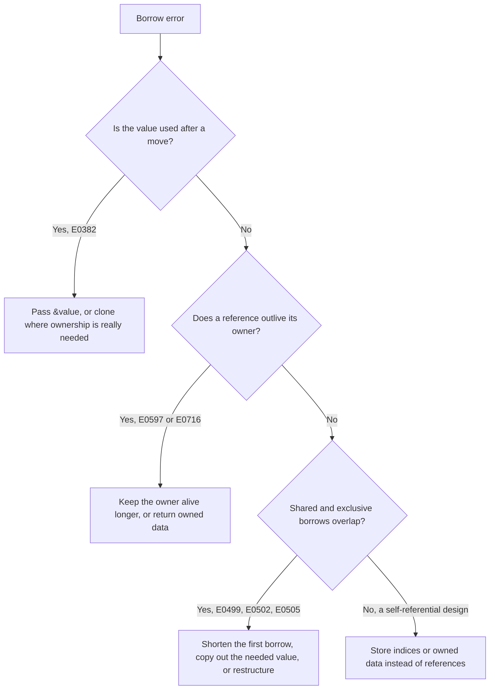

A `.clone()` is a legitimate fix when the data is small or the code is not hot, but it hides design problems when used reflexively. Before cloning, ask whether the function should take a reference, return an index, or whether two fields should be split into separate borrows.

### 2.14 Pitfalls

| Pitfall | Symptom | Fix |
| --- | --- | --- |
| Using a `String` after passing it by value | `error[E0382]: borrow of moved value: 's'` | Change the callee to take `&str`, or pass `s.clone()` only if it must own a copy. |
| Holding `&v[0]` while pushing to `v` | `error[E0502]: cannot borrow 'v' as mutable because it is also borrowed as immutable` | Copy the element out (`let first = v[0];`) or finish using the reference before the push. |
| Returning a reference to a local | `error[E0106]` or `error[E0515]: cannot return reference to local variable` | Return the owned value (`String`, `Vec<T>`) instead. |
| `let _ = mutex.lock()` | The lock is released immediately; the code that follows runs unprotected | Bind a name: `let _guard = mutex.lock()`. |
| Struct storing `&str` from a temporary | `error[E0716]: temporary value dropped while borrowed` | Bind the owner with `let` first, or make the field `String`. |
| Self-referential struct (a field borrowing another field) | Lifetime errors that cannot be satisfied | Store an index or range into the owned field; reach for crates like `ouroboros` only as a last resort. |
| Taking `&String` or `&Vec<T>` parameters | Callers with `&str` literals or arrays cannot call it; Clippy `ptr_arg` warns | Take `&str` and `&[T]`. |
| Cloning inside a hot loop to silence the checker | Correct but slow: one allocation per iteration | Restructure borrows, iterate by reference, or clone once outside the loop. |
| Mutating a map while iterating it | `error[E0502]` on `insert` inside `for (k, v) in &map` | Collect the changes into a `Vec` first, or use `retain` / `iter_mut`. |
| `thread::spawn` closure borrowing a local | `error[E0373]: closure may outlive the current function` | Add `move` so it owns its captures, or use `thread::scope` (Stage 6). |

### 2.15 Best Practices

- **Accept the most general borrowed type**: `&str` over `&String`, `&[T]` over `&Vec<T>`, so callers never have to convert.
- **Take ownership only when you store or consume**: the signature tells the caller whether they keep their value.
- **Return owned data from constructors and parsers that outlive their input**: borrowing views are for short-lived, hot paths.
- **Let elision work; annotate only when there are several input references**: extra `'a` noise makes signatures harder to read without adding safety.
- **Use `mem::take`, `mem::replace` and `Option::take` to move out of `&mut`**: they avoid clones and keep the value valid.
- **Use the `entry` API for insert-or-update**: one hash lookup, and it sidesteps the classic NLL rejection.
- **Name guards you rely on**: `let _guard = lock()` makes the drop point visible.
- **Prefer indices or IDs over long-lived references in data structures**: graphs, caches and ECS-style designs stay borrow-checker friendly.
- **Read the "borrow later used here" note first**: it names the borrow that must end sooner.

### 2.16 Hands-on Exercise

**Task.** In `src/text.rs`, replace the body of `Iterator::next` for `Words<'a>` with `todo!()` and reimplement it so that the unit tests pass. Rules:

1. A word is a maximal run of alphanumeric characters or apostrophes.
2. Items must be sub-slices of the original text (no `String` allocation inside `next`).
3. Multi-byte text such as `"café naïve 🦀 crab"` must yield `["café", "naïve", "crab"]` without panicking.

Then confirm the borrow relationships compile: collect the words of a local `String` into a `Vec<&str>`, drop the iterator, and print the vector.

**Expected output.**

```text
test text::tests::words_handles_multibyte_text ... ok
test text::tests::words_skips_punctuation_and_keeps_apostrophes ... ok
test text::tests::stats_counts_and_ranks ... ok
```

**Solution.** `impl<'a> Iterator for Words<'a>` in [`src/text.rs`](src/text.rs). Stretch goal: add a `Sentences<'a>` iterator that splits on `.`, `!` and `?`, trims each sentence, and skips empty ones, with tests.

[Back to top ⤴️](#-table-of-contents)

---

## 3. Stage 3: Structs, Enums, Modules & Error Handling

This stage is about modelling a domain so that invalid states cannot be represented, and about failing in a way callers can handle. It covers structs and methods, derived traits, enums that carry data, `Option`, pattern matching, modules and visibility, `Result` and `?`, and error types for libraries and applications. It builds on Stages 1 and 2. Afterwards you can read and extend `src/tasks.rs` and `src/app.rs`: a task store with a state machine, a typed error enum, and an HTTP layer that turns each error into the right status code.

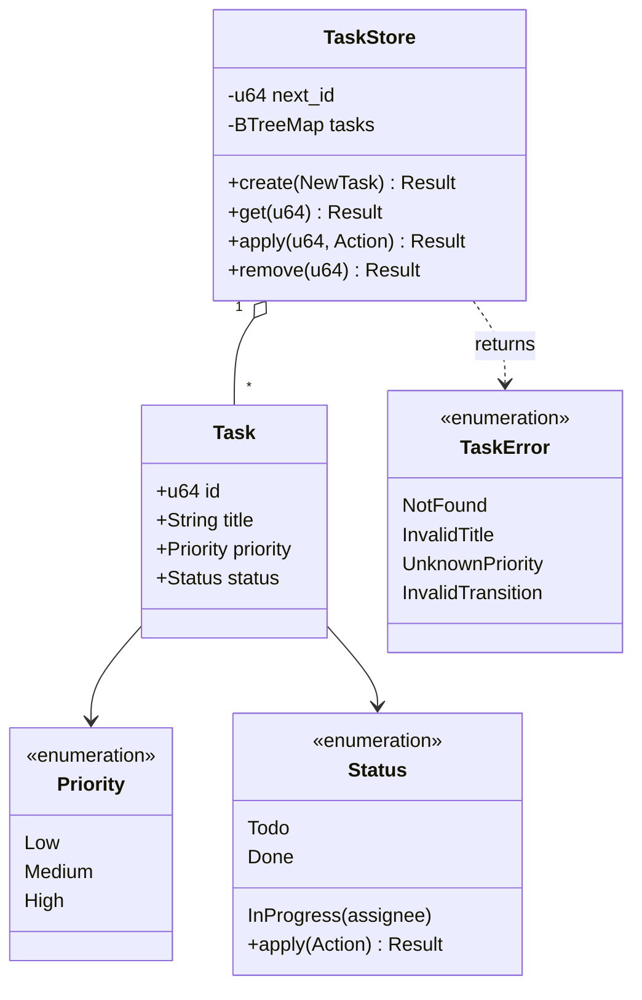

### 3.1 Structs: Named, Tuple, Unit and Newtypes

Rust has three struct forms. Named-field structs are the default. Tuple structs have positional fields and are mostly used as **newtypes**: a wrapper around one value that gives it a distinct type. Unit structs have no fields and take zero bytes; they are useful as markers and as types that implement a trait without state.

```rust
// 1. Named fields
#[derive(Debug, Clone)]
pub struct DatabaseConfig {
    pub host: String,
    pub port: u16,
    pub max_pool_size: u32,
    pub timeout_seconds: u64,
}

// 2. Tuple structs as newtypes: same representation as u64, different types
#[derive(Debug, Clone, Copy, PartialEq, Eq, Hash)]
pub struct UserId(pub u64);

#[derive(Debug, Clone, Copy, PartialEq, Eq, Hash)]
pub struct AccountId(pub u64);

// 3. Unit struct: zero-sized
pub struct LeaderLock;

fn close_account(user: UserId, account: AccountId) {
    println!("user {} closes account {}", user.0, account.0);
}

fn main() {
    let user = UserId(7);
    let account = AccountId(42);
    close_account(user, account);
    // close_account(account, user); // error[E0308]: mismatched types: expected `UserId`, found `AccountId`

    // Field init shorthand and struct update syntax
    let host = String::from("db.internal");
    let primary = DatabaseConfig { host, port: 5432, max_pool_size: 10, timeout_seconds: 30 };
    let replica = DatabaseConfig { host: String::from("replica.internal"), ..primary.clone() };
    println!("{replica:?}, lock is {} bytes", std::mem::size_of::<LeaderLock>());
}
```

Newtypes cost nothing at runtime and catch argument mix-ups at compile time, which matters most for IDs, units (`Meters(f64)` vs `Feet(f64)`) and validated values (`Email(String)` that can only be built through a checking constructor). Struct update syntax `..primary.clone()` moves the remaining fields from the expression; without `.clone()`, the non-`Copy` fields of `primary` would be moved and `primary` partly unusable.

### 3.2 Methods, Associated Functions and Receivers

An `impl` block attaches functions to a type. Functions with a `self` receiver are methods called with dot syntax; the others are associated functions called with `Type::name`, such as the `new` constructor convention.

| Receiver | Meaning | Caller keeps the value? | Typical use |
| :--- | :--- | :--- | :--- |
| `&self` | Shared borrow | Yes | Getters, queries, formatting |
| `&mut self` | Exclusive borrow | Yes, modified | Setters, push, state changes |
| `self` | Takes ownership | No | Builders' `build()`, conversions such as `into_inner()` |
| `self: Box<Self>`, `self: Arc<Self>` | Ownership through a smart pointer | No | Trait objects, tasks that consume a shared handle |
| none | Associated function | n/a | Constructors, `Default`, parsing |

```rust
#[derive(Debug, Clone)]
pub struct DatabaseConfig {
    host: String,
    port: u16,
    timeout_seconds: u64,
}

impl DatabaseConfig {
    /// Associated function: accepts &str or String without an extra copy.
    pub fn new(host: impl Into<String>, port: u16) -> Self {
        Self { host: host.into(), port, timeout_seconds: 30 }
    }

    pub fn connection_string(&self) -> String {
        format!("postgres://{}:{}/app", self.host, self.port)
    }

    pub fn set_timeout(&mut self, seconds: u64) {
        self.timeout_seconds = seconds;
    }

    /// Consumes the config and returns its parts.
    pub fn into_parts(self) -> (String, u16) {
        (self.host, self.port)
    }
}

fn main() {
    let mut cfg = DatabaseConfig::new("localhost", 5432);
    cfg.set_timeout(5);                  // auto-borrows &mut cfg
    println!("{}", cfg.connection_string()); // auto-borrows &cfg
    let (host, port) = cfg.into_parts(); // moves cfg
    println!("{host}:{port}");
}
```

Method calls auto-reference and auto-dereference: `cfg.set_timeout(5)` is `DatabaseConfig::set_timeout(&mut cfg, 5)`. Keep fields private (as here) and expose methods when a value has invariants; public fields are fine for plain data such as `Task` in the starter, where any combination of field values is valid.

### 3.3 Deriving Common Traits

`#[derive(...)]` generates trait implementations from the type's structure. Derive what makes sense for the type and nothing more; each derive is a public promise.

| Derive | Gives you | Requires | Notes |
| :--- | :--- | :--- | :--- |
| `Debug` | `{:?}` formatting | Fields are `Debug` | Derive on almost everything |
| `Clone` | `.clone()` | Fields are `Clone` | Deep copy |
| `Copy` | Implicit bitwise copies | `Clone`, all fields `Copy`, no `Drop` | Small value types only |
| `PartialEq`, `Eq` | `==`, `!=` | Fields comparable | `Eq` is a promise that `x == x` always holds; floats are only `PartialEq` because `NaN != NaN` |
| `PartialOrd`, `Ord` | `<`, `sort()`, `BTreeMap` keys | Fields ordered | Structs compare field by field in declaration order; enums by variant order |
| `Hash` | `HashMap` / `HashSet` keys | Fields `Hash` | Must agree with `Eq` |
| `Default` | `Type::default()` | Fields `Default` | Enums mark one variant with `#[default]` |
| `Serialize`, `Deserialize` | JSON and other formats via serde | serde `derive` feature | Control names with `#[serde(rename_all = "...")]` |

From the starter, where variant order gives `Low < Medium < High` and `Medium` is the default:

```rust
use serde::{Deserialize, Serialize};

#[derive(
    Debug, Clone, Copy, Default, PartialEq, Eq, PartialOrd, Ord, Hash, Serialize, Deserialize,
)]
#[serde(rename_all = "lowercase")]
pub enum Priority {
    Low,
    #[default]
    Medium,
    High,
}

fn main() {
    let mut list = vec![Priority::High, Priority::Low, Priority::Medium];
    list.sort();
    assert_eq!(list, [Priority::Low, Priority::Medium, Priority::High]);
    assert_eq!(Priority::default(), Priority::Medium);
    assert_eq!(serde_json::to_string(&Priority::High).unwrap(), "\"high\"");
}
```

Reordering the variants would silently change sorting. When ordering is a business rule rather than an accident of declaration, implement `Ord` by hand or sort with an explicit key.

### 3.4 Enums as Algebraic Data Types

A Rust enum is a tagged union: a value is exactly one of its variants, and each variant can carry its own data. Together with structs (which hold all fields at once), this lets you express "one of these shapes" without nullable fields or class hierarchies.

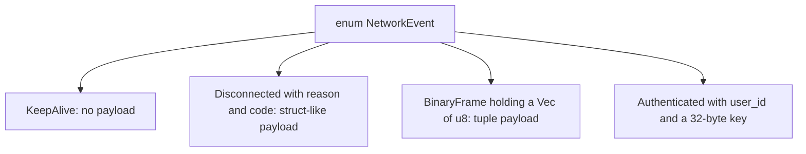

```rust
#[derive(Debug)]
pub enum NetworkEvent {
    KeepAlive,
    Disconnected { reason: String, code: u16 },
    BinaryFrame(Vec<u8>),
    Authenticated { user_id: u64, session_key: [u8; 32] },
}

fn handle(event: NetworkEvent) {
    match event {
        NetworkEvent::KeepAlive => println!("heartbeat"),
        NetworkEvent::Disconnected { reason, code } => eprintln!("closed {code}: {reason}"),
        NetworkEvent::BinaryFrame(bytes) if bytes.len() > 1024 => {
            println!("large frame: {} bytes", bytes.len()) // match guard
        }
        NetworkEvent::BinaryFrame(bytes) => println!("frame: {} bytes", bytes.len()),
        NetworkEvent::Authenticated { user_id, .. } => println!("session for user {user_id}"),
    }
}

fn main() {
    handle(NetworkEvent::BinaryFrame(vec![0; 2048]));
    handle(NetworkEvent::Disconnected { reason: "timeout".into(), code: 1006 });
    println!("{} bytes", std::mem::size_of::<NetworkEvent>());
}
```

An enum's size is the largest variant plus the tag, rounded up to alignment. Here `Authenticated` (8 + 32 bytes) dominates. If one variant is much larger than the rest, box its payload (`Authenticated(Box<Session>)`) so that every value does not pay for it; Clippy's `large_enum_variant` lint flags the case. The compiler also stores the tag in invalid bit patterns of the payload when it can (the **niche** optimisation), which is why `Option<&T>` and `Option<Box<T>>` are pointer-sized.

The starter's `Status` uses the same idea for a workflow: only `InProgress` has an assignee, so there is no `assignee: Option<String>` field that could be set on a `Done` task by mistake.

```rust
use serde::{Deserialize, Serialize};

#[derive(Debug, Clone, PartialEq, Eq, Serialize, Deserialize)]
#[serde(tag = "state", rename_all = "snake_case")]
pub enum Status {
    Todo,
    InProgress { assignee: String },
    Done,
}
```

`#[serde(tag = "state")]` serialises it as `{"state":"in_progress","assignee":"ana"}`, which is what the HTTP tests assert.

### 3.5 Option: Replacing Null

`Option<T>` is `Some(T)` or `None`. Because it is a different type from `T`, you cannot use a possibly-missing value without deciding what happens when it is missing. The combinators below cover most cases without an explicit `match`:

| Method | From | To | Use |
| :--- | :--- | :--- | :--- |
| `map(f)` | `Option<T>` | `Option<U>` | Transform the value if present |
| `and_then(f)` | `Option<T>` | `Option<U>`, `f` returns `Option` | Chain lookups that may fail |
| `filter(p)` | `Option<T>` | `Option<T>` | Keep only if the predicate holds |
| `unwrap_or(v)` / `unwrap_or_else(f)` / `unwrap_or_default()` | `Option<T>` | `T` | Fallback value (use `_else` when the fallback is costly) |
| `ok_or(e)` / `ok_or_else(f)` | `Option<T>` | `Result<T, E>` | Turn absence into an error (`TaskStore::get`) |
| `is_some_and(p)` / `is_none_or(p)` | `Option<T>` | `bool` | Test without unwrapping (`TaskStore::list` uses `is_none_or`) |
| `as_deref()` | `Option<String>` | `Option<&str>` | Borrow the inner value (`list_tasks` uses it) |
| `take()` | `&mut Option<T>` | `Option<T>` | Move the value out, leave `None` |
| `?` | `Option<T>` | `T`, or return `None` | Early return in functions returning `Option` |

```rust
struct User {
    name: String,
    manager_id: Option<u64>,
}

fn find(id: u64) -> Option<User> {
    match id {
        1 => Some(User { name: "ana".into(), manager_id: Some(2) }),
        2 => Some(User { name: "bo".into(), manager_id: None }),
        _ => None,
    }
}

fn manager_name(id: u64) -> Option<String> {
    let user = find(id)?;              // None if the user does not exist
    let manager = find(user.manager_id?)?;
    Some(manager.name)
}

fn main() {
    println!("{:?}", manager_name(1)); // Some("bo")
    println!("{:?}", manager_name(2)); // None: bo has no manager
    let label = find(9).map(|u| u.name).unwrap_or_else(|| "unknown".to_string());
    println!("{label}");
    let id_error: Result<User, String> = find(9).ok_or("no user 9".to_string());
    println!("{}", id_error.is_err());
}
```

### 3.6 Pattern Matching in Depth

`match` compares a value against patterns top to bottom and runs the first arm that fits. It must be **exhaustive**: if a case is missing, the program does not compile (`error[E0004]: non-exhaustive patterns: 'Status::Done' not covered`). This is what makes enums safe to extend: add a variant and the compiler lists every `match` that needs updating, provided the match has no catch-all `_` arm.

| Pattern | Matches | Example |
| :--- | :--- | :--- |
| Literal | An exact value | `0 => ...`, `"GET" => ...` |
| Range | Inclusive or exclusive range | `1..=9`, `b'a'..=b'z'`, `..0` |
| Or | Any alternative | `Ok(0) \| Err(_)` |
| Binding with `@` | Tests and binds at once | `code @ 500..=599` |
| Guard | Extra boolean condition | `n if n % 2 == 0` |
| Tuple / struct | Destructures | `(x, 0)`, `Point { x, .. }` |
| Slice | Matches by shape | `[first, .., last]`, `[]`, `[only]` |
| Wildcard / rest | Ignores | `_` (one value), `..` (remaining fields or elements) |

```rust
fn classify(status: u16) -> &'static str {
    match status {
        200 | 204 => "success",
        code @ 300..=399 if code != 304 => "redirect",
        304 => "not modified",
        400..=499 => "client error",
        500.. => "server error",
        _ => "other",
    }
}

fn describe(path: &[&str]) -> String {
    match path {
        [] => "root".into(),
        ["api", version, rest @ ..] => format!("api {version}, {} more segments", rest.len()),
        [single] => format!("one segment: {single}"),
        [first, .., last] => format!("{first} ... {last}"),
    }
}

fn main() {
    println!("{} {} {}", classify(204), classify(302), classify(503));
    println!("{}", describe(&["api", "v1", "tasks", "7"]));
    println!("{}", describe(&["docs", "intro", "setup"]));
}
```

The starter's state machine (excerpt from `src/tasks.rs`) matches on a tuple of current state and requested action, so every legal transition is one line and everything else falls into one rejection arm:

```rust
impl Status {
    pub fn apply(&self, action: Action) -> Result<Status, TaskError> {
        match (self, action) {
            (Status::Todo, Action::Start { assignee }) => Ok(Status::InProgress { assignee }),
            (Status::InProgress { .. }, Action::Complete) => Ok(Status::Done),
            (Status::InProgress { .. } | Status::Done, Action::Reopen) => Ok(Status::Todo),
            (from, action) => Err(TaskError::InvalidTransition {
                from: from.name(),
                action: action.name(),
            }),
        }
    }
}
```

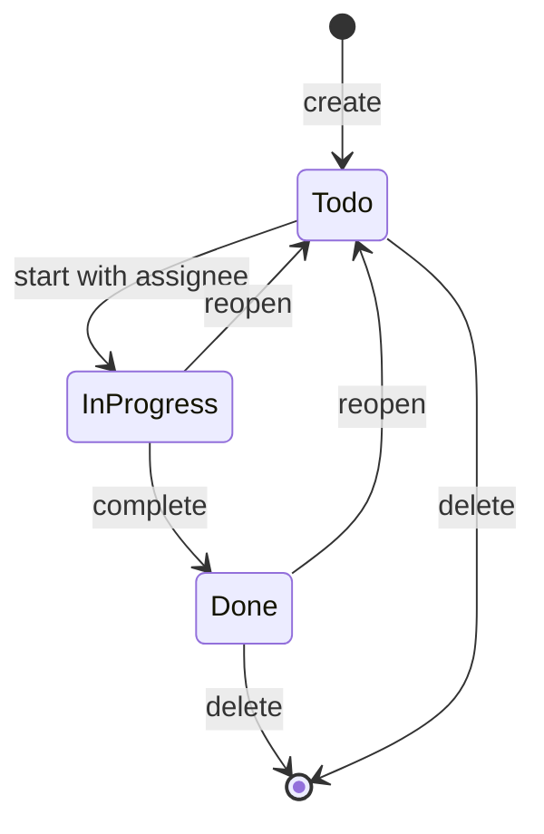

`(self, action)` has type `(&Status, Action)`. The pattern `Status::Todo` matches through the reference (match ergonomics), while `Action::Start { assignee }` moves the `String` out of the owned action into the new state with no clone. The trade-off of the catch-all arm is spelled out in the source: it keeps the table short, but new variants are flagged by the exhaustive `name()` methods rather than here.

### 3.7 if let, while let, let-else, let chains and matches!

When only one pattern matters, `match` is verbose. Four shorter forms exist:

```rust
fn parse_header(raw: Option<&str>) -> Result<(String, String), String> {
    // let-else (1.65): bind or diverge. The else block must return, break, continue or panic.
    let Some(line) = raw else {
        return Err("missing header".into());
    };
    let Some((name, value)) = line.split_once(':') else {
        return Err(format!("malformed header {line:?}"));
    };
    // `name` and `value` are in scope here, with no extra nesting.
    Ok((name.trim().to_lowercase(), value.trim().to_string()))
}

fn main() {
    // if let: one interesting pattern
    if let Ok((name, value)) = parse_header(Some("Content-Type: text/plain")) {
        println!("{name} = {value}");
    }

    // while let: loop while the pattern matches
    let mut queue = vec!["c", "b", "a"];
    while let Some(job) = queue.pop() {
        print!("{job} ");
    }
    println!();

    // let chains (Edition 2024, 1.88): patterns and conditions in one if
    let header = parse_header(Some("X-Retry: 3"));
    if let Ok((name, value)) = &header
        && name == "x-retry"
        && let Ok(n) = value.parse::<u8>()
    {
        println!("retry {n} times");
    }

    // matches!: a pattern test that returns bool
    let is_client_error = matches!(parse_header(None), Err(e) if e.contains("missing"));
    println!("{is_client_error}");
}
```

`let-else` is the right default for "extract or bail" at the top of a function. It keeps the happy path unindented and makes the failure exit explicit, which reads better than a chain of `if let ... else { return }` blocks.

### 3.8 Modules, Visibility and Crate Layout

A crate is a tree of modules rooted at `src/lib.rs` or `src/main.rs`. `mod config;` in the root tells the compiler to load `src/config.rs` (or `src/config/mod.rs`). Everything is private to its module by default; `pub` and its restricted forms widen access.

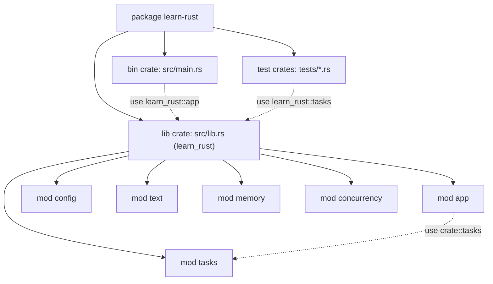

| Visibility | Visible to |
| :--- | :--- |
| (none) | The current module and its children |
| `pub(super)` | The parent module |
| `pub(crate)` | The whole crate, but not other crates |
| `pub(in crate::a::b)` | A named ancestor module |
| `pub` | Everyone who can reach the item's path |

| Path | Starts from |
| :--- | :--- |
| `crate::tasks::Task` | The crate root |
| `super::helper` | The parent module (`use super::*;` in `#[cfg(test)] mod tests`) |
| `self::inner` | The current module |
| `learn_rust::app` | Another crate (from `main.rs` or `tests/`) |

```rust
// src/lib.rs shape, collapsed into one file for illustration
mod storage {
    // Private helper: only `storage` and its children can call it.
    fn checksum(data: &[u8]) -> u32 {
        data.iter().map(|&b| u32::from(b)).sum()
    }

    pub mod disk {
        pub struct Block {
            pub id: u64,
            pub(crate) data: Vec<u8>, // crate-internal field
        }

        impl Block {
            pub fn new(id: u64, data: Vec<u8>) -> Self {
                Self { id, data }
            }

            pub fn checksum(&self) -> u32 {
                super::checksum(&self.data) // child may use parent's private item
            }
        }
    }
}

// Re-export so users write `crate::Block` instead of `crate::storage::disk::Block`.
pub use storage::disk::Block;

fn main() {
    let block = Block::new(1, vec![1, 2, 3]);
    println!("block {} checksum {} size {}", block.id, block.checksum(), block.data.len());
}
```

Guidelines: one module per file once it passes a screen or two; prefer `foo.rs` plus a `foo/` directory over `foo/mod.rs` (both work, the first avoids many tabs named `mod.rs`); make items `pub(crate)` unless they are part of the public API; use `pub use` at the root to present a flat API independent of the internal layout. The starter keeps the HTTP layer (`app`) separate from the domain (`tasks`, `text`), so the domain has no axum dependency and its unit tests run without a server.

### 3.9 Result and the ? Operator

`Result<T, E>` is `Ok(T)` or `Err(E)`. Functions that can fail return it, and the caller must handle it: an unused `Result` triggers the `unused_must_use` warning. The `?` operator unwraps an `Ok` or returns the error early, converting it with `From::from` on the way.

```rust
fn read_count(text: &str) -> Result<u32, std::num::ParseIntError> {
    let n = text.trim().parse::<u32>()?;
    Ok(n * 2)
}
```

The `?` line desugars roughly to:

```rust
fn read_count(text: &str) -> Result<u32, std::num::ParseIntError> {
    let n = match text.trim().parse::<u32>() {
        Ok(value) => value,
        Err(err) => return Err(From::from(err)),
    };
    Ok(n * 2)
}
```

The `From::from` call is what lets one function use `?` on several error types: each must convert into the function's error type. A hand-written conversion:

```rust
use std::fmt;
use std::num::ParseIntError;

#[derive(Debug)]
enum ConfigError {
    Missing(&'static str),
    BadNumber(ParseIntError),
}

impl fmt::Display for ConfigError {
    fn fmt(&self, f: &mut fmt::Formatter<'_>) -> fmt::Result {
        match self {
            Self::Missing(key) => write!(f, "missing key {key}"),
            Self::BadNumber(e) => write!(f, "bad number: {e}"),
        }
    }
}

impl std::error::Error for ConfigError {}

impl From<ParseIntError> for ConfigError {
    fn from(e: ParseIntError) -> Self {
        Self::BadNumber(e)
    }
}

fn workers(raw: Option<&str>) -> Result<usize, ConfigError> {
    let text = raw.ok_or(ConfigError::Missing("WORKERS"))?; // Option -> Result
    Ok(text.parse::<usize>()?)                              // ParseIntError -> ConfigError via From
}

fn main() -> Result<(), Box<dyn std::error::Error>> {
    println!("{}", workers(Some("8"))?);
    println!("{}", workers(Some("eight")).unwrap_err());   // bad number: invalid digit found in string
    println!("{}", workers(None).unwrap_err());            // missing key WORKERS
    Ok(())
}
```

`Option<Result<T, E>>` and `Result<Option<T>, E>` convert into each other with `transpose()`. The starter uses it to make an optional query parameter fail only when it is present and invalid:

```rust
let priority = query
    .priority                    // Option<String>
    .as_deref()                  // Option<&str>
    .map(str::parse::<Priority>) // Option<Result<Priority, TaskError>>
    .transpose()?;               // Result<Option<Priority>, TaskError>, then ?
```

### 3.10 Designing Library Errors with thiserror

Writing `Display`, `Error` and `From` by hand, as above, is mechanical. The `thiserror` crate derives them from attributes and adds no type to your public API: callers see an ordinary enum.

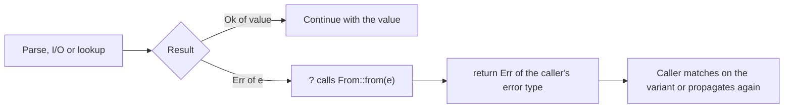

The starter's error type:

```rust
use thiserror::Error;

#[derive(Debug, Clone, Error, PartialEq, Eq)]
pub enum TaskError {
    #[error("task {0} not found")]
    NotFound(u64),
    #[error("title must be 1 to {max} characters, got {len}")]
    InvalidTitle { len: usize, max: usize },
    #[error("unknown priority {0:?}; expected low, medium or high")]
    UnknownPriority(String),
    #[error("cannot {action} a task that is {from}")]
    InvalidTransition {
        from: &'static str,
        action: &'static str,
    },
}
```

Wrapping lower-level errors, with `#[from]` generating the `From` impl and `#[source]` exposing the cause through `Error::source()`:

```rust
use thiserror::Error;

#[derive(Debug, Error)]
pub enum StorageError {
    #[error("I/O error on block file {path}")]
    Io {
        path: String,
        #[source]
        source: std::io::Error,
    },

    #[error("checksum mismatch: expected {expected:#X}, found {actual:#X}")]
    Corrupt { expected: u32, actual: u32 },

    #[error("key {0:?} does not exist")]
    KeyNotFound(String),

    #[error(transparent)]
    Json(#[from] serde_json::Error), // `?` on serde_json results converts automatically
}

fn read_block(path: &str) -> Result<Vec<u8>, StorageError> {
    std::fs::read(path).map_err(|source| StorageError::Io { path: path.to_string(), source })
}

fn main() {
    let err = read_block("/no/such/file").unwrap_err();
    println!("{err}");                                  // I/O error on block file /no/such/file
    if let Some(cause) = std::error::Error::source(&err) {
        println!("caused by: {cause}");                 // caused by: No such file or directory (os error 2)
    }
}
```

Design rules for library error enums:

- **One enum per domain or module boundary**, not one per function and not one for the whole crate.
- **Variants describe what went wrong for the caller** (`NotFound`, `InvalidTitle`), not which dependency failed.
- **Carry data the caller can act on**: the id that was missing, the limit that was exceeded.
- **Do not put the source's message in your own message when you also return it as `source`**; reporters that walk the chain would print it twice.
- **Mark public enums `#[non_exhaustive]`** if you expect to add variants, so downstream `match`es must have a catch-all and adding a variant is not a breaking change.

### 3.11 Application Errors with anyhow

Inside a binary, most errors are not matched on; they are reported with context and the program stops or the request fails. `anyhow::Error` wraps any `std::error::Error + Send + Sync + 'static`, keeps the cause chain, and captures a backtrace when `RUST_BACKTRACE=1` is set.

```rust
use anyhow::{Context, Result, bail, ensure};
use std::fs;

fn load_certificate(path: &str) -> Result<Vec<u8>> {
    let bytes = fs::read(path).with_context(|| format!("reading TLS certificate {path}"))?;
    ensure!(!bytes.is_empty(), "certificate {path} is empty");
    if !bytes.starts_with(b"-----BEGIN") {
        bail!("certificate {path} is not PEM encoded");
    }
    Ok(bytes)
}

fn main() {
    if let Err(err) = load_certificate("/etc/missing.pem") {
        // {:#} prints the whole chain on one line:
        // reading TLS certificate /etc/missing.pem: No such file or directory (os error 2)
        eprintln!("{err:#}");
    }
}
```

| Approach | Callers can match variants? | Context and chain | Best for |
| :--- | :--- | :--- | :--- |
| Hand-written enum + `impl Error` | Yes | Manual | No-dependency libraries, `no_std` |
| `thiserror` enum | Yes | `#[source]`, `#[from]` | Libraries and domain layers (the starter's `TaskError`) |
| `anyhow::Error` | Only by `downcast_ref` | `.context()`, chain, backtrace | Binaries, CLIs, top-level glue |
| `Box<dyn Error + Send + Sync>` | Only by downcasting | Chain via `source()` | Quick prototypes, `main` (the starter's `main`) |

A common split: domain modules return `thiserror` enums; the binary's `main`, CLI commands and background jobs return `anyhow::Result` and add `.context(...)` at each layer.

### 3.12 Mapping Domain Errors to HTTP Responses

An HTTP service should decide status codes in one place. In axum, a handler may return `Result<T, E>` when both `T` and `E` implement `IntoResponse`. The starter implements it for `TaskError`, so handlers use `?` and never mention status codes for failures (excerpt from `src/app.rs`, which has the imports):

```rust
impl IntoResponse for TaskError {
    fn into_response(self) -> Response {
        let status = match &self {
            TaskError::NotFound(_) => StatusCode::NOT_FOUND,
            TaskError::InvalidTitle { .. } | TaskError::UnknownPriority(_) => {
                StatusCode::UNPROCESSABLE_ENTITY
            }
            TaskError::InvalidTransition { .. } => StatusCode::CONFLICT,
        };
        (status, Json(json!({ "error": self.to_string() }))).into_response()
    }
}

async fn apply_action(
    State(state): State<AppState>,
    Path(id): Path<u64>,
    Json(action): Json<Action>,
) -> Result<Json<Task>, TaskError> {
    Ok(Json(state.store().apply(id, action)?.clone()))
}
```

| `TaskError` variant | Status | Why |
| :--- | :--- | :--- |
| `NotFound` | 404 | The resource id does not exist |
| `InvalidTitle`, `UnknownPriority` | 422 | The request is well-formed JSON but fails validation |
| `InvalidTransition` | 409 | Valid request, but it conflicts with the resource's current state |
| (axum's own `JsonRejection`) | 400 / 415 / 422 | Broken JSON, wrong content type, or missing fields; produced by the extractor before the handler runs |
| (axum's own `PathRejection`) | 400 | `/api/v1/tasks/not-a-number` cannot parse into `u64` |

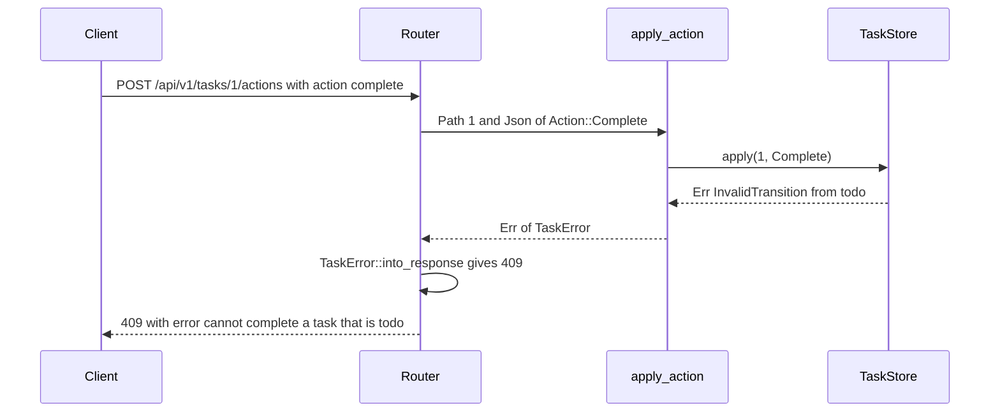

The match in `into_response` has no catch-all, so adding a `TaskError` variant fails to compile until someone chooses its status code. That is the reason to avoid `_ =>` in mappings like this one.

### 3.13 Panics vs Errors

A panic means a bug: an invariant the program relies on was broken. It unwinds the current thread (running destructors) and, in the main thread, ends the process with exit code 101. Errors are expected outcomes the caller should handle.

| Situation | Use | Example |
| :--- | :--- | :--- |
| Input from users, files, network | `Result` | `Config::from_port_var`, `TaskStore::create` |
| A lookup that may legitimately miss | `Option` or `Result` | `TaskStore::get` |
| An impossible state if the code is correct | `expect("why it cannot fail")` or `unreachable!()` | Index computed from the same slice's length |
| Startup configuration that must exist | `expect` with a clear message, or return `Err` from `main` | Installing a signal handler in `main.rs` |
| Tests | `unwrap()` is fine | A failure is a test failure anyway |
| Library public API | Never panic on bad input; return `Result` | `parse`, `try_from` |

```rust
fn percent(part: u32, whole: u32) -> Option<f64> {
    if whole == 0 {
        return None; // expected case: no data yet
    }
    Some(f64::from(part) / f64::from(whole) * 100.0)
}

fn main() {
    let samples = [3, 9, 4];
    let max = samples.iter().max().expect("samples is a non-empty literal");
    println!("max {max}, share {:?}", percent(*max, samples.iter().sum()));
    println!("{:?}", percent(1, 0));
}
```

Run with `RUST_BACKTRACE=1` to get a backtrace on panic. A panic inside a spawned thread or Tokio task does not kill the process; the `JoinHandle` reports it, and a `Mutex` the thread held becomes poisoned (the starter recovers with `unwrap_or_else(PoisonError::into_inner)` because its store has no invariant that a half-finished write could break).

### 3.14 Builders and the Typestate Pattern

Rust has no named or default arguments. For types with many optional settings, a **builder** collects them and validates once in `build()`.

```rust
#[derive(Debug)]
pub struct HttpClient {
    base_url: String,
    timeout_ms: u64,
    retries: u8,
    user_agent: String,
}

#[derive(Default)]
pub struct HttpClientBuilder {
    base_url: Option<String>,
    timeout_ms: Option<u64>,
    retries: u8,
    user_agent: Option<String>,
}

impl HttpClientBuilder {
    pub fn base_url(mut self, url: impl Into<String>) -> Self {
        self.base_url = Some(url.into());
        self
    }
    pub fn timeout_ms(mut self, ms: u64) -> Self {
        self.timeout_ms = Some(ms);
        self
    }
    pub fn retries(mut self, n: u8) -> Self {
        self.retries = n;
        self
    }
    pub fn build(self) -> Result<HttpClient, String> {
        let base_url = self.base_url.ok_or("base_url is required")?;
        if !base_url.starts_with("http") {
            return Err(format!("base_url {base_url:?} must start with http"));
        }
        Ok(HttpClient {
            base_url,
            timeout_ms: self.timeout_ms.unwrap_or(5_000),
            retries: self.retries,
            user_agent: self.user_agent.unwrap_or_else(|| "learn-rust/1.0".into()),
        })
    }
}

fn main() {
    let client = HttpClientBuilder::default()
        .base_url("https://api.example.com")
        .timeout_ms(2_000)
        .retries(3)
        .build()
        .expect("valid client config");
    println!("{client:?}");
    println!("{:?}", HttpClientBuilder::default().build()); // Err("base_url is required")
}
```

The **typestate** pattern goes further: it encodes the state in a type parameter so that calling methods in the wrong order is a compile error, not a runtime `Err`. Zero-sized marker types make it free at runtime.

```rust
use std::marker::PhantomData;

pub struct Draft;
pub struct Reviewed;
pub struct Published;

pub struct Post<State> {
    body: String,
    _state: PhantomData<State>,
}

impl Post<Draft> {
    pub fn new(body: &str) -> Self {
        Post { body: body.to_string(), _state: PhantomData }
    }
    pub fn submit(self) -> Post<Reviewed> {
        Post { body: self.body, _state: PhantomData }
    }
}

impl Post<Reviewed> {
    pub fn approve(self) -> Post<Published> {
        Post { body: self.body, _state: PhantomData }
    }
}

impl Post<Published> {
    pub fn url(&self) -> String {
        format!("/posts/{}", self.body.len())
    }
}

fn main() {
    let post = Post::new("hello").submit().approve();
    println!("{}", post.url());
    // Post::new("x").approve(); // error[E0599]: no method named `approve` found for struct `Post<Draft>`
}
```

Use a runtime state enum (like the starter's `Status`) when the state comes from outside, for example from a request or a database row. Use typestate when the sequence is fixed in code, such as a connection that must be authenticated before queries can be sent.

### 3.15 Pitfalls

| Pitfall | Symptom | Fix |
| --- | --- | --- |
| Adding an enum variant behind a `_ =>` arm | Compiles, but the new variant silently takes the default path | Avoid catch-alls in matches over your own enums; list variants explicitly. |
| Missing a variant in `match` | `error[E0004]: non-exhaustive patterns: 'Status::Done' not covered` | Handle it; that error is the feature working. |
| `.unwrap()` on user input | Panic: `called 'Result::unwrap()' on an 'Err' value: ParseIntError { kind: InvalidDigit }` | Propagate with `?` or map to a domain error. |
| `?` with an error type that has no `From` | `error[E0277]: '?' couldn't convert the error to 'TaskError'` | Add `#[from]`, implement `From`, or `.map_err(...)`. |
| `?` in a function returning `()` | `error[E0277]: the '?' operator can only be used in a function that returns 'Result' or 'Option'` | Return `Result`, including from `main` and tests. |
| Public enum without `#[non_exhaustive]` | Adding a variant breaks downstream crates | Mark it before the first release. |
| Huge variant in an enum | Every value is as large as the biggest variant; Clippy `large_enum_variant` | Box the large payload. |
| Private type in a public signature | Warning `private_interfaces: type 'Inner' is more private than the item` (it was hard error E0446 before 1.74); callers cannot name the type | Make the type `pub`, or hide it behind a public wrapper. |
| Deriving `PartialOrd` on an enum and reordering variants | Sorting changes with no compile error | Implement `Ord` explicitly when order is a rule. |
| Mapping all errors to 500 | Clients cannot tell bad input from server faults | One `IntoResponse` impl with an exhaustive status mapping. |
| Shadowing an enum variant with a binding | A pattern like `Low => ...` without the type path is a new variable that matches everything; the `bindings_with_variant_name` lint (E0170) flags it | Write `Priority::Low`, or `use Priority::*` deliberately. |

### 3.16 Best Practices

- **Make invalid states unrepresentable**: an enum variant that carries its data (`InProgress { assignee }`) beats several optional fields that must agree.
- **Wrap primitive IDs and units in newtypes**: `UserId(u64)` turns argument mix-ups into compile errors at no runtime cost.
- **Validate in constructors and keep fields private when there is an invariant**: every value of the type is then known good.
- **Implement `FromStr` and `Display` for types that cross a text boundary**: `"high".parse::<Priority>()` reads naturally and works with `?`.
- **Use `thiserror` in libraries and domain modules, `anyhow` at the application edge**: callers can match where they need to, and reports get context everywhere else.
- **Map errors to transport codes in one exhaustive `match`**: adding a variant forces a decision.
- **Prefer `let-else` for extract-or-return**: the happy path stays flat.
- **Use `expect("reason")` over `unwrap()` outside tests**: the message documents why failure is impossible and appears in the panic.
- **Keep the domain free of framework types**: `tasks.rs` has no axum imports, so it can move to another transport or a CLI unchanged.

### 3.17 Hands-on Exercise

**Task.** Two parts, both checked by existing tests.

1. In `src/tasks.rs`, replace the body of `Status::apply` with `todo!()` and reimplement the state machine shown in 3.6: `Todo` to `InProgress` on `Start`, `InProgress` to `Done` on `Complete`, `InProgress` or `Done` to `Todo` on `Reopen`, and `TaskError::InvalidTransition` for every other pair.
2. In `src/app.rs`, delete the `impl IntoResponse for TaskError` block and write it again so that `cargo test --test http_api` passes: 404 for `NotFound`, 422 for validation errors, 409 for invalid transitions, and a JSON body `{"error": "<Display text>"}`.

**Expected output.**

```text
running 6 tests
test bad_json_is_rejected_by_the_extractor ... ok
test health_reports_ok ... ok
test metrics_returns_three_items ... ok
test task_crud_and_state_machine ... ok
test text_stats_endpoint ... ok
test validation_errors_are_422 ... ok

test result: ok. 6 passed; 0 failed; 0 ignored; 0 measured; 0 filtered out
```

**Solution.** `Status::apply` in [`src/tasks.rs`](src/tasks.rs) and `impl IntoResponse for TaskError` in [`src/app.rs`](src/app.rs). Stretch goal: add a `Blocked { reason: String }` status with `block` and `unblock` actions, extend the state diagram, and add a test that blocking a `Done` task returns 409.

[Back to top ⤴️](#-table-of-contents)

---

## 4. Stage 4: Traits, Generics & Zero-Cost Abstractions

Traits describe shared behaviour and generics let one implementation serve many types without runtime cost. This stage covers monomorphization, trait bounds, static versus dynamic dispatch, and the standard conversion and deref traits.

### 4.1 Generics & Zero-Cost Monomorphization
Rust generics allow writing type-agnostic algorithms without runtime overhead. During compilation, Rust performs **monomorphization**: it inspects all concrete types that instantiate the generic function and generates dedicated, optimized machine code for each type:

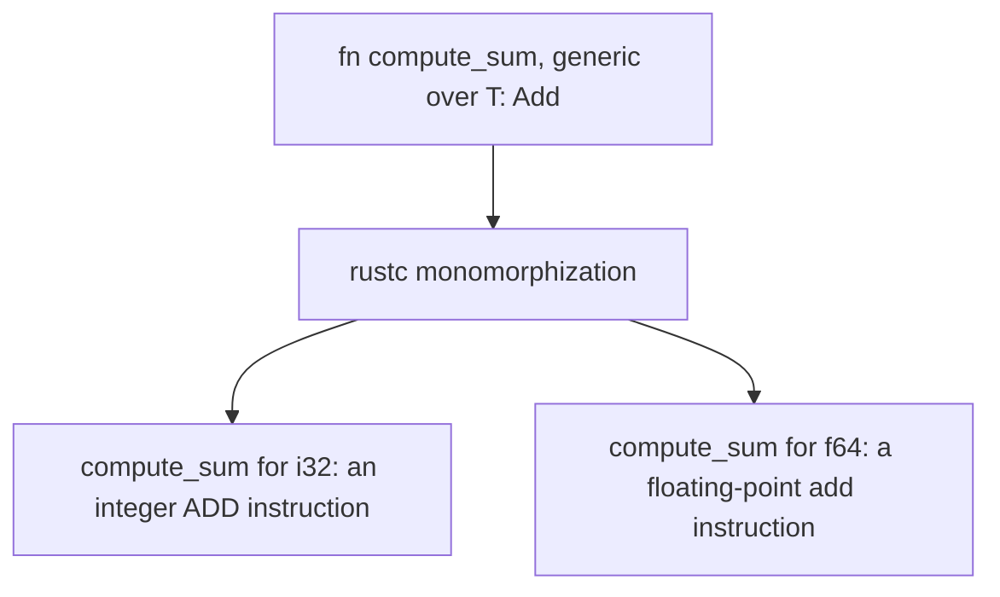

```rust
// Generic struct over type T
pub struct KeyValueStore<K, V> {
    pub key: K,
    pub value: V,
}

impl<K, V> KeyValueStore<K, V> {
    pub fn new(key: K, value: V) -> Self {
        Self { key, value }
    }
}
```

### 4.2 Traits, Trait Bounds & where Clauses
Traits define shared behavior contracts (analogous to interfaces in other languages, but more expressive):

```rust
use std::fmt::{Debug, Display};

// 1. Defining a Trait with Default Method Implementation
pub trait TelemetrySerializer {
    fn serialize_to_bytes(&self) -> Vec<u8>;

    // Default implementation can be overridden by implementors
    fn format_header(&self) -> String {
        String::from("Content-Type: application/octet-stream\r\n")
    }
}

// 2. Trait bounds using the `where` clause for maximum readability
pub fn process_telemetry_batch<T, U>(primary_stream: T, fallback_stream: U) -> Result<(), String>
where
    T: TelemetrySerializer + Display + Clone,
    U: TelemetrySerializer + Debug,
{
    println!("Streaming primary: {primary_stream}");
    let payload = primary_stream.serialize_to_bytes();
    println!("Payload size: {} bytes", payload.len());
    Ok(())
}
```

### 4.3 Static vs Dynamic Dispatch: dyn Trait & Vtables

| Dimension | Static Dispatch (`impl Trait` / Generics) | Dynamic Dispatch (`Box<dyn Trait>` / `&dyn Trait`) |
|---|---|---|
| **Mechanism** | Monomorphization at compile time | Fat Pointer: Data Pointer + Vtable Pointer |
| **Runtime Cost** | **Zero runtime cost** (Direct jump / Inlined) | Virtual call indirection (1 pointer dereference) |
| **Binary Size** | Larger (Code generated per concrete type) | Smaller (Single code path operates on vtable) |
| **Heterogeneous Collections** | No (`Vec<T>` holds one concrete type) | Yes (`Vec<Box<dyn Trait>>` mixes types) |

```mermaid
flowchart LR
    subgraph FP["Fat pointer, 16 bytes on 64-bit"]
        DataPtr["data pointer, 8 bytes"]
        VtablePtr["vtable pointer, 8 bytes"]
    end
    DataPtr --> ConcreteObj["Concrete struct on the heap"]
    VtablePtr --> Vtable["Vtable: drop_in_place, size, align, method pointers"]
```

```rust
pub trait StorageDriver {
    fn write_block(&self, block_id: u64, data: &[u8]) -> Result<(), String>;
}

pub struct NvmeDriver;
impl StorageDriver for NvmeDriver {
    fn write_block(&self, block_id: u64, _data: &[u8]) -> Result<(), String> {
        println!("Writing block {block_id} via NVMe hardware bus");
        Ok(())
    }
}

pub struct S3CloudDriver;
impl StorageDriver for S3CloudDriver {
    fn write_block(&self, block_id: u64, _data: &[u8]) -> Result<(), String> {
        println!("Uploading block {block_id} to S3 REST bucket");
        Ok(())
    }
}

// Heterogeneous collection using dynamic dispatch
fn main() {
    let mut storage_tier: Vec<Box<dyn StorageDriver>> = Vec::new();
    storage_tier.push(Box::new(NvmeDriver));
    storage_tier.push(Box::new(S3CloudDriver));

    for driver in &storage_tier {
        driver.write_block(42, &[0xFF, 0xEE]).unwrap();
    }
}
```

### 4.4 Standard Library Traits: From, Into & Deref
- **`From` & `Into`**: Infallible type conversions (`impl From<T> for U` automatically provides `Into<U> for T`).
- **`Deref` & `DerefMut`**: Enables smart pointer transparency through implicit deref coercion.

```rust
use std::ops::Deref;

// Custom Smart Wrapper
pub struct EncryptedPayload<T> {
    inner: T,
    checksum: u32,
}

impl<T> EncryptedPayload<T> {
    pub fn new(inner: T) -> Self {
        Self { inner, checksum: 0xCAFE_BABE }
    }
}

// Deref coercion allows accessing all inner methods seamlessly!
impl<T> Deref for EncryptedPayload<T> {
    type Target = T;

    fn deref(&self) -> &Self::Target {
        &self.inner
    }
}

fn main() {
    let payload = EncryptedPayload::new(String::from("secret_cleartext"));
    // Even though payload is an EncryptedPayload, we can call .len() directly due to Deref!
    println!("Payload string length: {}", payload.len());
}
```

[Back to top ⤴️](#-table-of-contents)

---

## 5. Stage 5: Smart Pointers, Memory Management & Interior Mutability

Smart pointers are structs that own heap data and add behaviour on top: single ownership (`Box`), shared ownership (`Rc`, `Arc`), runtime-checked mutation (`RefCell`) and non-owning back references (`Weak`). The starter's `src/memory.rs` combines `Arc` and `Mutex`.

### 5.1 Box: Heap Allocation & Recursive Data Types
A `Box<T>` allocates its value on the heap and keeps only a pointer on the stack (8 bytes on 64-bit targets for sized `T`). Its primary use cases are:
1. **Recursive types** whose size cannot be known at compile time.
2. **Transferring ownership of large data** without copying stack bytes.
3. **Trait objects** (`Box<dyn Trait>`) for dynamic dispatch.

```rust
// Binary Abstract Syntax Tree (AST) using Box for recursive indirection
#[derive(Debug)]
pub enum AstNode {
    Number(f64),
    Add(Box<AstNode>, Box<AstNode>),
    Multiply(Box<AstNode>, Box<AstNode>),
}

impl AstNode {
    pub fn evaluate(&self) -> f64 {
        match self {
            AstNode::Number(n) => *n,
            AstNode::Add(left, right) => left.evaluate() + right.evaluate(),
            AstNode::Multiply(left, right) => left.evaluate() * right.evaluate(),
        }
    }
}

fn main() {
    // Represents the expression: (10 + 20) * 3
    let expression = AstNode::Multiply(
        Box::new(AstNode::Add(
            Box::new(AstNode::Number(10.0)),
            Box::new(AstNode::Number(20.0)),
        )),
        Box::new(AstNode::Number(3.0)),
    );

    println!("AST Result: {}", expression.evaluate()); // Output: 90
}
```

### 5.2 Reference Counting: Rc vs Arc

| Smart Pointer | Thread Safety | Performance | Strong Count Operation | Primary Use Case |
|---|---|---|---|---|
| `Rc<T>` | Single-threaded only (`!Send`, `!Sync`) | Fastest (Plain non-atomic integers) | `Rc::clone(&ptr)` | Graph nodes, UI widget trees in single thread. |
| `Arc<T>` | Thread-safe when `T: Send + Sync` | Slightly slower (Atomic CPU bus instructions) | `Arc::clone(&ptr)` | Sharing immutable state across thread pools. |

```rust
use std::rc::Rc;
use std::sync::Arc;

fn main() {
    // 1. Single-Threaded Shared Ownership (Rc)
    let shared_config = Rc::new(String::from("DB_PORT=5432"));
    let consumer_a = Rc::clone(&shared_config); // Increments strong reference count
    let consumer_b = Rc::clone(&shared_config); // Increments strong reference count

    println!("Shared value: {consumer_a}, Strong count: {}", Rc::strong_count(&shared_config)); // Count: 3

    // 2. Thread-Safe Atomic Shared Ownership (Arc)
    let atomic_config = Arc::new(String::from("MAX_WORKERS=64"));
    let thread_worker = Arc::clone(&atomic_config);

    std::thread::spawn(move || {
        println!("Worker thread reading Arc: {thread_worker}");
    }).join().unwrap();
}
```

### 5.3 Interior Mutability with RefCell
Interior Mutability allows **mutating data even when you hold an immutable reference (`&T`)**. It moves the borrow checker's rules from **compile time to runtime**:

```mermaid
flowchart TD
    RefCell["RefCell container"]
    Borrow["borrow() returns a Ref guard"] --> RefCell
    BorrowMut["borrow_mut() returns a RefMut guard"] --> RefCell
    RefCell --> Counter["Borrow flag: count of readers, or -1 for a writer"]
    Counter --> Check{"Would this borrow break aliasing XOR mutability?"}
    Check -- Yes --> Panic["panic: already borrowed (BorrowMutError)"]
    Check -- No --> Access["Hand out the guard; dropping it updates the flag"]
```

```rust
use std::cell::RefCell;

pub struct TelemetryTracker {
    // The tracker itself might be shared via immutable reference,
    // but message_count must be incremented internally
    message_count: RefCell<usize>,
}

impl TelemetryTracker {
    pub fn new() -> Self {
        Self { message_count: RefCell::new(0) }
    }

    pub fn record_ping(&self) {
        // Borrow mutably at runtime!
        let mut count = self.message_count.borrow_mut();
        *count += 1;
    }

    pub fn get_count(&self) -> usize {
        *self.message_count.borrow()
    }
}
```

### 5.4 Preventing Memory Leaks with Weak
When two structs point to each other with `Rc<T>` or `Arc<T>`, a **reference cycle** occurs. The reference count never drops to 0, causing a memory leak. Using `Weak<T>` (weak pointers) breaks the cycle:

```rust
use std::rc::{Rc, Weak};
use std::cell::RefCell;

pub struct TreeNode {
    pub value: i32,
    pub parent: RefCell<Weak<TreeNode>>, // weak reference to the parent breaks the cycle
    pub children: RefCell<Vec<Rc<TreeNode>>>, // Strong reference to children
}

fn main() {
    let leaf = Rc::new(TreeNode {
        value: 1,
        parent: RefCell::new(Weak::new()),
        children: RefCell::new(vec![]),
    });

    let branch = Rc::new(TreeNode {
        value: 10,
        parent: RefCell::new(Weak::new()),
        children: RefCell::new(vec![Rc::clone(&leaf)]),
    });

    // Link leaf's parent weakly to branch
    *leaf.parent.borrow_mut() = Rc::downgrade(&branch);

    // To read the parent, upgrade the Weak pointer: returns Option<Rc<T>>
    if let Some(parent_rc) = leaf.parent.borrow().upgrade() {
        println!("Leaf's parent value: {}", parent_rc.value);
    }
}
```

[Back to top ⤴️](#-table-of-contents)

---

## 6. Stage 6: Fearless Concurrency & Asynchronous Rust

Rust's type system extends ownership to threads: `Send` and `Sync` decide what may cross or be shared between threads, so data races are compile errors. This stage covers OS threads, scoped threads, channels, locks and atomics, and the poll-based async model with Tokio, which the starter server runs on.

### 6.1 Native Threads & Scoped Threads
Rust guarantees **data-race freedom at compile time**. A data race occurs when two threads access the same memory concurrently, at least one access is a write, and there is no synchronization. Rust makes this impossible:

```rust
use std::thread;

fn main() {
    // 1. Classic Spawning with move closure
    let data = vec![1, 2, 3];
    let handle = thread::spawn(move || {
        println!("Thread received owned data: {data:?}");
    });
    handle.join().unwrap();

    // 2. Modern Scoped Threads (std::thread::scope)
    // Allows threads to BORROW local stack variables without requiring 'static or Arc!
    let mut numbers = vec![10, 20, 30];

    thread::scope(|scope| {
        // Thread A borrows numbers immutably
        scope.spawn(|| {
            println!("Scoped Reader Thread: sum = {}", numbers.iter().sum::<i32>());
        });

        // Thread B can also read numbers concurrently
        scope.spawn(|| {
            println!("Scoped Reader Thread 2: count = {}", numbers.len());
        });
        // Both scoped threads are GUARANTEED to terminate before scope exits!
    });

    // Back in parent thread: We retain full mutable ownership of numbers
    numbers.push(40);
    println!("Main thread modified numbers: {numbers:?}");
}
```

### 6.2 Message-Passing Concurrency with mpsc
Following the Go/Erlang principle *"Do not communicate by sharing memory; instead, share memory by communicating"*:

```rust
use std::sync::mpsc;
use std::thread;

pub struct WorkOrder {
    pub order_id: u64,
    pub payload: String,
}

fn main() {
    // Multi-Producer, Single-Consumer channel
    let (tx, rx) = mpsc::channel::<WorkOrder>();

    // Producer 1
    let tx1 = tx.clone();
    thread::spawn(move || {
        tx1.send(WorkOrder { order_id: 101, payload: "PaymentAuth".into() }).unwrap();
    });

    // Producer 2
    thread::spawn(move || {
        tx.send(WorkOrder { order_id: 102, payload: "InvoiceReceipt".into() }).unwrap();
    });

    // Consumer (Single reader thread)
    for work in rx {
        println!("Worker processed order #{}: {}", work.order_id, work.payload);
    }
}
```

### 6.3 Shared-State Concurrency: Arc, Mutex & Atomics
```rust
use std::sync::{Arc, Mutex};
use std::sync::atomic::{AtomicUsize, Ordering};
use std::thread;

fn main() {
    // 1. Thread-safe Mutex protected by Arc
    let shared_counter = Arc::new(Mutex::new(0));
    let mut handles = vec![];

    for _ in 0..10 {
        let counter_clone = Arc::clone(&shared_counter);
        let handle = thread::spawn(move || {
            // .lock() acquires exclusive lock or panics on lock poisoning
            let mut guard = counter_clone.lock().unwrap();
            *guard += 1;
            // Lock guard is automatically released when it goes out of scope!
        });
        handles.push(handle);
    }

    for h in handles {
        h.join().unwrap();
    }
    println!("Final Mutex value: {}", *shared_counter.lock().unwrap()); // 10

    // 2. Lock-free Atomic Counter (Hardware CPU instructions)
    let atomic_metric = Arc::new(AtomicUsize::new(0));
    let mut atomic_handles = vec![];

    for _ in 0..10 {
        let metric_clone = Arc::clone(&atomic_metric);
        atomic_handles.push(thread::spawn(move || {
            metric_clone.fetch_add(1, Ordering::SeqCst);
        }));
    }

    for h in atomic_handles { h.join().unwrap(); }
    println!("Final Atomic metric: {}", atomic_metric.load(Ordering::SeqCst)); // 10
}
```

### 6.4 Compile-Time Thread Safety: Send & Sync
Rust enforces thread safety through two auto-traits in `std::marker`:
- **`Send`**: Indicates that ownership of the type can be safely transferred across thread boundaries.
- **`Sync`**: Indicates that it is safe to share references to the type between multiple threads (`T: Sync` if and only if `&T: Send`).

```rust
// Rule of Thumb:
// Almost all primitive types are Send + Sync.
// Types with raw pointers (*const T, *mut T) are NOT Send or Sync.
// Rc<T> is NOT Send or Sync (non-atomic ref count). Use Arc<T> instead.
// RefCell<T> is Send, but NOT Sync (non-atomic borrow counter). Use Mutex<T> instead.
```

### 6.5 Asynchronous Rust & The Tokio Runtime
Rust async is **pull-based (poll-driven)**. Futures do nothing unless actively polled by an async runtime executor:

```mermaid
sequenceDiagram
    autonumber
    participant TokioExecutor as Tokio Work-Stealing Runtime
    participant Task as Async Task / Future
    participant Epoll as OS epoll / kqueue (I/O)
    
    TokioExecutor->>Task: poll(&mut Context)
    Task->>Epoll: Register non-blocking TCP socket
    Task-->>TokioExecutor: Return Poll::Pending (Registers Waker)
    Note over TokioExecutor: Thread executes other tasks (No blocking!)
    Epoll->>Task: Socket has data! Call waker.wake()
    Task->>TokioExecutor: Put task on runnable queue
    TokioExecutor->>Task: poll(&mut Context)
    Task-->>TokioExecutor: Return Poll::Ready(data)
```

```rust
use tokio::sync::mpsc;
use tokio::time::{sleep, Duration};

#[tokio::main]
async fn main() -> Result<(), Box<dyn std::error::Error>> {
    let (tx, mut rx) = mpsc::channel::<String>(32);

    // Spawn non-blocking background async task on Tokio worker pool
    tokio::spawn(async move {
        for i in 1..=3 {
            sleep(Duration::from_millis(100)).await;
            tx.send(format!("Telemetry batch #{i}")).await.unwrap();
        }
    });

    // tokio::select! multiplexes multiple asynchronous branches concurrently
    loop {
        tokio::select! {
            Some(msg) = rx.recv() => {
                println!("Async channel received: {msg}");
            }
            _ = sleep(Duration::from_millis(500)) => {
                println!("Timeout: No telemetry messages received in 500ms; terminating.");
                break;
            }
        }
    }

    Ok(())
}
```

[Back to top ⤴️](#-table-of-contents)

---

## M1. Masterclass: Unsafe Rust & FFI

`unsafe` marks code whose soundness the compiler cannot check, so the author must. This masterclass covers what `unsafe` permits, how raw pointers interact with the aliasing rules, and how to call C and be called from C under Edition 2024 rules.

### M1.1 Unsafe Rust: The Five Superpowers

`unsafe` does not switch off the borrow checker or type checking. Inside an `unsafe` block or `unsafe fn` you may additionally:

1. Dereference a raw pointer (`*const T`, `*mut T`).
2. Call an `unsafe` function or method, including foreign functions not declared `safe`.
3. Implement an `unsafe` trait (for example `unsafe impl Send for MyType {}`).
4. Read or write a mutable `static`.
5. Read a field of a `union`.

In Edition 2024, the body of an `unsafe fn` is no longer an implicit `unsafe` block (`unsafe_op_in_unsafe_fn` warns), so each unsafe operation sits in its own block with a `// SAFETY:` comment saying why it is sound.

```rust
fn main() {
    let mut value: i32 = 42;

    // Creating raw pointers is safe. Derive both from one place so that neither
    // is invalidated by a later `&mut value` (which would be undefined behaviour).
    let raw_mut: *mut i32 = &raw mut value;
    let raw_const: *const i32 = raw_mut;

    // SAFETY: both pointers come from `value`, which is alive and not otherwise
    // borrowed for the duration of this block.
    unsafe {
        *raw_mut = 100;
        println!("value read through raw pointer: {}", *raw_const);
    }
}
```

### M1.2 Foreign Function Interface: C ABI Interoperability

```rust
use std::ffi::c_int;

// Calling C from Rust. The block is `unsafe` because the declarations are unchecked
// promises; `safe fn` marks a function that is sound to call with any arguments.
unsafe extern "C" {
    safe fn abs(input: c_int) -> c_int;
}

/// Exporting a Rust function with the C ABI for C, Python (ctypes), Go (cgo) callers.
///
/// # Safety
/// `data` must point to `len` readable bytes, or be null.
#[unsafe(no_mangle)]
pub unsafe extern "C" fn byte_sum_checksum(data: *const u8, len: usize) -> u32 {
    if data.is_null() || len == 0 {
        return 0;
    }
    // SAFETY: the caller guarantees `data` points to `len` readable bytes.
    let bytes = unsafe { std::slice::from_raw_parts(data, len) };
    bytes.iter().map(|&b| u32::from(b)).sum()
}

fn main() {
    println!("abs from libc: {}", abs(-42));
    let payload = [1u8, 2, 3];
    // SAFETY: pointer and length come from a live array.
    let sum = unsafe { byte_sum_checksum(payload.as_ptr(), payload.len()) };
    println!("checksum: {sum}");
}
```

The exported function is `unsafe extern "C"` because a safe Rust caller could otherwise pass a dangling pointer without writing `unsafe`, which would make the function unsound.

[Back to top ⤴️](#-table-of-contents)

---

## M2. Masterclass: Sharded Concurrent Cache

A single `RwLock<HashMap>` serialises all writers. Lock striping splits the key space across independent shards so that threads touching different keys rarely contend.

### M2.1 Sharded Cache Implementation

```rust
use std::collections::HashMap;
use std::collections::hash_map::DefaultHasher;
use std::hash::{Hash, Hasher};
use std::sync::RwLock;

pub struct ShardedCache<K, V> {
    shards: Vec<RwLock<HashMap<K, V>>>,
}

impl<K: Hash + Eq, V: Clone> ShardedCache<K, V> {
    pub fn new(num_shards: usize) -> Self {
        assert!(num_shards > 0, "need at least one shard");
        let shards = (0..num_shards).map(|_| RwLock::new(HashMap::new())).collect();
        Self { shards }
    }

    fn shard(&self, key: &K) -> &RwLock<HashMap<K, V>> {
        let mut hasher = DefaultHasher::new();
        key.hash(&mut hasher);
        let index = (hasher.finish() as usize) % self.shards.len();
        &self.shards[index]
    }

    pub fn get(&self, key: &K) -> Option<V> {
        self.shard(key).read().unwrap().get(key).cloned()
    }

    pub fn insert(&self, key: K, value: V) {
        self.shard(&key).write().unwrap().insert(key, value);
    }
}
```

### M2.2 Verifying Thread Safety at Compile Time

```rust
#[cfg(test)]
mod tests {
    use super::*;

    #[test]
    fn cache_is_send_and_sync() {
        fn assert_send_sync<T: Send + Sync>() {}
        assert_send_sync::<ShardedCache<String, i32>>();
    }

    #[test]
    fn concurrent_inserts_are_all_visible() {
        let cache = ShardedCache::new(8);
        std::thread::scope(|s| {
            for t in 0..4 {
                let cache = &cache;
                s.spawn(move || {
                    for i in 0..100 {
                        cache.insert(t * 100 + i, i);
                    }
                });
            }
        });
        assert_eq!(cache.get(&250), Some(50));
    }
}
```

[Back to top ⤴️](#-table-of-contents)

---

## M3. Masterclass: Thread-Pool TCP Server

A fixed pool of worker threads pulls jobs from one channel. The receiver is shared through `Arc<Mutex<Receiver>>`, because `std::sync::mpsc` allows only one consumer.

### M3.1 Worker Pool and Connection Handler

```rust
use std::io::{Read, Write};
use std::net::{TcpListener, TcpStream};
use std::sync::{Arc, Mutex, mpsc};
use std::thread;

type Job = Box<dyn FnOnce() + Send + 'static>;

pub struct ThreadPool {
    sender: mpsc::Sender<Job>,
}

impl ThreadPool {
    pub fn new(size: usize) -> Self {
        assert!(size > 0);
        let (sender, receiver) = mpsc::channel::<Job>();
        let receiver = Arc::new(Mutex::new(receiver));

        for id in 0..size {
            let rx = Arc::clone(&receiver);
            thread::spawn(move || loop {
                // The guard is a temporary, so the lock is released before the job runs.
                let job = rx.lock().unwrap().recv();
                match job {
                    Ok(task) => {
                        println!("worker {id} running a job");
                        task();
                    }
                    Err(_) => break, // all senders dropped: shut down
                }
            });
        }
        Self { sender }
    }

    pub fn execute<F>(&self, f: F)
    where
        F: FnOnce() + Send + 'static,
    {
        self.sender.send(Box::new(f)).expect("workers are alive");
    }
}

pub fn handle_client(mut stream: TcpStream) -> std::io::Result<()> {
    let mut buffer = [0; 512];
    let _read = stream.read(&mut buffer)?;
    let response = "HTTP/1.1 200 OK\r\nContent-Length: 16\r\n\r\nHello from Rust!";
    stream.write_all(response.as_bytes())
}

fn main() -> std::io::Result<()> {
    let listener = TcpListener::bind("0.0.0.0:7878")?;
    let pool = ThreadPool::new(4);
    for stream in listener.incoming() {
        let stream = stream?;
        pool.execute(move || {
            if let Err(e) = handle_client(stream) {
                eprintln!("client error: {e}");
            }
        });
    }
    Ok(())
}
```

`"Hello from Rust!"` is 16 bytes, which is what `Content-Length` must say; a wrong length makes clients hang or truncate the body.

[Back to top ⤴️](#-table-of-contents)

---

## M4. Masterclass: Production Crate Architecture & Release Builds

Choosing crates and build settings is most of the work of shipping a Rust service. This masterclass collects the common choices and a reference manifest.

### M4.1 Production Architecture Matrix

| Architectural Problem | Idiomatic Rust Solution | Primary Crates | Notes |
|---|---|---|---|
| **HTTP API** | Async runtime plus router and middleware | `tokio`, `axum`, `tower`, `tower-http` | `tower` middleware (timeouts, limits, tracing) composes across frameworks |
| **Relational database access** | Async drivers with compile-time checked SQL, or an ORM | `sqlx`, `diesel` | `sqlx` checks queries against a live database or saved metadata at build time |
| **Structured telemetry** | Spans and events with context | `tracing`, `tracing-subscriber`, `tracing-opentelemetry` | Spans follow async tasks, unlike thread-local loggers |
| **Serialization** | Derive-based or zero-copy formats | `serde`, `serde_json`, `rkyv`, `bincode` | `rkyv` reads archived data in place without deserializing |
| **Command-line interface** | Declarative argument parsing | `clap` (derive) | Generates help text and shell completions |

### M4.2 Production Cargo.toml Reference

```toml
[package]
name = "core_service"
version = "1.0.0"
edition = "2024"
rust-version = "1.85"

[dependencies]
# Async runtime and networking
tokio = { version = "1", features = ["macros", "rt-multi-thread", "net", "signal", "time"] }
axum = "0.8"
tower = { version = "0.5", features = ["timeout", "limit"] }

# Serialization and data
serde = { version = "1", features = ["derive"] }
serde_json = "1"
bytes = "1"

# Observability
tracing = "0.1"
tracing-subscriber = { version = "0.3", features = ["env-filter", "json"] }

# Error handling
thiserror = "2"
anyhow = "1"

# Concurrency
parking_lot = "0.12"
crossbeam-channel = "0.5"

[profile.release]
opt-level = 3
lto = "fat"
codegen-units = 1
panic = "abort"
strip = true

[profile.bench]
debug = true
```

[Back to top ⤴️](#-table-of-contents)

---

## M5. Masterclass: Flagship Blueprint: Async REST Microservice with Tokio & Axum

The flagship pulls the guide together into a stateful HTTP service. The starter project in this repository (see 1.5 and 3.12) is a tested, runnable version of this design; the blueprint below shows the core shape with shared state behind an async `RwLock`.

### M5.1 Shared State, Handlers and Router

```rust
use axum::{Json, Router, extract::State, routing::get};
use serde::{Deserialize, Serialize};
use std::sync::Arc;
use tokio::sync::RwLock;

#[derive(Serialize, Deserialize, Clone)]
pub struct ClusterNode {
    pub id: String,
    pub ip_address: String,
    pub status: String,
}

#[derive(Clone, Default)]
pub struct AppState {
    pub nodes: Arc<RwLock<Vec<ClusterNode>>>,
}

pub async fn list_nodes(State(state): State<AppState>) -> Json<Vec<ClusterNode>> {
    let nodes = state.nodes.read().await;
    Json(nodes.clone())
}

pub async fn register_node(
    State(state): State<AppState>,
    Json(payload): Json<ClusterNode>,
) -> Json<ClusterNode> {
    state.nodes.write().await.push(payload.clone());
    Json(payload)
}

pub fn create_router(state: AppState) -> Router {
    Router::new()
        .route("/nodes", get(list_nodes).post(register_node))
        .with_state(state)
}

#[tokio::main]
async fn main() -> std::io::Result<()> {
    let listener = tokio::net::TcpListener::bind("0.0.0.0:8080").await?;
    axum::serve(listener, create_router(AppState::default())).await
}
```

`tokio::sync::RwLock` is used here because a guard might be held across an `.await` in a fuller version of the handler. The starter uses `std::sync::Mutex` instead, which is faster when the guard is never held across an `.await`.

[Back to top ⤴️](#-table-of-contents)

---

## 7. Stage 7: Staff Rust Systems Engineer Interview Handbook & Cheatsheet

Fifty questions that come up in senior and staff Rust interviews, grouped by theme, followed by a cheatsheet.

### 7.1 Core Concepts (Q1-Q10)

#### Q1. What happens when a variable is moved, at the machine level?

A move in Rust is conceptually a shallow bitwise copy of the stack slot (the pointer, length, and capacity). The compiler tracks the validity of the source variable statically and marks it as uninitialized. At the machine code level, a move does not allocate or free heap memory; it merely copies a few 64-bit words across registers or stack slots, and elides the destructor on the source variable.

#### Q2. What are non-lexical lifetimes (NLL), and what problem did they solve?

Prior to NLL, a reference remained alive until the end of its enclosing lexical scope `{ ... }`. This frequently caused compilation errors when a mutable borrow was needed in the second half of a function after an immutable borrow had completed its read. NLL computes control-flow graph liveness, terminating the borrow at its last syntactic read or write.

#### Q3. What is the difference between `Copy` and `Clone`?

`Clone` is a general trait for explicit duplication (`x.clone()`) that can perform expensive heap allocations. `Copy` is a marker trait indicating that the type can be duplicated implicitly via a bitwise `memcpy` on the stack. A type cannot implement `Copy` if it implements `Drop`, because duplicating ownership of a heap resource without adjusting pointers leads to double-free bugs.

#### Q4. How does Rust prevent data races at compile time?

Rust defines a data race as two concurrent accesses to the same memory location where at least one is a write and there is no synchronization. Rust prevents this through two mechanisms: (1) The borrow checker guarantees aliasing XOR mutability (`&T` vs `&mut T`), and (2) The `Send` and `Sync` auto-traits restrict which types can be transferred or shared across thread boundaries.

#### Q5. What are Drop Flags in the Rust compiler?

When a variable may or may not have been moved conditionally (e.g. inside an `if` block), the compiler allocates a secret boolean byte on the stack called a "drop flag". At the exit of the scope, it checks this flag to decide whether to run the destructor. When a move is unconditional, the compiler elides the drop flag entirely.

#### Q6. What is the difference between `String` and `&str` in memory?

`String` is an owned, heap-allocated, growable UTF-8 buffer represented on the stack as a 24-byte struct (8-byte pointer to heap, 8-byte length, 8-byte capacity). `&str` is an immutable string slice, represented on the stack as a 16-byte "fat pointer" (8-byte pointer to an existing UTF-8 sequence, 8-byte length). `&str` can point to data on the heap (inside a `String`), to the program's static text segment (string literals), or to stack-allocated byte arrays.

#### Q7. What are zero-cost abstractions in Rust?

A zero-cost abstraction is one you could not beat by writing the low-level code by hand: you pay nothing for features you do not use, and the features you do use compile to what a careful programmer would have written. Iterator chains are the standard example. `v.iter().filter(..).map(..).sum()` is inlined into a single loop, and LLVM can often remove bounds checks and vectorise it. Generics are another: monomorphization produces a specialised copy per type, so there is no virtual call.

The "zero" is about runtime cost, not compile time or binary size. Monomorphization makes builds slower and binaries larger, and an abstraction is only zero-cost if the optimiser can see through it, which is why measurements should be made on release builds.

#### Q8. What is the difference between `RefCell<T>` and `Mutex<T>`?

Both provide interior mutability (mutating data through an immutable reference). However, `RefCell<T>` is strictly single-threaded; its borrow counter is a non-atomic integer. Attempting to violate borrowing rules at runtime panics the thread immediately. `Mutex<T>` is thread-safe (`Sync`); it uses atomic OS synchronization primitives to put contending threads to sleep until the lock guard is released.

#### Q9. How does the `?` operator work under the hood?

The expression `let val = result?;` is desugared by the compiler into:
```rust
match result {
    Ok(val) => val,
    Err(err) => return Err(From::from(err)),
}
```
Crucially, the `From::from(err)` conversion automatically converts the concrete error type into the caller's return error type, provided an appropriate `From` implementation exists.

#### Q10. What are PhantomData types used for in Rust?

`std::marker::PhantomData<T>` is a zero-sized type (ZST) that instructs the compiler to treat a struct as if it contains a value of type `T`, without actually storing any runtime bytes. It is essential when implementing custom pointers, unsafe collections, or lifetimes where a struct logically owns or borrows `T` for variance or drop-checking purposes, but only holds a raw pointer (`*const T`).

### 7.2 Internals & Performance (Q11-Q20)

#### Q11. What is the difference between `Arc::clone(&ptr)` and `ptr.clone()`?

Functionally, they execute the same code. However, `Arc::clone(&ptr)` is strongly preferred in idiomatic Rust because it visually communicates that only the atomic reference counter is being incremented (an O(1) operation), whereas `ptr.clone()` might mislead code reviewers into thinking an expensive deep clone of the underlying payload is occurring.

#### Q12. What is dynamic dispatch and how do Vtables work in Rust?

When invoking methods via `dyn Trait`, Rust passes a 16-byte fat pointer consisting of two 64-bit addresses: (1) a pointer to the concrete data on the heap, and (2) a pointer to a statically allocated Virtual Method Table (vtable). The vtable contains pointers to the concrete struct's size, alignment, destructor (`drop_in_place`), and function pointers for every trait method. Invoking a method incurs a single pointer dereference indirection.

#### Q13. Why does Rust require `move` closures when spawning threads?

`std::thread::spawn` requires the passed closure to have a `'static` lifetime, because the newly spawned OS thread could outlive the stack frame of the parent function that spawned it. Without `move`, the closure attempts to borrow variables from the parent stack frame by reference, which could result in dangling pointer reads if the parent function returns before the child thread finishes. `move` forces ownership transfer into the child thread's independent stack.

#### Q14. How does Tokio's cooperative scheduling prevent task starvation?

Tokio cannot preempt a task: a task only gives up its worker thread when it returns `Poll::Pending` at an `.await`. To stop a task that is always ready (for example one reading from a socket that always has data) from monopolising a worker, Tokio gives each task a budget of operations per poll, currently 128. Every operation on a Tokio resource (socket read, channel receive, timer) consumes one unit; when the budget is exhausted, those resources return `Pending` even if they are ready, forcing the task to yield and letting the scheduler run others.

The budget does nothing for CPU-bound code that never touches a Tokio resource. A loop that hashes a large file without awaiting blocks its worker thread entirely. Move such work to `tokio::task::spawn_blocking` or a `rayon` pool, or insert `tokio::task::yield_now().await` in long loops.

#### Q15. What is the purpose of `std::mem::take` and `std::mem::replace`?

They allow extracting an owned value out of a mutable reference (`&mut T`) without violating ownership rules:
- `std::mem::replace(&mut target, new_val)` swaps the value in `target` with `new_val` and returns the old value.
- `std::mem::take(&mut target)` replaces `target` with its `Default::default()` implementation, returning the previous value. This enables taking ownership of struct fields inside `&mut self` methods without cloning.

#### Q16. What is pinning, and why does async Rust need `Pin<P>`?

In async Rust, compiler-generated `Future` state machines often hold self-referential pointers (e.g. a local variable borrowing a buffer declared earlier in the same async function). If the future is moved in memory (e.g. copied to a different stack slot), the internal self-referential pointers become invalid dangling pointers. `Pin<P>` wraps a pointer and guarantees that the pointee will **never be moved in memory again** until it is dropped, ensuring safe self-referential polling.

#### Q17. What is Link-Time Optimization (LTO) and how does it affect Rust binaries?

LTO lets LLVM optimise across crate boundaries at link time: it can inline functions from dependencies into your code and remove functions nothing calls. `lto = "thin"` does this in parallel with modest build cost; `lto = "fat"` merges everything into one module for the most optimisation and the slowest builds. Combined with `codegen-units = 1`, it typically makes release binaries smaller and somewhat faster; the gain depends on the program and must be measured. The starter uses `lto = "thin"` and `codegen-units = 1` as a balance.

#### Q18. What is the difference between `String::from` and `to_string()`?

`String::from("text")` implements `From<&str>`, which performs a direct memory allocation and copies the bytes directly. `text.to_string()` is provided by the `ToString` trait, which historically utilized formatting machinery (`write!`) and was slightly slower. In modern Rust, `ToString for str` delegates to `String::from`, but `String::from` or `"text".to_owned()` remains preferred as it conveys direct ownership allocation.

#### Q19. What does the `Unpin` marker trait mean?

`Unpin` is an auto-trait implemented by almost all standard Rust types (primitives, structs, vectors). It indicates that the type is completely safe to move even when wrapped inside `Pin`. Only self-referential types (such as compiler-generated async `Future` state machines) explicitly opt out of `Unpin` via `PhantomPinned`.

#### Q20. What are SIMD instructions in Rust and how are they used?

SIMD (single instruction, multiple data) processes several values in one instruction using wide vector registers, such as 128-bit SSE or NEON and 256-bit AVX2. Rust gets SIMD three ways: LLVM auto-vectorises simple loops in release builds; `std::arch` exposes stable, platform-specific intrinsics such as `_mm256_add_ps` behind `#[target_feature]` and runtime detection with `is_x86_feature_detected!`; and portable SIMD (`std::simd`) offers architecture-independent vector types but is still unstable, so it needs nightly.

### 7.3 Low-Level Concurrency & Unsafe (Q21-Q30)

#### Q21. What is the purpose of `std::sync::OnceLock` and `LazyLock`?

`OnceLock<T>` (stable since 1.70) is a thread-safe cell that can be written exactly once; later reads get a shared reference without locking. `LazyLock<T>` (1.80) wraps a `OnceLock` with an initialiser closure that runs on first access. Together they replace the `lazy_static` macro and `once_cell::sync::{OnceCell, Lazy}` for global configuration, compiled regexes and other expensive one-time values. If several threads race on first access, exactly one runs the initialiser and the others wait.

#### Q22. What is the ABA problem, and how does Rust code avoid it?

In lock-free algorithms built on compare-and-swap (CAS), a thread reads pointer A, is delayed, and meanwhile another thread pops A, frees it, and pushes a new node that happens to reuse A's address. The first thread's CAS sees A again and succeeds, corrupting the structure. Rust's type system does not prevent this, because it happens through raw pointers and atomics.

The fixes are the same as in other languages: tagged pointers (a version counter updated in the same CAS, using spare pointer bits or a double-width CAS), or safe memory reclamation that guarantees a node's memory is not reused while any thread may still hold its address. `crossbeam-epoch` implements epoch-based reclamation; hazard-pointer crates exist as well. In practice, prefer ready-made structures from `crossbeam` over writing your own.

#### Q23. What does `#[repr(C)]` do on a Rust struct?

By default, Rust's compiler has the freedom to reorder struct fields in memory to minimize padding and maximize alignment (`repr(Rust)`). `#[repr(C)]` forces the compiler to lay out fields in the exact order declared, matching the C ABI specification. This is mandatory when passing structs across FFI boundaries or casting raw memory buffers from network sockets.

#### Q24. What is the difference between `std::sync::mpsc` and `crossbeam-channel`?

`std::sync::mpsc` is multi-producer, single-consumer: `Receiver` cannot be cloned. Since Rust 1.67 its implementation is based on the crossbeam channel algorithms, so throughput is comparable. `crossbeam-channel` adds multi-consumer channels (cloneable receivers), a `select!` macro over several channels, and helpers such as `after` and `tick` timers. For async code use `tokio::sync::mpsc`, which awaits instead of blocking the thread.

#### Q25. What is undefined behavior (UB) in Rust?

Undefined behaviour is any execution that breaks a rule the compiler is allowed to assume always holds. Examples: dereferencing a null or dangling pointer, creating two live `&mut` to the same data, producing an invalid value (a `bool` that is neither 0 nor 1, a `char` above `0x10FFFF`), reading uninitialised memory, and data races. Once UB happens, the optimiser may transform the program in ways that make any outcome possible, including outcomes that seem unrelated to the bug.

Safe Rust is designed so that UB cannot happen, provided the `unsafe` code it calls (in the standard library and dependencies) is sound. The RustBelt project gave a formal proof for a core of the language and key library types. Tools such as Miri (`cargo +nightly miri test`) detect many kinds of UB in `unsafe` code at test time.

#### Q26. How does the `Deref` trait enable smart pointer transparency?

When a type implements `Deref<Target = U>`, the compiler automatically inserts dereference operations (`*`) when accessing fields or methods. If a function expects `&U`, passing `&T` triggers implicit "deref coercion" without manual conversions (e.g. passing `&String` to a function expecting `&str`, or `&Box<T>` to `&T`).

#### Q27. What is the purpose of `std::mem::forget` and when should it be avoided?

`std::mem::forget(x)` consumes a value without running its `Drop` implementation. It is useful when transferring ownership of resources to foreign C code or OS handles. However, it should not be used as a security measure (e.g. to clear memory), as it leaks heap allocations. For secure clearing, use `zeroize`.

#### Q28. What is the difference between `Box<dyn Trait>` and `impl Trait` as return types?

`impl Trait` uses static dispatch: the function returns a single, concrete, hidden type chosen at compile time with zero allocation. `Box<dyn Trait>` uses dynamic dispatch: it allocates the return value on the heap and returns a fat pointer with a vtable, allowing the function to return different concrete types across different conditional branches.

#### Q29. What is the memory layout of `Option<Box<T>>`?

Thanks to Rust's **Null Pointer Optimization (NPO)**, `Option<Box<T>>` occupies the exact same 8 bytes as a plain `Box<T>`. The compiler uses the null pointer (0x0) to represent `None`, and any valid non-zero heap address to represent `Some(Box<T>)`, eliminating discriminator tag memory overhead.

#### Q30. How does `std::sync::atomic::fence` work?

A memory fence enforces CPU and compiler memory ordering constraints without being tied to a specific atomic variable. An `Acquire` fence prevents subsequent reads/writes from being reordered before the fence; a `Release` fence prevents prior reads/writes from being reordered after the fence.

### 7.4 Advanced Systems Questions (Q31-Q50)

#### Q31. What is the difference between `std::panic::catch_unwind` and exceptions in C++?

`catch_unwind` allows catching unwinding panics at thread boundaries or FFI boundaries. However, unlike C++ exceptions, panics in Rust are not intended for general control flow or recoverable business logic. Furthermore, if a binary is compiled with `panic = "abort"`, `catch_unwind` cannot catch the panic; the process terminates immediately.

#### Q32. What is the memory layout of `Vec<T>`?

A `Vec<T>` is three machine words on the stack (24 bytes on 64-bit targets): a pointer to a heap buffer, the capacity (how many elements fit), and the length (how many are initialised). The field order is unspecified. When a push finds `len == cap`, the vector allocates a larger buffer, moves the elements and frees the old one; growth is geometric (the current implementation doubles), so pushes are amortised O(1). An empty `Vec` does not allocate, and `with_capacity` or `reserve` avoid repeated growth when the final size is known.

#### Q33. What is the purpose of `std::sync::Barrier`?

A `Barrier` enables multiple threads to synchronize the beginning or completion of a computation. All participating threads call `barrier.wait()`; no thread proceeds until the exact required number of threads have arrived at the barrier point.

#### Q34. How does the borrow checker detect aliasing violations at compile time?

During the MIR (Mid-Level Intermediate Representation) phase, the compiler assigns every reference a lifetime region. It constructs a loan set tracking which paths in memory are borrowed, whether the loan is shared or exclusive, and the liveness region of the loan. If any access violates the disjointness invariant, a compiler diagnostic is emitted before LLVM code generation.

#### Q35. What is the difference between `AsRef<T>` and `Borrow<T>`?

`AsRef<T>` is a lightweight trait for cheap reference-to-reference conversion. `Borrow<T>` has stricter semantic contracts: the borrowed form must preserve equality and hashing semantics (`x.borrow() == y.borrow()` if and only if `x == y`). This makes `Borrow` mandatory for looking up keys in `HashMap<K, V>` (e.g. looking up with `&str` when the key is `String`).

#### Q36. In what sense are `Option` and `Result` monads?

Both `Option` and `Result` act as monads through combinator methods: `map` (transforming inner value), `and_then` (monadic bind / flatMap), `or_else` (fallback recovery), and `unwrap_or_default`. These allow composing complex error-handling pipelines without nested conditionals.

#### Q37. What is the purpose of `std::hint::black_box`?

In benchmarks, the optimiser may delete work whose result is unused or precompute it from constant inputs, making the measurement meaningless. `black_box(x)` (stable since 1.66) returns `x` unchanged while telling the compiler to assume it may be read or modified in unknown ways, which discourages those optimisations. It is a best-effort hint, not a guarantee, and must never be relied on for correctness; benchmark harnesses such as Criterion use it internally.

#### Q38. What are Auto-Traits and can developers define their own?

Auto-traits (such as `Send`, `Sync`, and `Unpin`) are automatically implemented by the compiler for compound types if all their fields implement the trait. In stable Rust, third-party developers cannot define new auto-traits; only the standard library can declare them via `#![feature(auto_traits)]`.

#### Q39. How does dropping a future clean up an async task's resources?

A future owns everything its async body holds across `.await` points. Dropping it, which happens when a `select!` branch loses, a timeout fires or a `JoinHandle` is aborted, drops those locals in reverse order, so sockets close, buffers are freed and lock guards are released. This is called cancellation, and it can happen at any `.await`, so async code must not leave shared state half-updated across an await.

Dropping does not prevent every leak. A detached `tokio::spawn` task that never finishes, an `Rc` or `Arc` cycle, or `mem::forget` all keep memory alive. Leaks are safe in Rust, so the compiler does not reject them.

#### Q40. What is the difference between `std::sync::Condvar` and a Semaphore?

A `Condvar` (Condition Variable) is always paired with a `Mutex` to block a thread until a specific condition becomes true. A Semaphore maintains an atomic integer permit counter, allowing up to N concurrent threads to enter a critical section without requiring an external condition check.

#### Q41. How does trait resolution handle blanket implementations?

A blanket implementation implements a trait for any type satisfying specific bounds (e.g. `impl<T: Display> ToString for T`). Rust enforces the "orphan rule" and coherence checks to ensure that at most one implementation exists for any given type, preventing conflicting trait resolutions.

#### Q42. What is the difference between `*const T` and `NonNull<T>`?

`*const T` is a raw pointer that can be null (`0x0`). `NonNull<T>` is a wrapper around `*mut T` that guarantees non-nullness at compile time, enabling Null Pointer Optimization (NPO) inside `Option<NonNull<T>>`.

#### Q43. What is the purpose of `std::hint::spin_loop`?

`std::hint::spin_loop()` emits a CPU hint (such as `PAUSE` on x86 or `YIELD` on Arm) inside busy-wait loops. It tells the processor the thread is spinning, which saves power, reduces the penalty when the loop exits, and gives a sibling hyperthread more resources. It replaced the deprecated `std::sync::atomic::spin_loop_hint`. Spinning is only appropriate for very short waits; longer waits should block on a `Mutex`, `Condvar` or `thread::park`.

#### Q44. How does Tokio's multi-threaded scheduler implement work-stealing?

Each worker thread maintains its own local run queue of tasks (typically 256 slots). When a worker drains its local queue, it attempts to "steal" half of the tasks from the local queue of another worker thread, balancing load across CPU cores without global lock contention.

#### Q45. What is the difference between `io::Read` and `tokio::io::AsyncRead`?

`io::Read` performs blocking synchronous reads on the current OS thread. `tokio::io::AsyncRead` integrates with the async event loop: if data is not ready, it registers a `Waker` with OS epoll/kqueue and returns `Poll::Pending`, freeing the thread for other tasks.

#### Q46. When would you choose `std::sync::Mutex`, `parking_lot::Mutex` or `tokio::sync::Mutex`?

`std::sync::Mutex` is the default for protecting data briefly in both threaded and async code, as long as the guard is never held across an `.await`. It supports poisoning, so a panic while locked is visible to later users. `parking_lot::Mutex` is a third-party lock with no poisoning, a smaller footprint and extras such as fair unlocking; it was historically faster than std, but std's lock was reimplemented in 1.62 and the gap is now small.

`tokio::sync::Mutex` is for the case where the guard must be held across an `.await`, such as performing I/O while holding the lock. Its `lock()` is async, so waiting tasks yield instead of blocking the worker thread, but each operation costs more. A common design avoids both by giving one task ownership of the state and sending it messages over a channel.

#### Q47. How does `crossbeam-epoch` implement lock-free garbage collection?

It tracks global and thread-local "epochs" (generational time counters). When a node is deleted from a lock-free data structure, it is added to a retirement list. The node is only freed when all threads have advanced beyond the epoch in which the deletion occurred, preventing use-after-free bugs.

#### Q48. What is the difference between `eprintln!` and `println!`?

`println!` writes to standard output (`stdout`), which is line-buffered. `eprintln!` writes to standard error (`stderr`), which is unbuffered, ensuring error messages appear immediately in terminal logs even if the process crashes.

#### Q49. How does the Rust compiler optimize enum tag discriminants?

Rust packs enum discriminants into unused bit patterns of inner data. For instance, `Option<bool>` uses 1 byte (0 for false, 1 for true, 2 for None). `Option<&T>` uses 8 bytes (null for None). This niche filling eliminates padding overhead.

#### Q50. What is the most important design rule for large Rust systems?

**Model invariants in the type system rather than asserting them at runtime.** Use types, traits, and lifetimes to make invalid states unrepresentable at compile time, eliminating defensive null checks, data races, and runtime panic handlers from production systems.

### 7.5 Staff Cheatsheet

| Need | Rust answer | Gotcha |
| --- | --- | --- |
| Fast feedback while editing | `cargo check` | Skips code generation, so link errors only show in `cargo build`. |
| Lint as a merge gate | `cargo clippy --all-targets -- -D warnings` | Without `--all-targets`, tests and examples are not linted. |
| Reproducible builds | Commit `Cargo.lock`, build with `--locked` | `cargo install` ignores the lockfile unless given `--locked`. |
| Dependency vulnerabilities | `cargo audit` (RustSec database) | Needs `cargo install cargo-audit`; run it on a schedule, not only on PRs. |
| Duplicate crate versions | `cargo tree -d` | Duplicates inflate build time and binary size. |
| Panic backtraces | `RUST_BACKTRACE=1` (or `full`) | Release binaries with `strip = true` show fewer symbol names. |
| Detect UB in unsafe code | `cargo +nightly miri test` | Slow; run on the crates that contain `unsafe`. |
| Accept text or a slice | `fn f(s: &str)`, `fn g(v: &[T])` | `&String` and `&Vec<T>` parameters reject literals and arrays. |
| Move a field out of `&mut self` | `std::mem::take(&mut self.field)` | Needs `Default`; otherwise `mem::replace` or `Option::take`. |
| Insert or update a map entry | `*map.entry(k).or_insert(0) += 1` | `entry` takes the key by value; clone it only if you need it afterwards. |
| Global lazy value | `static X: LazyLock<T> = LazyLock::new(...)` | Initialisation panics poison the lock for every later access. |
| Library error type | `#[derive(thiserror::Error)] enum` | Mark public enums `#[non_exhaustive]`. |
| Application error type | `anyhow::Result<T>` plus `.context(...)` | Callers can only match by `downcast_ref`. |
| Shared mutable state across threads | `Arc<Mutex<T>>` or `Arc<RwLock<T>>` | Never hold a `std` guard across `.await`. |
| CPU-heavy work in async code | `tokio::task::spawn_blocking` | Blocking a worker stalls every task scheduled on it. |
| Borrow locals in threads | `std::thread::scope` | All scoped threads join before `scope` returns. |
| Stop a container cleanly | Handle SIGTERM with `with_graceful_shutdown` | PID 1 in a container gets no default signal handlers. |

[Back to top ⤴️](#-table-of-contents)

---

## 🧪 Example Projects

| Project | Builds on | What you practise | Stretch goal |
| --- | --- | --- | --- |
| [Starter task service](./src) (in this repo) | [Stage 1](#15-line-by-line-breakdown-of-the-starter-project), [2.10](#210-structs-that-borrow-the-words-iterator), [3.12](#312-mapping-domain-errors-to-http-responses) | Cargo layout, borrowed text processing, enum state machine, `thiserror`, axum handlers and in-process HTTP tests | Persist tasks in SQLite with `sqlx`, keeping `TaskStore`'s API |
| Word-frequency CLI | [1.11](#111-strings-at-a-glance-string-str-and-utf-8), [2.12](#212-collections-and-ownership-vec-string-and-hashmap), [3.9](#39-result-and-the--operator) | Reading files and stdin, `BTreeMap` counting, error propagation from `main` | Parallelise across files with `rayon` and compare timings |
| Zero-copy log parser | [2.7](#27-slices-borrowed-views-into-strings-and-arrays), [2.10](#210-structs-that-borrow-the-words-iterator), [3.6](#36-pattern-matching-in-depth) | Structs holding `&'a str`, slice patterns, `split_once` | Stream gigabyte files with `BufRead::read_line` into a reused buffer |
| Expression evaluator | [3.4](#34-enums-as-algebraic-data-types), [5.1](#51-box-heap-allocation--recursive-data-types) | Recursive enums with `Box`, exhaustive matching | Add a tokenizer and a recursive-descent parser with precise error positions |
| Typed configuration loader | [3.9](#39-result-and-the--operator), [3.10](#310-designing-library-errors-with-thiserror), [3.14](#314-builders-and-the-typestate-pattern) | `FromStr`, builders, error enums with sources | Layer defaults, a TOML file and environment variables with clear precedence |
| Sharded in-memory cache | [M2](#m2-masterclass-sharded-concurrent-cache), [6.3](#63-shared-state-concurrency-arc-mutex--atomics) | Lock striping, `Send`/`Sync` checks, scoped threads | Add TTL expiry and benchmark shard counts with Criterion |
| Thread-pool HTTP server | [M3](#m3-masterclass-thread-pool-tcp-server), [6.2](#62-message-passing-concurrency-with-mpsc) | Channels, `Arc<Mutex<Receiver>>`, closures as jobs | Implement `Drop` for the pool so workers finish and join on shutdown |
| C library binding | [M1](#m1-masterclass-unsafe-rust--ffi) | `unsafe extern`, raw pointers, `# Safety` contracts | Generate bindings with `bindgen` and a C header for Rust code with `cbindgen` |

## 📝 Cheat Sheets

### CLI / Commands

```bash
# Toolchain
rustup update stable               # newest stable compiler
rustup default stable              # make it the default
rustup override set 1.88.0         # pin this directory to a version
rustup component add clippy rustfmt rust-analyzer
rustup target add wasm32-unknown-unknown
rustup doc --std                   # offline standard library docs

# Project
cargo new app && cargo new lib --lib
cargo add serde --features derive  # add a dependency
cargo remove serde                 # remove it
cargo update                       # refresh Cargo.lock within SemVer ranges
cargo tree -i tokio                # who depends on tokio?

# Build and run
cargo check --all-targets
cargo build --release --locked
cargo run --release -- --flag value
cargo run --example demo
RUSTFLAGS="-C target-cpu=native" cargo build --release   # tune for this machine only

# Quality
cargo fmt --all --check
cargo clippy --all-targets --all-features -- -D warnings
cargo test --all-targets
cargo test --doc
cargo test name_filter -- --nocapture --test-threads=1
cargo doc --no-deps --open

# Editions and fixes
cargo fix --edition --all-targets
cargo clippy --fix --allow-dirty
```

### Syntax Quick Reference

| Task | Code |
| --- | --- |
| Immutable / mutable binding | `let x = 5;` / `let mut y = 5;` |
| Constant / static | `const MAX: usize = 10;` / `static NAME: &str = "app";` |
| Function with return value | `fn add(a: i32, b: i32) -> i32 { a + b }` |
| Borrow / exclusive borrow | `&value` / `&mut value` |
| String types | `String::from("x")`, `"x".to_owned()`, `&s[..]` |
| Vector and map | `vec![1, 2, 3]`, `HashMap::from([("a", 1)])` |
| Struct and impl | `struct P { x: i32 }` / `impl P { fn new() -> Self { .. } }` |
| Enum with data | `enum Shape { Circle(f64), Rect { w: f64, h: f64 } }` |
| Match with guard and binding | `match n { x @ 1..=9 if x % 2 == 0 => .., _ => .. }` |
| Extract or return | `let Some(v) = opt else { return; };` |
| Propagate an error | `let n: u16 = text.parse()?;` |
| Closure capturing by move | `let f = move \|x: i32\| x + offset;` |
| Iterator chain | `v.iter().filter(\|x\| **x > 0).map(\|x\| x * 2).collect::<Vec<_>>()` |
| Trait and impl | `trait Area { fn area(&self) -> f64; }` / `impl Area for Sq { .. }` |
| Generic with bound | `fn largest<T: PartialOrd + Copy>(v: &[T]) -> T` |
| Lifetime on a function | `fn pick<'a>(a: &'a str, b: &'a str) -> &'a str` |
| Unit test | `#[cfg(test)] mod tests { #[test] fn t() { assert_eq!(1, 1); } }` |
| Async main with Tokio | `#[tokio::main] async fn main() { .. }` |

## 📚 Resources

- [The Rust Programming Language (the Book)](https://doc.rust-lang.org/book/)
- [Rust by Example](https://doc.rust-lang.org/rust-by-example/)
- [Standard library documentation](https://doc.rust-lang.org/std/)
- [The Rust Reference](https://doc.rust-lang.org/reference/)
- [The Rustonomicon (unsafe Rust)](https://doc.rust-lang.org/nomicon/)
- [The Edition Guide](https://doc.rust-lang.org/edition-guide/)
- [The Cargo Book](https://doc.rust-lang.org/cargo/)
- [Rust compiler error index](https://doc.rust-lang.org/error_codes/error-index.html)
- [Clippy lint list](https://rust-lang.github.io/rust-clippy/master/index.html)
- [Rust API Guidelines](https://rust-lang.github.io/api-guidelines/)
- [Rust release notes](https://github.com/rust-lang/rust/blob/master/RELEASES.md)
- [Official Rust blog](https://blog.rust-lang.org/)
- [rust-lang/rust source repository](https://github.com/rust-lang/rust)
- [Tokio documentation](https://tokio.rs/)
- [axum documentation](https://docs.rs/axum/latest/axum/)
- [RustSec advisory database](https://rustsec.org/)

## 🤝 Contributing

Contributions are welcome. Read the [contributing guide](https://github.com/TheLearningHubOrg/.github/blob/main/CONTRIBUTING.md) and the [code of conduct](https://github.com/TheLearningHubOrg/.github/blob/main/CODE_OF_CONDUCT.md) before you open a pull request. Commit messages follow [Conventional Commits](https://www.conventionalcommits.org/), which drive the automated changelog.

## 📄 License

This project is licensed under the MIT License. See the [LICENSE](LICENSE) file for details.

## 🙏 Acknowledgments

- [Rust](https://www.rust-lang.org/) and its maintainers
- [Tokio](https://tokio.rs/) and [axum](https://github.com/tokio-rs/axum), which run the starter service
- [serde](https://serde.rs/), [thiserror](https://github.com/dtolnay/thiserror) and [tracing](https://github.com/tokio-rs/tracing), used by the starter

## 🌐 Connect with me

- [Twitter](https://twitter.com/manthan_ank)
- [LinkedIn](https://www.linkedin.com/in/manthanank)
- [Facebook](https://www.facebook.com/manthanank/)
- [Instagram](https://www.instagram.com/manthan_ank/)
- [YouTube](https://www.youtube.com/@manthanank)
- [GitHub](https://github.com/manthanank)

## ☕ Support

If you like this learning repository and find it useful, consider buying me a coffee or sponsoring me through GitHub Sponsors. Your support helps me keep these guides up to date. Thank you!

[](https://www.buymeacoffee.com/manthanank)

[](https://github.com/sponsors/manthanank)

---

Show your support by 🌟 the repository.
