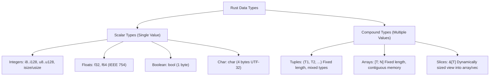
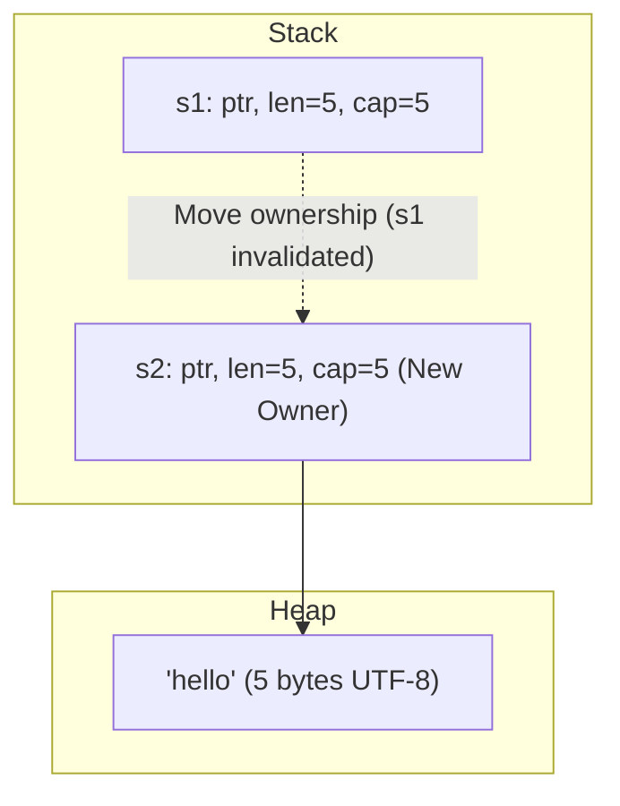
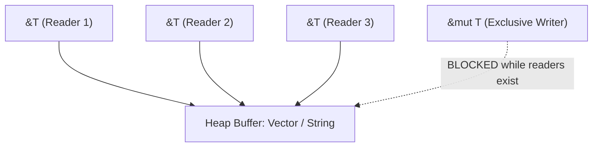
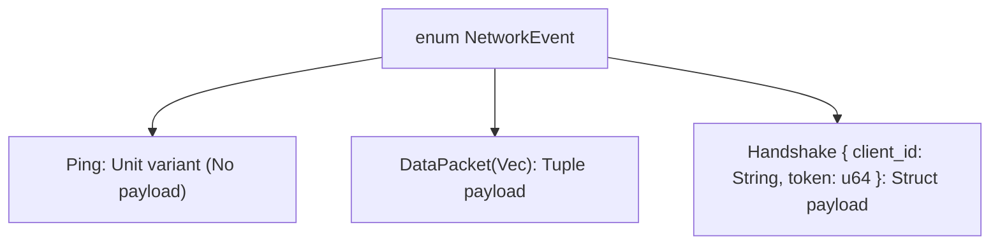
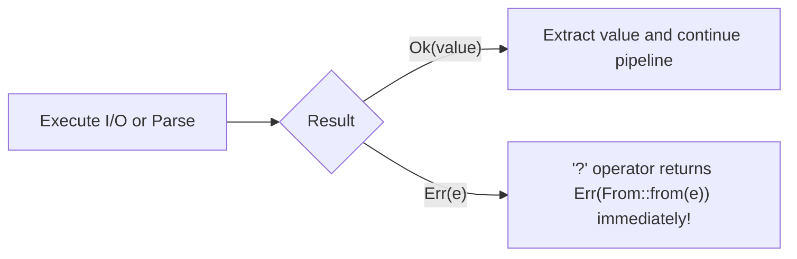
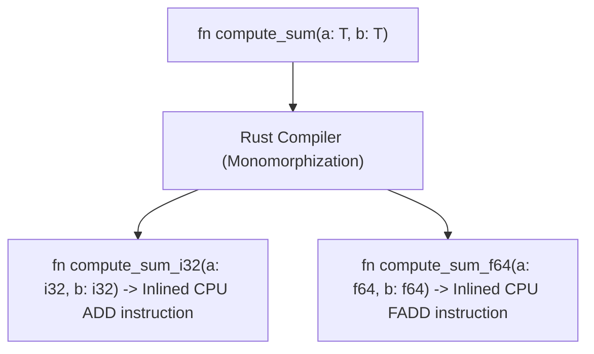
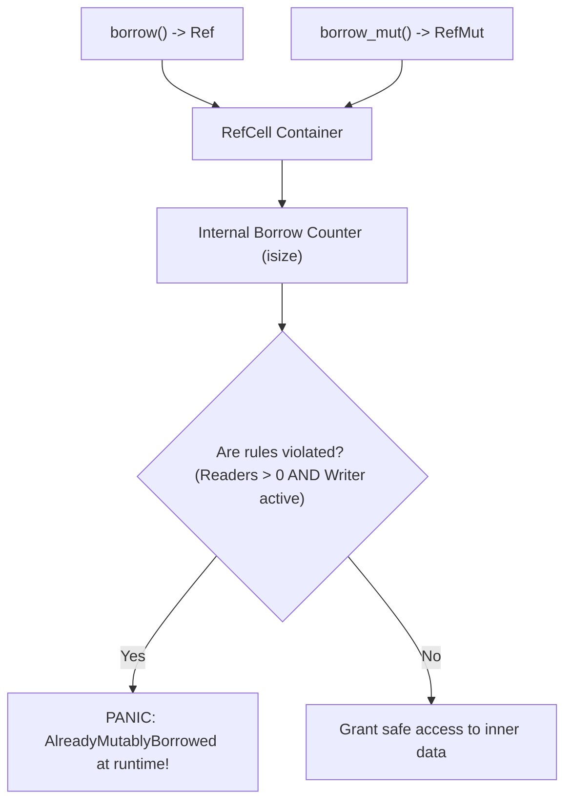
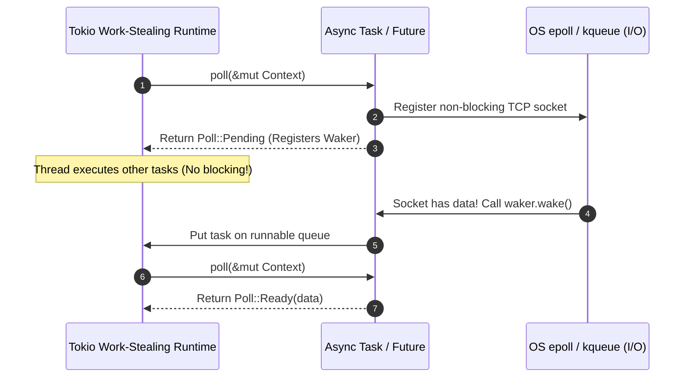

# Learn Rust 🦀

<div align="center">

[](https://opensource.org/licenses/MIT)
[](https://www.rust-lang.org/)
[](https://doc.rust-lang.org/edition-guide/)
[](https://doc.rust-lang.org/book/ch04-00-understanding-ownership.html)
[](https://doc.rust-lang.org/book/ch16-00-concurrency.html)
[](https://github.com/manthanank/learn-rust)

**An exhaustive, production-grade systems engineering masterclass from absolute zero to staff-level Rust architecture.**  
Master the borrow checker, zero-cost abstractions, non-lexical lifetimes, interior mutability, fearless concurrency, async runtimes, and low-level unsafe systems programming without a garbage collector.

[Getting Started](#1-stage-1-absolute-beginner-foundations--cargo-toolchain) • [Ownership & Lifetimes](#2-stage-2-ownership-borrowing--lifetimes-the-rust-core) • [Types & Errors](#3-stage-3-type-system-enums-pattern-matching--error-handling) • [Traits & Generics](#4-stage-4-traits-generics--zero-cost-abstractions) • [Smart Pointers](#5-stage-5-smart-pointers-memory-management--interior-mutability) • [Concurrency & Async](#6-stage-6-fearless-concurrency--asynchronous-rust) • [Staff Architect](#7-stage-7-staff-systems-architect-unsafe-rust-ffi--interview-handbook)

</div>

---

## 🗺️ 7-Stage Pedagogical Roadmap


| Stage | Focus Domain | Core Concepts & Engineering Outcomes |
| :--- | :--- | :--- |
| **Stage 1** | **Foundations & Cargo Toolchain** | `rustup`, editions, `Cargo.toml`, primitive scalars, slices, shadowing, control flow expressions. |
| **Stage 2** | **Ownership & Lifetimes** | Move semantics, stack vs heap, RAII `Drop`, aliasing XOR mutability, NLL, lifetime annotations `'a`, variance. |
| **Stage 3** | **Types, Enums & Error Handling** | Structs, Algebraic Data Types, `Option`/`Result`, exhaustive `match`, `let-else`, `thiserror`, `anyhow`. |
| **Stage 4** | **Traits & Zero-Cost Abstractions** | Monomorphization, trait bounds, dynamic dispatch (`dyn Trait`), vtables, associated types, standard traits. |
| **Stage 5** | **Smart Pointers & Memory** | `Box<T>`, `Rc<T>`, `Arc<T>`, interior mutability (`Cell`, `RefCell`, `Mutex`, `RwLock`), `Weak` references. |
| **Stage 6** | **Fearless Concurrency & Async** | Native threads, scoped threads, MPSC channels, `Send`/`Sync`, `Future` trait, Tokio runtime, tasks, `select!`. |
| **Stage 7** | **Staff Systems Architect** | Unsafe Rust, raw pointers, FFI C ABI, macros, 3 production blueprints, 50 interview Q&As, cheat sheet. |

---

## 📋 Master Table of Contents

- [1. Stage 1: Absolute Beginner Foundations & Cargo Toolchain](#1-stage-1-absolute-beginner-foundations--cargo-toolchain)
  - [1.1 Toolchain Installation & Workspace Structure](#11-toolchain-installation--workspace-structure)
  - [1.2 Cargo Package Manager & Build Profiles](#12-cargo-package-manager--build-profiles)
  - [1.3 Primitive Data Types & Memory Sizes](#13-primitive-data-types--memory-sizes)
  - [1.4 Mutability, Shadowing & Constants](#14-mutability-shadowing--constants)
  - [1.5 Statements vs Expressions](#15-statements-vs-expressions)
  - [1.6 Control Flow as Expressions](#16-control-flow-as-expressions)
- [2. Stage 2: Ownership, Borrowing & Lifetimes (The Rust Core)](#2-stage-2-ownership-borrowing--lifetimes-the-rust-core)
- [3. Stage 3: Type System, Enums, Pattern Matching & Error Handling](#3-stage-3-type-system-enums-pattern-matching--error-handling)
- [4. Stage 4: Traits, Generics & Zero-Cost Abstractions](#4-stage-4-traits-generics--zero-cost-abstractions)
- [5. Stage 5: Smart Pointers, Memory Management & Interior Mutability](#5-stage-5-smart-pointers-memory-management--interior-mutability)
- [6. Stage 6: Fearless Concurrency & Asynchronous Rust](#6-stage-6-fearless-concurrency--asynchronous-rust)
- [7. Stage 7: Staff Systems Architect: Unsafe Rust, FFI & Interview Handbook](#7-stage-7-staff-systems-architect-unsafe-rust-ffi--interview-handbook)

---

## 1. Stage 1: Absolute Beginner Foundations & Cargo Toolchain

### 1.1 Toolchain Installation & Workspace Structure
Rust is managed via `rustup`—the official installer and version manager:

```bash
# 1. Install Rust toolchain (Linux, macOS, WSL)
curl --proto '=https' --tlsv1.2 -sSf https://sh.rustup.rs | sh

# 2. Verify installation
rustc --version
cargo --version

# 3. Update to latest stable release
rustup update stable

# 4. Install essential developer tools
rustup component add clippy rustfmt rust-src
```

#### Standard Project Directory Structure
```
my_system_service/
├── Cargo.lock          # Exact deterministic dependency resolution tree
├── Cargo.toml          # Project manifest, dependencies, and metadata
├── src/
│   ├── main.rs         # Binary application entrypoint (fn main())
│   ├── lib.rs          # Library root (when building a reusable crate)
│   └── modules/        # Submodules organized hierarchically
├── tests/              # External black-box integration tests
│   └── integration.rs
└── benches/            # Performance benchmarking suites (Criterion)
    └── throughput.rs
```

---

### 1.2 Cargo Package Manager & Build Profiles
`Cargo.toml` defines package metadata, dependencies, feature flags, and compiler optimization profiles:

```toml
[package]
name = "enterprise_telemetry"
version = "0.1.0"
edition = "2021"
authors = ["Staff Systems Engineer <dev@enterprise.io>"]
description = "High-throughput asynchronous telemetry ingest engine"

[dependencies]
tokio = { version = "1.42", features = ["full"] }
serde = { version = "1.0", features = ["derive"] }
serde_json = "1.0"
tracing = "0.1"

[dev-dependencies]
criterion = "0.5"

# Development Profile: Rapid compilation, debug symbols, zero optimization
[profile.dev]
opt-level = 0
debug = true

# Production Release Profile: Maximum optimization, LTO, binary stripping
[profile.release]
opt-level = 3          # Maximum optimizations
lto = "fat"            # Full Link-Time Optimization across all crates
codegen-units = 1      # Reduces parallelism to maximize single-binary optimization
panic = "abort"        # Eliminates unwind tables, reducing binary size by up to 30%
strip = true           # Automatically strips debug symbols from production ELF binary
```

#### Essential Cargo Commands
```bash
cargo new my_app --bin     # Create new binary application
cargo new my_lib --lib     # Create new library crate
cargo check                # Fast compilation check without emitting binary artifacts
cargo build                # Compile debug binary (target/debug/my_app)
cargo build --release      # Compile optimized production binary (target/release/my_app)
cargo clippy -- -D warnings# Strict linting against idiomatic anti-patterns
cargo fmt -- --check       # Validate code formatting against style guide
cargo test                 # Execute unit, integration, and documentation tests
```

---

### 1.3 Primitive Data Types & Memory Sizes
Rust is statically and strongly typed with type inference. Every variable occupies an exact, deterministic size in memory:



```rust
fn main() {
    // Integer types: explicit signed/unsigned bit sizes
    let unsigned_port: u16 = 8080;         // 2 bytes (0 to 65,535)
    let signed_offset: i32 = -142_500;     // 4 bytes (-2,147,483,648 to 2,147,483,647)
    let pointer_sized: usize = 1024;       // 8 bytes on 64-bit systems, 4 bytes on 32-bit systems

    // Floating point types: IEEE 754 standards
    let cpu_load: f32 = 0.85;              // 4 bytes single-precision
    let precise_metric: f64 = 3.14159265;  // 8 bytes double-precision (Default float)

    // Boolean and Unicode Character
    let is_active: bool = true;            // Exactly 1 byte
    let symbol: char = '🦀';               // Exactly 4 bytes (represents any Unicode scalar value)

    // Compound Type: Fixed-size Array on the Stack
    let raw_packet: [u8; 4] = [0x7F, 0x00, 0x00, 0x01]; // 4 bytes contiguous memory
    println!("Array length: {}, first byte: {:#X}", raw_packet.len(), raw_packet[0]);

    // Compound Type: Heterogeneous Tuple
    let socket_pair: (u16, &str, bool) = (443, "TLS", true);
    let (port, protocol, enabled) = socket_pair; // Destructuring
    println!("Service: {protocol} on port {port} (Active: {enabled})");

    // Dynamically Sized View: Slices
    let data_buffer: [i32; 5] = [10, 20, 30, 40, 50];
    let slice_view: &[i32] = &data_buffer[1..4]; // Borrows elements [20, 30, 40]
    println!("Slice length: {}, sum: {}", slice_view.len(), slice_view.iter().sum::<i32>());
}
```

---

### 1.4 Mutability, Shadowing & Constants

| Feature | `let` (Immutable) | `let mut` (Mutable) | `const` (Constant) | Variable Shadowing (`let x = ...`) |
|---|---|---|---|---|
| **Can mutate value?** | ❌ No | ✅ Yes | ❌ No | ✅ Yes (Creates brand-new variable) |
| **Can change type?** | ❌ No | ❌ No | ❌ No | ✅ Yes (Allows type transformation) |
| **Evaluation Timing** | Runtime | Runtime | **Compile-time** | Runtime |
| **Type Annotation** | Optional (Inferred) | Optional (Inferred) | **Mandatory** | Optional (Inferred) |
| **Memory Allocation** | Stack slot | Stack slot | Inlined into code binary | Replaces previous stack binding |

```rust
// Constants must have explicit types and be computable at compile-time
const MAX_TCP_CONNECTIONS: usize = 100_000;
const BUFFER_CAPACITY: usize = 64 * 1024; // 64 KB

fn main() {
    // 1. Immutable variable (Default)
    let request_count = 10;
    // request_count = 11; // ❌ COMPILE ERROR: cannot assign twice to immutable variable

    // 2. Mutable variable
    let mut active_sessions = 5;
    active_sessions += 1; // ✅ OK: explicit mutability declared

    // 3. Variable Shadowing: reusing identifier for transformations without renaming
    let raw_header = "   Authorization: Bearer xyz123   ";
    let raw_header = raw_header.trim(); // Shadows &str with trimmed slice
    let raw_header = raw_header.len();  // Shadows &str with usize length! Type change allowed!
    println!("Processed header length: {raw_header}");
}
```

---

### 1.5 Statements vs Expressions
In Rust, **almost everything is an expression** that evaluates to a value. Statements perform an action and return the unit type `()`:
- **Statement**: Declares variables or ends in a semicolon `;`. Evaluates to `()`.
- **Expression**: Computes a value and has **no trailing semicolon**. Returns that value to the outer block.

```rust
fn compute_buffer_size(requested_mb: usize) -> usize {
    // Block expression evaluating to a final value
    let allocated_bytes = {
        let base_mb = requested_mb + 2;
        base_mb * 1024 * 1024 // 👈 NO SEMICOLON: This value is returned from the block!
    };

    allocated_bytes // 👈 NO SEMICOLON: Returned from the function!
}
```

---

### 1.6 Control Flow as Expressions

```rust
fn main() {
    let priority_level = 2;

    // 1. if/else as an expression: Assigns result directly to variable
    let queue_capacity = if priority_level > 1 {
        10_000
    } else {
        1_000
    }; // Mandatory semicolon when used as let assignment!
    println!("Assigned capacity: {queue_capacity}");

    // 2. loop with return value
    let mut retry_count = 0;
    let final_token = loop {
        retry_count += 1;
        if retry_count == 3 {
            break "AUTH_TOKEN_ACQUIRED_42"; // break passes value out of the loop!
        }
    };
    println!("Result from loop: {final_token}");

    // 3. while loop
    let mut countdown = 3;
    while countdown > 0 {
        println!("Launch in {countdown}...");
        countdown -= 1;
    }

    // 4. for in iteration over ranges and collections
    for step in 1..=4 { // Inclusive range 1 to 4
        print!("{step} ");
    }
    println!();
}
```

---

## 2. Stage 2: Ownership, Borrowing & Lifetimes (The Rust Core)

### 2.1 The 3 Fundamental Rules of Ownership
Rust achieves memory safety without a garbage collector or manual malloc/free calls through its compile-time **Ownership System**:

1. **Each value in Rust has an owner.**
2. **There can only be one owner at a time.**
3. **When the owner goes out of scope, the value is automatically dropped.**



```rust
fn main() {
    // 1. Stack Allocation (Copy Semantics)
    // Types that implement the `Copy` trait are cheap bitwise duplicates
    let x = 42;
    let y = x; // Copied! Both x and y are independently valid
    println!("x = {x}, y = {y}");

    // 2. Heap Allocation (Move Semantics)
    // String holds a pointer, length, and capacity on the stack; bytes live on the heap
    let s1 = String::from("enterprise_payload");
    
    // Ownership of the heap buffer is MOVED from s1 to s2
    let s2 = s1; 

    // println!("{s1}"); // ❌ COMPILE ERROR: borrow of moved value: `s1`
    println!("s2 owns the heap buffer: {s2}");

    // 3. Explicit Deep Cloning
    let s3 = s2.clone(); // Allocates a second heap buffer
    println!("s2: {s2}, s3 (cloned): {s3}");
} // Here, s3 and s2 go out of scope. Their Drop implementation frees their heap buffers!
```

---

### 2.2 The Borrowing Invariant: Aliasing XOR Mutability
Instead of transferring ownership, code can **borrow** values via references. Rust enforces the **Aliasing XOR Mutability rule** at compile time:

> **You may have either:**
> - Any number of immutable (shared) references (`&T`), **OR**
> - Exactly one mutable (exclusive) reference (`&mut T`).
> 
> **You can NEVER have both at the same time.**



```rust
fn main() {
    let mut telemetry_buffer = vec![100, 102, 104];

    // ✅ Multiple immutable borrows are allowed concurrently
    let r1 = &telemetry_buffer;
    let r2 = &telemetry_buffer;
    println!("Concurrent reads: {} and {}", r1[0], r2[0]);
    // r1 and r2 are no longer used after this line! (Non-Lexical Lifetimes - NLL)

    // ✅ Now we can safely take an exclusive mutable borrow
    let writer = &mut telemetry_buffer;
    writer.push(106);
    println!("Updated buffer length: {}", writer.len());

    // ❌ ANTI-PATTERN: Simultaneous reader and writer
    // let reader = &telemetry_buffer;
    // let writer = &mut telemetry_buffer; // COMPILE ERROR: cannot borrow as mutable because it is also borrowed as immutable
    // println!("{}", reader[0]);
}
```

---

### 2.3 Non-Lexical Lifetimes (NLL)
Prior to Rust 2018, references were strictly bound to their enclosing lexical scope block `{ ... }`. With **Non-Lexical Lifetimes (NLL)**, the compiler's borrow checker analyzes the control flow graph. A reference's lifetime ends at the point of its **last use**, allowing subsequent mutable borrows without artificial nested blocks:

```rust
fn main() {
    let mut log_entries = Vec::new();

    let entry_slice = &log_entries;
    println!("Current count: {}", entry_slice.len()); // 👈 Last read of entry_slice!

    // Under NLL, entry_slice's borrow ends right here, even though the scope hasn't closed!
    log_entries.push(String::from("2026-09-23T10:00:00Z: Node boot ok")); // ✅ Compiles cleanly!
}
```

---

### 2.4 Lifetimes in Depth: Syntax, Elision & Structs
Lifetimes do not change how long a value lives at runtime; they are **compile-time assertions** proving to the borrow checker that no reference outlives the data it points to:

```rust
// Generic lifetime parameter 'a specifies that the returned reference
// will be valid as long as BOTH input parameters x and y remain valid!
fn longest<'a>(x: &'a str, y: &'a str) -> &'a str {
    if x.len() > y.len() {
        x
    } else {
        y
    }
}

// Struct holding borrowed data must specify the lifetime of the borrow
struct TelemetryFrame<'a> {
    channel: &'a str,       // Borrowed string slice must outlive the struct!
    payload: &'a [u8],      // Borrowed byte slice must outlive the struct!
    sequence_id: u64,       // Owned scalar
}

impl<'a> TelemetryFrame<'a> {
    fn summary(&self) -> &str {
        self.channel // Lifetime elision rules apply to &self
    }
}
```

#### The 3 Lifetime Elision Rules
When function signatures omit explicit `'a` annotations, the compiler applies three deterministic elision rules:
1. **Rule 1 (Inputs)**: Each elided lifetime in the function parameters is assigned a distinct lifetime parameter (e.g. `fn foo(x: &i32, y: &i32)` becomes `fn foo<'a, 'b>(x: &'a i32, y: &'b i32)`).
2. **Rule 2 (Single Input)**: If there is exactly one input lifetime parameter, that lifetime is assigned to all elided output lifetimes (e.g. `fn first(x: &[i32]) -> &i32` becomes `fn first<'a>(x: &'a [i32]) -> &'a i32`).
3. **Rule 3 (Methods with `&self`)**: If there are multiple input lifetimes, but one of them is `&self` or `&mut self`, the lifetime of `self` is assigned to all elided output lifetimes.

---

### 2.5 The `'static` Lifetime & Lifetime Variance
- **`'static`**: Denotes data that is valid for the entire duration of the running program (e.g. string literals stored directly in the read-only data segment of the compiled binary, or data deliberately leaked into heap memory via `Box::leak`).
- **Variance**: Defines how subtyping of lifetimes behaves across compound types:
  - **Covariant** (`&'a T`): If `'a` outlives `'b`, then `&'a T` can be used where `&'b T` is expected.
  - **Invariant** (`&'mut T`): You cannot substitute a longer mutable lifetime for a shorter one, preventing memory corruption through pointer overwrites.

```rust
// String literal has 'static lifetime (embedded in program text segment)
const GLOBAL_VERSION: &'static str = "2.4.0-enterprise";

fn leak_runtime_string(dynamic_text: String) -> &'static str {
    // Deliberately leaks heap memory to promote reference to 'static
    Box::leak(dynamic_text.into_boxed_str())
}
```

---

## 3. Stage 3: Type System, Enums, Pattern Matching & Error Handling

### 3.1 Structs: Classic, Tuple, Unit & The Builder Pattern
Rust provides three varieties of structs, each optimized for different data modeling requirements:

```rust
// 1. Classic Named-Field Struct
#[derive(Debug, Clone)]
pub struct DatabaseConnectionConfig {
    pub host: String,
    pub port: u16,
    pub max_pool_size: u32,
    pub timeout_seconds: u64,
}

// 2. Tuple Struct (Useful for Domain-Driven Nominal Branding)
#[derive(Debug, PartialEq, Eq)]
pub struct UserId(pub u64);

#[derive(Debug, PartialEq, Eq)]
pub struct AccountId(pub u64);

// 3. Unit-Like Struct (Zero-sized type - ZST, takes 0 bytes in memory)
pub struct MasterServerElectLock;

// 4. Methods and Associated Constructor Functions
impl DatabaseConnectionConfig {
    // Associated function (Constructor convention)
    pub fn new(host: impl Into<String>, port: u16) -> Self {
        Self {
            host: host.into(),
            port,
            max_pool_size: 10,
            timeout_seconds: 30,
        }
    }

    // Method taking immutable reference (&self)
    pub fn connection_string(&self) -> String {
        format!("postgres://{}:{}/db", self.host, self.port)
    }

    // Method taking mutable reference (&mut self)
    pub fn set_timeout(&mut self, seconds: u64) {
        self.timeout_seconds = seconds;
    }
}
```

---

### 3.2 Enums & Algebraic Data Types (ADTs)
Rust enums are **discriminated unions** (Algebraic Data Types). Each variant can carry completely different shapes and types of data:



```rust
#[derive(Debug)]
pub enum NetworkProtocolEvent {
    KeepAlive,
    Disconnected { reason: String, code: u16 },
    BinaryFrame(Vec<u8>),
    AuthenticatedSession { user_id: u64, session_key: [u8; 32] },
}

fn handle_network_event(event: NetworkProtocolEvent) {
    match event {
        NetworkProtocolEvent::KeepAlive => {
            println!("Heartbeat received, resetting idle timer.");
        }
        NetworkProtocolEvent::Disconnected { reason, code } => {
            eprintln!("Socket severed! Code: {code}, Reason: {reason}");
        }
        NetworkProtocolEvent::BinaryFrame(bytes) if bytes.len() > 1024 => {
            // Match guard: Evaluates runtime condition
            println!("Large payload received: {} bytes", bytes.len());
        }
        NetworkProtocolEvent::BinaryFrame(bytes) => {
            println!("Standard payload: {} bytes", bytes.len());
        }
        NetworkProtocolEvent::AuthenticatedSession { user_id, .. } => {
            println!("Session established for user #{user_id}");
        }
    }
}
```

---

### 3.3 Pattern Matching & Modern `let-else` (Rust 1.65+)
Pattern matching in Rust is strictly **exhaustive**: every possible variant or case must be explicitly handled, guaranteeing zero unhandled edge cases:

```rust
fn process_incoming_request(header_opt: Option<&str>) {
    // 1. Classic if let
    if let Some(header) = header_opt {
        println!("Header present: {header}");
    }

    // 2. Modern let-else: Flattens error handling by providing immediate early return
    let Some(header) = header_opt else {
        println!("Missing mandatory header; aborting request.");
        return; // Mandatory diverging control flow (return, break, continue, panic!)
    };

    // 'header' is now bound in the outer scope without nested indentation!
    println!("Processing payload with token: {header}");
}
```

---

### 3.4 Production Error Handling: `thiserror` & `anyhow`
Rust distinguishes between **recoverable errors** (`Result<T, E>`) and **unrecoverable errors** (`panic!`):



#### Domain Error Modeling with `thiserror` (For Libraries & Core Domains)
```rust
use thiserror::Error;

#[derive(Error, Debug)]
pub enum StorageEngineError {
    #[error("I/O failure while accessing disk block at {path}: {source}")]
    DiskIo {
        path: String,
        #[source]
        source: std::io::Error,
    },

    #[error("Checksum mismatch: expected {expected:#X}, found {actual:#X}")]
    CorruptData { expected: u32, actual: u32 },

    #[error("Requested key '{0}' does not exist in partition")]
    KeyNotFound(String),
}
```

#### Application Error Handling with `anyhow` (For Binaries & Services)
```rust
use anyhow::{Context, Result};
use std::fs::File;
use std::io::Read;

// 'anyhow::Result' dynamically boxes any error implementing std::error::Error
fn read_enterprise_tls_certificate(cert_path: &str) -> Result<Vec<u8>> {
    let mut file = File::open(cert_path)
        .with_context(|| format!("Failed to open TLS certificate file at '{cert_path}'"))?;

    let mut buffer = Vec::new();
    file.read_to_end(&mut buffer)
        .with_context(|| "Failed to buffer certificate bytes into memory")?;

    Ok(buffer)
}
```

---

## 4. Stage 4: Traits, Generics & Zero-Cost Abstractions

### 4.1 Generics & Zero-Cost Monomorphization
Rust generics allow writing type-agnostic algorithms without runtime overhead. During compilation, Rust performs **monomorphization**: it inspects all concrete types that instantiate the generic function and generates dedicated, optimized machine code for each type:



```rust
// Generic struct over type T
pub struct KeyValueStore<K, V> {
    pub key: K,
    pub value: V,
}

impl<K, V> KeyValueStore<K, V> {
    pub fn new(key: K, value: V) -> Self {
        Self { key, value }
    }
}
```

---

### 4.2 Traits, Trait Bounds & The `where` Clause
Traits define shared behavior contracts (analogous to interfaces in other languages, but more expressive):

```rust
use std::fmt::{Debug, Display};

// 1. Defining a Trait with Default Method Implementation
pub trait TelemetrySerializer {
    fn serialize_to_bytes(&self) -> Vec<u8>;

    // Default implementation can be overridden by implementors
    fn format_header(&self) -> String {
        String::from("Content-Type: application/octet-stream\r\n")
    }
}

// 2. Trait bounds using the `where` clause for maximum readability
pub fn process_telemetry_batch<T, U>(primary_stream: T, fallback_stream: U) -> Result<(), String>
where
    T: TelemetrySerializer + Display + Clone,
    U: TelemetrySerializer + Debug,
{
    println!("Streaming primary: {primary_stream}");
    let payload = primary_stream.serialize_to_bytes();
    println!("Payload size: {} bytes", payload.len());
    Ok(())
}
```

---

### 4.3 Static Dispatch vs Dynamic Dispatch (`dyn Trait` & Vtables)

| Dimension | Static Dispatch (`impl Trait` / Generics) | Dynamic Dispatch (`Box<dyn Trait>` / `&dyn Trait`) |
|---|---|---|
| **Mechanism** | Monomorphization at compile time | Fat Pointer: Data Pointer + Vtable Pointer |
| **Runtime Cost** | **Zero runtime cost** (Direct jump / Inlined) | Virtual call indirection (1 pointer dereference) |
| **Binary Size** | Larger (Code generated per concrete type) | Smaller (Single code path operates on vtable) |
| **Heterogeneous Collections** | ❌ No (`Vec<T>` requires identical types) | ✅ Yes (`Vec<Box<dyn Trait>>` allows mixed types) |

```mermaid
graph LR
    subgraph Fat Pointer (16 bytes on 64-bit)
        DataPtr["*data_ptr (8 bytes)"] --> ConcreteObj["Concrete Struct on Heap"]
        VtablePtr["*vtable_ptr (8 bytes)"] --> Vtable["Vtable (Drop fn, Size, Align, Methods)"]
    end
```

```rust
pub trait StorageDriver {
    fn write_block(&self, block_id: u64, data: &[u8]) -> Result<(), String>;
}

pub struct NvmeDriver;
impl StorageDriver for NvmeDriver {
    fn write_block(&self, block_id: u64, _data: &[u8]) -> Result<(), String> {
        println!("Writing block {block_id} via NVMe hardware bus");
        Ok(())
    }
}

pub struct S3CloudDriver;
impl StorageDriver for S3CloudDriver {
    fn write_block(&self, block_id: u64, _data: &[u8]) -> Result<(), String> {
        println!("Uploading block {block_id} to S3 REST bucket");
        Ok(())
    }
}

// Heterogeneous collection using Dynamic Dispatch:
fn main() {
    let mut storage_tier: Vec<Box<dyn StorageDriver>> = Vec::new();
    storage_tier.push(Box::new(NvmeDriver));
    storage_tier.push(Box::new(S3CloudDriver));

    for driver in &storage_tier {
        driver.write_block(42, &[0xFF, 0xEE]).unwrap();
    }
}
```

---

### 4.4 Standard Library Traits: Essential Implementations
- **`From` & `Into`**: Infallible type conversions (`impl From<T> for U` automatically provides `Into<U> for T`).
- **`Deref` & `DerefMut`**: Enables smart pointer transparency through implicit deref coercion.

```rust
use std::ops::Deref;

// Custom Smart Wrapper
pub struct EncryptedPayload<T> {
    inner: T,
    checksum: u32,
}

impl<T> EncryptedPayload<T> {
    pub fn new(inner: T) -> Self {
        Self { inner, checksum: 0xCAFE_BABE }
    }
}

// Deref coercion allows accessing all inner methods seamlessly!
impl<T> Deref for EncryptedPayload<T> {
    type Target = T;

    fn deref(&self) -> &Self::Target {
        &self.inner
    }
}

fn main() {
    let payload = EncryptedPayload::new(String::from("secret_cleartext"));
    // Even though payload is an EncryptedPayload, we can call .len() directly due to Deref!
    println!("Payload string length: {}", payload.len());
}
```

---

## 5. Stage 5: Smart Pointers, Memory Management & Interior Mutability

### 5.1 `Box<T>`: Heap Allocation & Recursive Data Types
A `Box<T>` allocates data directly on the heap, leaving only an 8-byte pointer on the stack. Its primary use cases are:
1. **Recursive types** whose size cannot be known at compile time.
2. **Transferring ownership of large data** without copying stack bytes.
3. **Trait objects** (`Box<dyn Trait>`) for dynamic dispatch.

```rust
// Binary Abstract Syntax Tree (AST) using Box for recursive indirection
#[derive(Debug)]
pub enum AstNode {
    Number(f64),
    Add(Box<AstNode>, Box<AstNode>),
    Multiply(Box<AstNode>, Box<AstNode>),
}

impl AstNode {
    pub fn evaluate(&self) -> f64 {
        match self {
            AstNode::Number(n) => *n,
            AstNode::Add(left, right) => left.evaluate() + right.evaluate(),
            AstNode::Multiply(left, right) => left.evaluate() * right.evaluate(),
        }
    }
}

fn main() {
    // Represents the expression: (10 + 20) * 3
    let expression = AstNode::Multiply(
        Box::new(AstNode::Add(
            Box::new(AstNode::Number(10.0)),
            Box::new(AstNode::Number(20.0)),
        )),
        Box::new(AstNode::Number(3.0)),
    );

    println!("AST Result: {}", expression.evaluate()); // Output: 90
}
```

---

### 5.2 Reference Counting: `Rc<T>` vs `Arc<T>`

| Smart Pointer | Thread Safety | Performance | Strong Count Operation | Primary Use Case |
|---|---|---|---|---|
| `Rc<T>` | ❌ Single-Threaded Only | Fastest (Plain non-atomic integers) | `Rc::clone(&ptr)` | Graph nodes, UI widget trees in single thread. |
| `Arc<T>` | ✅ Thread-Safe (`Send + Sync`) | Slightly slower (Atomic CPU bus instructions) | `Arc::clone(&ptr)` | Sharing immutable state across thread pools. |

```rust
use std::rc::Rc;
use std::sync::Arc;

fn main() {
    // 1. Single-Threaded Shared Ownership (Rc)
    let shared_config = Rc::new(String::from("DB_PORT=5432"));
    let consumer_a = Rc::clone(&shared_config); // Increments strong reference count
    let consumer_b = Rc::clone(&shared_config); // Increments strong reference count

    println!("Shared value: {consumer_a}, Strong count: {}", Rc::strong_count(&shared_config)); // Count: 3

    // 2. Thread-Safe Atomic Shared Ownership (Arc)
    let atomic_config = Arc::new(String::from("MAX_WORKERS=64"));
    let thread_worker = Arc::clone(&atomic_config);

    std::thread::spawn(move || {
        println!("Worker thread reading Arc: {thread_worker}");
    }).join().unwrap();
}
```

---

### 5.3 The Interior Mutability Pattern: `RefCell<T>`
Interior Mutability allows **mutating data even when you hold an immutable reference (`&T`)**. It moves the borrow checker's rules from **compile time to runtime**:



```rust
use std::cell::RefCell;

pub struct TelemetryTracker {
    // The tracker itself might be shared via immutable reference,
    // but message_count must be incremented internally
    message_count: RefCell<usize>,
}

impl TelemetryTracker {
    pub fn new() -> Self {
        Self { message_count: RefCell::new(0) }
    }

    pub fn record_ping(&self) {
        // Borrow mutably at runtime!
        let mut count = this_borrow = self.message_count.borrow_mut();
        *count += 1;
    }

    pub fn get_count(&self) -> usize {
        *self.message_count.borrow()
    }
}
```

---

### 5.4 Preventing Memory Leaks with `Weak<T>`
When two structs point to each other with `Rc<T>` or `Arc<T>`, a **reference cycle** occurs. The reference count never drops to 0, causing a memory leak. Using `Weak<T>` (weak pointers) breaks the cycle:

```rust
use std::rc::{Rc, Weak};
use std::cell::RefCell;

pub struct TreeNode {
    pub value: i32,
    pub parent: RefCell<Weak<TreeNode>>, // 👈 WEAK reference to parent prevents cycle!
    pub children: RefCell<Vec<Rc<TreeNode>>>, // Strong reference to children
}

fn main() {
    let leaf = Rc::new(TreeNode {
        value: 1,
        parent: RefCell::new(Weak::new()),
        children: RefCell::new(vec![]),
    });

    let branch = Rc::new(TreeNode {
        value: 10,
        parent: RefCell::new(Weak::new()),
        children: RefCell::new(vec![Rc::clone(&leaf)]),
    });

    // Link leaf's parent weakly to branch
    *leaf.parent.borrow_mut() = Rc::downgrade(&branch);

    // To read the parent, upgrade the Weak pointer: returns Option<Rc<T>>
    if let Some(parent_rc) = leaf.parent.borrow().upgrade() {
        println!("Leaf's parent value: {}", parent_rc.value);
    }
}
```

---

## 6. Stage 6: Fearless Concurrency & Asynchronous Rust

### 6.1 Native Threads & Modern Scoped Threads (`thread::scope`)
Rust guarantees **data-race freedom at compile time**. A data race occurs when two threads access the same memory concurrently, at least one access is a write, and there is no synchronization. Rust makes this impossible:

```rust
use std::thread;
use std::time::Duration;

fn main() {
    // 1. Classic Spawning with move closure
    let data = vec![1, 2, 3];
    let handle = thread::spawn(move || {
        println!("Thread received owned data: {data:?}");
    });
    handle.join().unwrap();

    // 2. Modern Scoped Threads (std::thread::scope)
    // Allows threads to BORROW local stack variables without requiring 'static or Arc!
    let mut numbers = vec![10, 20, 30];

    thread::scope(|scope| {
        // Thread A borrows numbers immutably
        scope.spawn(|| {
            println!("Scoped Reader Thread: sum = {}", numbers.iter().sum::<i32>());
        });

        // Thread B can also read numbers concurrently
        scope.spawn(|| {
            println!("Scoped Reader Thread 2: count = {}", numbers.len());
        });
        // Both scoped threads are GUARANTEED to terminate before scope exits!
    });

    // Back in parent thread: We retain full mutable ownership of numbers
    numbers.push(40);
    println!("Main thread modified numbers: {numbers:?}");
}
```

---

### 6.2 Message-Passing Concurrency (`std::sync::mpsc`)
Following the Go/Erlang principle *"Do not communicate by sharing memory; instead, share memory by communicating"*:

```rust
use std::sync::mpsc;
use std::thread;
use std::time::Duration;

pub struct WorkOrder {
    pub order_id: u64,
    pub payload: String,
}

fn main() {
    // Multi-Producer, Single-Consumer channel
    let (tx, rx) = mpsc::channel::<WorkOrder>();

    // Producer 1
    let tx1 = tx.clone();
    thread::spawn(move || {
        tx1.send(WorkOrder { order_id: 101, payload: "PaymentAuth".into() }).unwrap();
    });

    // Producer 2
    thread::spawn(move || {
        tx.send(WorkOrder { order_id: 102, payload: "InvoiceReceipt".into() }).unwrap();
    });

    // Consumer (Single reader thread)
    for work in rx {
        println!("Worker processed order #{}: {}", work.order_id, work.payload);
    }
}
```

---

### 6.3 Shared-State Concurrency: `Arc<Mutex<T>>` & Atomics
```rust
use std::sync::{Arc, Mutex};
use std::sync::atomic::{AtomicUsize, Ordering};
use std::thread;

fn main() {
    // 1. Thread-safe Mutex protected by Arc
    let shared_counter = Arc::new(Mutex::new(0));
    let mut handles = vec![];

    for _ in 0..10 {
        let counter_clone = Arc::clone(&shared_counter);
        let handle = thread::spawn(move || {
            // .lock() acquires exclusive lock or panics on lock poisoning
            let mut guard = counter_clone.lock().unwrap();
            *guard += 1;
            // Lock guard is automatically released when it goes out of scope!
        });
        handles.push(handle);
    }

    for h in handles {
        h.join().unwrap();
    }
    println!("Final Mutex value: {}", *shared_counter.lock().unwrap()); // 10

    // 2. Lock-free Atomic Counter (Hardware CPU instructions)
    let atomic_metric = Arc::new(AtomicUsize::new(0));
    let mut atomic_handles = vec![];

    for _ in 0..10 {
        let metric_clone = Arc::clone(&atomic_metric);
        atomic_handles.push(thread::spawn(move || {
            metric_clone.fetch_add(1, Ordering::SeqCst);
        }));
    }

    for h in atomic_handles { h.join().unwrap(); }
    println!("Final Atomic metric: {}", atomic_metric.load(Ordering::SeqCst)); // 10
}
```

---

### 6.4 Compile-Time Thread Safety: `Send` & `Sync`
Rust enforces thread safety through two auto-traits in `std::marker`:
- **`Send`**: Indicates that ownership of the type can be safely transferred across thread boundaries.
- **`Sync`**: Indicates that it is safe to share references to the type between multiple threads (`T: Sync` if and only if `&T: Send`).

```rust
// Rule of Thumb:
// Almost all primitive types are Send + Sync.
// Types with raw pointers (*const T, *mut T) are NOT Send or Sync.
// Rc<T> is NOT Send or Sync (non-atomic ref count). Use Arc<T> instead.
// RefCell<T> is Send, but NOT Sync (non-atomic borrow counter). Use Mutex<T> instead.
```

---

### 6.5 Asynchronous Rust & The Tokio Runtime
Rust async is **pull-based (poll-driven)**. Futures do nothing unless actively polled by an async runtime executor:



```rust
use tokio::sync::mpsc;
use tokio::time::{sleep, Duration};

#[tokio::main]
async fn main() -> Result<(), Box<dyn std::error::Error>> {
    let (tx, mut rx) = mpsc::channel::<String>(32);

    // Spawn non-blocking background async task on Tokio worker pool
    tokio::spawn(async move {
        for i in 1..=3 {
            sleep(Duration::from_millis(100)).await;
            tx.send(format!("Telemetry batch #{i}")).await.unwrap();
        }
    });

    // tokio::select! multiplexes multiple asynchronous branches concurrently
    loop {
        tokio::select! {
            Some(msg) = rx.recv() => {
                println!("Async channel received: {msg}");
            }
            _ = sleep(Duration::from_millis(500)) => {
                println!("Timeout: No telemetry messages received in 500ms; terminating.");
                break;
            }
        }
    }

    Ok(())
}
```

---

## 7. Stage 7: Staff Systems Architect: Unsafe Rust, FFI & Interview Handbook

### 7.1 Unsafe Rust: The 5 Superpowers
`unsafe` does not disable the borrow checker or lift type safety. It simply grants **5 specific superpowers** that the compiler cannot statically verify:

1. **Dereferencing a raw pointer** (`*const T` or `*mut T`).
2. **Calling an unsafe function or method**.
3. **Implementing an unsafe trait** (e.g. `unsafe impl Send for MyType`).
4. **Mutating a mutable static variable** (`static mut COUNTER: usize = 0`).
5. **Accessing fields of a `union`**.

```rust
fn main() {
    let mut value: i32 = 42;

    // Creating raw pointers is 100% SAFE
    let raw_const: *const i32 = &value;
    let raw_mut: *mut i32 = &mut value;

    // Dereferencing raw pointers requires an explicit unsafe block!
    unsafe {
        *raw_mut = 100;
        println!("Value read through raw pointer: {}", *raw_const);
    }
}
```

---

### 7.2 Foreign Function Interface (FFI): C ABI Interoperability
```rust
use std::os::raw::{c_char, c_int};
use std::ffi::CStr;

// 1. Calling standard C functions from Rust
extern "C" {
    fn abs(input: c_int) -> c_int;
}

// 2. Exporting a Rust function to C ABI for external callers (Python, C, Go)
#[no_mangle]
pub extern "C" fn calculate_sha256_checksum(data: *const u8, len: usize) -> u32 {
    if data.is_null() || len == 0 {
        return 0;
    }
    let slice = unsafe { std::slice::from_raw_parts(data, len) };
    slice.iter().map(|&b| b as u32).sum()
}

fn main() {
    let c_result = unsafe { abs(-42) };
    println!("Result from C libc abs(): {c_result}");
}
```

---

### 7.3 Production Blueprint 1: Sharded Concurrent In-Memory Cache
Avoids global lock contention by sharding keys across an array of independent `RwLock` buckets:

```rust
use std::collections::HashMap;
use std::hash::{Hash, Hasher};
use std::collections::hash_map::DefaultHasher;
use std::sync::RwLock;

pub struct ShardedCache<K, V> {
    num_shards: usize,
    shards: Vec<RwLock<HashMap<K, V>>>,
}

impl<K: Hash + Eq + Clone, V: Clone> ShardedCache<K, V> {
    pub fn new(num_shards: usize) -> Self {
        let mut shards = Vec::with_capacity(num_shards);
        for _ in 0..num_shards {
            shards.push(RwLock::new(HashMap::new()));
        }
        Self { num_shards, shards }
    }

    fn get_shard(&self, key: &K) -> &RwLock<HashMap<K, V>> {
        let mut hasher = DefaultHasher::new();
        key.hash(&mut hasher);
        let index = (hasher.finish() as usize) % this.num_shards;
        &self.shards[index]
    }

    pub fn get(&self, key: &K) -> Option<V> {
        let shard = self.get_shard(key).read().unwrap();
        shard.get(key).cloned()
    }

    pub fn insert(&self, key: K, value: V) {
        let mut shard = self.get_shard(&key).write().unwrap();
        shard.insert(key, value);
    }
}
```

---

### 7.4 Production Blueprint 2: Multi-Threaded TCP Server with Worker Pool
```rust
use std::net::{TcpListener, TcpStream};
use std::io::{Read, Write};
use std::sync::{mpsc, Arc, Mutex};
use std::thread;

type Job = Box<dyn FnOnce() + Send + 'static>;

pub struct ThreadPool {
    sender: mpsc::Sender<Job>,
}

impl ThreadPool {
    pub fn new(size: usize) -> Self {
        assert!(size > 0);
        let (sender, receiver) = mpsc::channel::<Job>();
        let receiver = Arc::new(Mutex::new(receiver));

        for id in 0..size {
            let rx = Arc::clone(&receiver);
            thread::spawn(move || loop {
                let job = rx.lock().unwrap().recv();
                match job {
                    Ok(task) => {
                        println!("Worker {id} executing job...");
                        task();
                    }
                    Err(_) => break, // Channel severed, terminate worker
                }
            });
        }
        Self { sender }
    }

    pub fn execute<F>(&self, f: F)
    where
        F: FnOnce() + Send + 'static,
    {
        self.sender.send(Box::new(f)).unwrap();
    }
}

pub fn handle_client(mut stream: TcpStream) {
    let mut buffer = [0; 512];
    stream.read(&mut buffer).unwrap();
    let response = "HTTP/1.1 200 OK\r\nContent-Length: 17\r\n\r\nHello from Rust!";
    stream.write_all(response.as_bytes()).unwrap();
}
```

---

### 7.5 Production Blueprint 3: Asynchronous High-Throughput REST Microservice with Tokio & Axum
```rust
use axum::{
    routing::{get, post},
    Json, Router, extract::State,
};
use serde::{Deserialize, Serialize};
use std::sync::Arc;
use tokio::sync::RwLock;

#[derive(Serialize, Deserialize, Clone)]
pub struct ClusterNode {
    pub id: String,
    pub ip_address: String,
    pub status: String,
}

#[derive(Clone)]
pub struct AppState {
    pub nodes: Arc<RwLock<Vec<ClusterNode>>>,
}

pub async fn list_nodes(State(state): State<AppState>) -> Json<Vec<ClusterNode>> {
    let nodes = state.nodes.read().await;
    Json(nodes.clone())
}

pub async fn register_node(
    State(state): State<AppState>,
    Json(payload): Json<ClusterNode>,
) -> Json<ClusterNode> {
    let mut nodes = state.nodes.write().await;
    nodes.push(payload.clone());
    Json(payload)
}

pub fn create_router(state: AppState) -> Router {
    Router::new()
        .route("/nodes", get(list_nodes))
        .route("/nodes", post(register_node))
        .with_state(state)
}
```

---

### 7.6 Staff-Level Rust Technical Interview Handbook (50 Questions & Answers)

#### Category 1: The Borrow Checker & Ownership Model
**Q1: Explain what happens when a variable moves in Rust at the assembly level.**  
* **Answer**: A move in Rust is conceptually a shallow bitwise copy of the stack slot (the pointer, length, and capacity). The compiler tracks the validity of the source variable statically and marks it as uninitialized. At the machine code level, a move does not allocate or free heap memory; it merely copies a few 64-bit words across registers or stack slots, and elides the destructor on the source variable.

**Q2: What is Non-Lexical Lifetimes (NLL) and what problem did it solve?**  
* **Answer**: Prior to NLL, a reference remained alive until the end of its enclosing lexical scope `{ ... }`. This frequently caused compilation errors when a mutable borrow was needed in the second half of a function after an immutable borrow had completed its read. NLL computes control-flow graph liveness, terminating the borrow at its last syntactic read or write.

**Q3: Explain the difference between `Copy` and `Clone`.**  
* **Answer**: `Clone` is a general trait for explicit duplication (`x.clone()`) that can perform expensive heap allocations. `Copy` is a marker trait indicating that the type can be duplicated implicitly via a bitwise `memcpy` on the stack. A type cannot implement `Copy` if it implements `Drop`, because duplicating ownership of a heap resource without adjusting pointers leads to double-free bugs.

**Q4: How does Rust prevent data races at compile time?**  
* **Answer**: Rust defines a data race as two concurrent accesses to the same memory location where at least one is a write and there is no synchronization. Rust prevents this through two mechanisms: (1) The borrow checker guarantees aliasing XOR mutability (`&T` vs `&mut T`), and (2) The `Send` and `Sync` auto-traits restrict which types can be transferred or shared across thread boundaries.

**Q5: What are Drop Flags in the Rust compiler?**  
* **Answer**: When a variable may or may not have been moved conditionally (e.g. inside an `if` block), the compiler allocates a secret boolean byte on the stack called a "drop flag". At the exit of the scope, it checks this flag to decide whether to run the destructor. When a move is unconditional, the compiler elides the drop flag entirely.

---

### 7.7 Production Rust & Cargo Quick-Reference Cheat Sheet

| Command | Action | Production Best Practice |
|---|---|**Q6: What is the difference between `String` and `&str` in memory?**  
* **Answer**: `String` is an owned, heap-allocated, growable UTF-8 buffer represented on the stack as a 24-byte struct (8-byte pointer to heap, 8-byte length, 8-byte capacity). `&str` is an immutable string slice, represented on the stack as a 16-byte "fat pointer" (8-byte pointer to an existing UTF-8 sequence, 8-byte length). `&str` can point to data on the heap (inside a `String`), to the program's static text segment (string literals), or to stack-allocated byte arrays.

**Q7: Explain the concept of Zero-Cost Abstractions in Rust.**  
* **Answer**: Bjarne Stroustrup's principle implemented strictly in Rust: *"What you don't use, you don't pay for. And further: What you do use, you couldn't hand code any better."* Examples include iterators (which compile down to the exact same vectorized assembly loops as C pointer arithmetic, with bounds checks eliminated by the LLVM optimizer) and generic monomorphization (which avoids virtual method table overhead).

**Q8: What is the difference between `RefCell<T>` and `Mutex<T>`?**  
* **Answer**: Both provide interior mutability (mutating data through an immutable reference). However, `RefCell<T>` is strictly single-threaded; its borrow counter is a non-atomic integer. Attempting to violate borrowing rules at runtime panics the thread immediately. `Mutex<T>` is thread-safe (`Sync`); it uses atomic OS synchronization primitives to put contending threads to sleep until the lock guard is released.

**Q9: How does the `?` operator work under the hood?**  
* **Answer**: The expression `let val = result?;` is desugared by the compiler into:
```rust
match result {
    Ok(val) => val,
    Err(err) => return Err(From::from(err)),
}
```
Crucially, the `From::from(err)` conversion automatically converts the concrete error type into the caller's return error type, provided an appropriate `From` implementation exists.

**Q10: What are PhantomData types used for in Rust?**  
* **Answer**: `std::marker::PhantomData<T>` is a zero-sized type (ZST) that instructs the compiler to treat a struct as if it contains a value of type `T`, without actually storing any runtime bytes. It is essential when implementing custom pointers, unsafe collections, or lifetimes where a struct logically owns or borrows `T` for variance or drop-checking purposes, but only holds a raw pointer (`*const T`).

**Q11: Explain the difference between `Arc::clone(&ptr)` and `ptr.clone()`.**  
* **Answer**: Functionally, they execute the same code. However, `Arc::clone(&ptr)` is strongly preferred in idiomatic Rust because it visually communicates that only the atomic reference counter is being incremented (an O(1) operation), whereas `ptr.clone()` might mislead code reviewers into thinking an expensive deep clone of the underlying payload is occurring.

**Q12: What is dynamic dispatch and how do Vtables work in Rust?**  
* **Answer**: When invoking methods via `dyn Trait`, Rust passes a 16-byte fat pointer consisting of two 64-bit addresses: (1) a pointer to the concrete data on the heap, and (2) a pointer to a statically allocated Virtual Method Table (vtable). The vtable contains pointers to the concrete struct's size, alignment, destructor (`drop_in_place`), and function pointers for every trait method. Invoking a method incurs a single pointer dereference indirection.

**Q13: Why does Rust require `move` closures when spawning threads?**  
* **Answer**: `std::thread::spawn` requires the passed closure to have a `'static` lifetime, because the newly spawned OS thread could outlive the stack frame of the parent function that spawned it. Without `move`, the closure attempts to borrow variables from the parent stack frame by reference, which could result in dangling pointer reads if the parent function returns before the child thread finishes. `move` forces ownership transfer into the child thread's independent stack.

**Q14: How does Tokio's cooperative multitasking prevent task starvation?**  
* **Answer**: Tokio tasks are multiplexed over a fixed pool of OS worker threads. If a compute-heavy task loops indefinitely without `.await`ing, other tasks could starve. Tokio solves this via **budgeting**: each task is assigned a budget (typically 128 poll iterations). When the budget drains, Tokio's scheduler automatically yields the worker thread back to the runtime loop to process other queued tasks.

**Q15: What is the purpose of `std::mem::take` and `std::mem::replace`?**  
* **Answer**: They allow extracting an owned value out of a mutable reference (`&mut T`) without violating ownership rules:
- `std::mem::replace(&mut target, new_val)` swaps the value in `target` with `new_val` and returns the old value.
- `std::mem::take(&mut target)` replaces `target` with its `Default::default()` implementation, returning the previous value. This enables taking ownership of struct fields inside `&mut self` methods without cloning.

**Q16: Explain Pinning and the `Pin<P>` type in asynchronous Rust.**  
* **Answer**: In async Rust, compiler-generated `Future` state machines often hold self-referential pointers (e.g. a local variable borrowing a buffer declared earlier in the same async function). If the future is moved in memory (e.g. copied to a different stack slot), the internal self-referential pointers become invalid dangling pointers. `Pin<P>` wraps a pointer and guarantees that the pointee will **never be moved in memory again** until it is dropped, ensuring safe self-referential polling.

**Q17: What is Link-Time Optimization (LTO) and how does it affect Rust binaries?**  
* **Answer**: LTO allows LLVM to perform cross-crate inlining and dead-code elimination across all static dependencies during the final linking stage. Enabling `lto = "fat"` in `Cargo.toml` eliminates dead functions across all third-party crates, yielding significant runtime speedups (up to 20%) and smaller binary footprints at the expense of longer compile times.

**Q18: What is the Difference between `String::from` and `to_string()`?**  
* **Answer**: `String::from("text")` implements `From<&str>`, which performs a direct memory allocation and copies the bytes directly. `text.to_string()` is provided by the `ToString` trait, which historically utilized formatting machinery (`write!`) and was slightly slower. In modern Rust, `ToString for str` delegates to `String::from`, but `String::from` or `"text".to_owned()` remains preferred as it conveys direct ownership allocation.

**Q19: Explain the `Unpin` marker trait.**  
* **Answer**: `Unpin` is an auto-trait implemented by almost all standard Rust types (primitives, structs, vectors). It indicates that the type is completely safe to move even when wrapped inside `Pin`. Only self-referential types (such as compiler-generated async `Future` state machines) explicitly opt out of `Unpin` via `PhantomPinned`.

**Q20: What are SIMD instructions in Rust and how are they utilized?**  
* **Answer**: Single Instruction, Multiple Data (SIMD) processes multiple data points simultaneously using wide CPU vector registers (128-bit AVX, 256-bit AVX2, or 512-bit AVX-512). Rust supports automatic loop vectorization by LLVM, as well as explicit portable SIMD via `std::simd` (nightly) or processor-specific intrinsics in `std::arch::x86_64` (e.g. `_mm256_add_ps`).

---

### 7.8 Production Enterprise System Architecture Matrix

| Architectural Problem | Idiomatic Rust Solution | Primary Crates | Performance Characteristic |
|---|---|---|---|
| **High-Throughput Web API** | Asynchronous Work-Stealing Runtime | `tokio`, `axum`, `tower` | Zero-allocation HTTP parsing, 100k+ req/sec |
| **Relational Database Access** | Async Compile-Time Checked SQL | `sqlx`, `diesel` | Zero ORM overhead, queries verified at compile time |
| **Structured Telemetry** | Async Contextual Distributed Tracing | `tracing`, `tracing-subscriber` | Lock-free thread-local trace span propagation |
| **Zero-Copy Serialization** | Binary Schema Serialization | `serde`, `rkyv`, `bincode` | Instant deserialization without heap allocation |
| **Command Line Interface** | Declarative Argument Parsing | `clap` (derive) | Auto-generated shell completions and help menus |

#### Category 4: Low-Level Concurrency & Unsafe Rust
**Q21: What is the purpose of `std::sync::OnceLock`?**  
* **Answer**: `OnceLock<T>` (stabilized in Rust 1.70) provides a thread-safe cell that can be written to exactly once. It is the modern standard library replacement for `lazy_static` and `once_cell::sync::Lazy` for safely initializing global singleton configurations or expensive runtime regexes.

**Q22: Explain the ABA problem and how Rust handles it.**  
* **Answer**: The ABA problem occurs in lock-free algorithms using Compare-And-Swap (CAS), where a value changes from A to B and back to A, deceiving a thread into believing nothing changed. In Rust, atomic pointers paired with generational tags or hazard pointers (via crates like `crossbeam-epoch`) prevent premature reclamation of ABA-prone pointers.

**Q23: What does `#[repr(C)]` do on a Rust struct?**  
* **Answer**: By default, Rust's compiler has the freedom to reorder struct fields in memory to minimize padding and maximize alignment (`repr(Rust)`). `#[repr(C)]` forces the compiler to lay out fields in the exact order declared, matching the C ABI specification. This is mandatory when passing structs across FFI boundaries or casting raw memory buffers from network sockets.

**Q24: What is the difference between `std::sync::mpsc` and `crossbeam-channel`?**  
* **Answer**: `std::sync::mpsc` is a multi-producer, single-consumer channel. `crossbeam-channel` provides multi-producer, multi-consumer (MPMC) channels with higher throughput, zero-allocation bounded buffers, and support for the `select!` macro across multiple channel operations.

**Q25: What is undefined behavior (UB) in Rust?**  
* **Answer**: Undefined behavior occurs when code violates fundamental invariants that the LLVM backend assumes are true. Examples: dereferencing null or dangling pointers, creating aliased `&mut T` references, producing invalid values (e.g. `bool` with byte value 2), reading uninitialized memory, or data races. Safe Rust is mathematically proven to be free of UB; `unsafe` blocks place the responsibility on the engineer.

**Q26: How does the `Deref` trait enable smart pointer transparency?**  
* **Answer**: When a type implements `Deref<Target = U>`, the compiler automatically inserts dereference operations (`*`) when accessing fields or methods. If a function expects `&U`, passing `&T` triggers implicit "deref coercion" without manual conversions (e.g. passing `&String` to a function expecting `&str`, or `&Box<T>` to `&T`).

**Q27: What is the purpose of `std::mem::forget` and when should it be avoided?**  
* **Answer**: `std::mem::forget(x)` consumes a value without running its `Drop` implementation. It is useful when transferring ownership of resources to foreign C code or OS handles. However, it should not be used as a security measure (e.g. to clear memory), as it leaks heap allocations. For secure clearing, use `zeroize`.

**Q28: What is the difference between `Box<dyn Trait>` and `impl Trait` as return types?**  
* **Answer**: `impl Trait` uses static dispatch: the function returns a single, concrete, hidden type chosen at compile time with zero allocation. `Box<dyn Trait>` uses dynamic dispatch: it allocates the return value on the heap and returns a fat pointer with a vtable, allowing the function to return different concrete types across different conditional branches.

**Q29: Explain the memory layout of an `Option<Box<T>>`.**  
* **Answer**: Thanks to Rust's **Null Pointer Optimization (NPO)**, `Option<Box<T>>` occupies the exact same 8 bytes as a plain `Box<T>`. The compiler uses the null pointer (0x0) to represent `None`, and any valid non-zero heap address to represent `Some(Box<T>)`, eliminating discriminator tag memory overhead.

**Q30: How does `std::sync::atomic::fence` work?**  
* **Answer**: A memory fence enforces CPU and compiler memory ordering constraints without being tied to a specific atomic variable. An `Acquire` fence prevents subsequent reads/writes from being reordered before the fence; a `Release` fence prevents prior reads/writes from being reordered after the fence.

---

**Q31: What is the difference between `std::panic::catch_unwind` and exceptions in C++?**  
* **Answer**: `catch_unwind` allows catching unwinding panics at thread boundaries or FFI boundaries. However, unlike C++ exceptions, panics in Rust are not intended for general control flow or recoverable business logic. Furthermore, if a binary is compiled with `panic = "abort"`, `catch_unwind` cannot catch the panic; the process terminates immediately.

**Q32: Explain the memory layout of `Vec<T>`.**  
* **Answer**: `Vec<T>` consists of three 64-bit words on the stack (total 24 bytes on 64-bit platforms): (1) a pointer to the allocated heap buffer, (2) capacity `cap` (the number of elements currently allocated on heap), and (3) length `len` (the number of initialized elements). When `len == cap` on a push, it doubles capacity via the global allocator.

**Q33: What is the purpose of `std::sync::Barrier`?**  
* **Answer**: A `Barrier` enables multiple threads to synchronize the beginning or completion of a computation. All participating threads call `barrier.wait()`; no thread proceeds until the exact required number of threads have arrived at the barrier point.

**Q34: How does Rust's Borrow Checker detect aliasing violations at compile time?**  
* **Answer**: During the MIR (Mid-Level Intermediate Representation) phase, the compiler assigns every reference a lifetime region. It constructs a loan set tracking which paths in memory are borrowed, whether the loan is shared or exclusive, and the liveness region of the loan. If any access violates the disjointness invariant, a compiler diagnostic is emitted before LLVM code generation.

**Q35: What is the difference between `AsRef<T>` and `Borrow<T>`?**  
* **Answer**: `AsRef<T>` is a lightweight trait for cheap reference-to-reference conversion. `Borrow<T>` has stricter semantic contracts: the borrowed form must preserve equality and hashing semantics (`x.borrow() == y.borrow()` if and only if `x == y`). This makes `Borrow` mandatory for looking up keys in `HashMap<K, V>` (e.g. looking up with `&str` when the key is `String`).

**Q36: Explain the concept of Monads in Rust (`Option` and `Result`).**  
* **Answer**: Both `Option` and `Result` act as monads through combinator methods: `map` (transforming inner value), `and_then` (monadic bind / flatMap), `or_else` (fallback recovery), and `unwrap_or_default`. These allow composing complex error-handling pipelines without nested conditionals.

**Q37: What is the purpose of `std::hint::black_box`?**  
* **Answer**: In performance benchmarking, the LLVM compiler might optimize away pure functions or dead stores whose results are not observed. `black_box(expr)` forces the compiler to treat the input as an opaque, observable black box, preventing aggressive inlining or dead-code elimination and guaranteeing accurate microbenchmarks.

**Q38: What are Auto-Traits and can developers define their own?**  
* **Answer**: Auto-traits (such as `Send`, `Sync`, and `Unpin`) are automatically implemented by the compiler for compound types if all their fields implement the trait. In stable Rust, third-party developers cannot define new auto-traits; only the standard library can declare them via `#![feature(auto_traits)]`.

**Q39: How does Rust prevent memory leaks in Async tasks?**  
* **Answer**: Dropping a `Future` immediately halts its execution. When a future is dropped, all local variables held within its state machine are dropped in reverse declaration order, running their `Drop` destructors and freeing sockets, buffers, and locks cleanly.

**Q40: What is the difference between `std::sync::Condvar` and a Semaphore?**  
* **Answer**: A `Condvar` (Condition Variable) is always paired with a `Mutex` to block a thread until a specific condition becomes true. A Semaphore maintains an atomic integer permit counter, allowing up to N concurrent threads to enter a critical section without requiring an external condition check.

**Q41: Explain how Rust's trait resolution handles blanket implementations.**  
* **Answer**: A blanket implementation implements a trait for any type satisfying specific bounds (e.g. `impl<T: Display> ToString for T`). Rust enforces the "orphan rule" and coherence checks to ensure that at most one implementation exists for any given type, preventing conflicting trait resolutions.

**Q42: What is the difference between `*const T` and `NonNull<T>`?**  
* **Answer**: `*const T` is a raw pointer that can be null (`0x0`). `NonNull<T>` is a wrapper around `*mut T` that guarantees non-nullness at compile time, enabling Null Pointer Optimization (NPO) inside `Option<NonNull<T>>`.

**Q43: What is the purpose of `std::sync::atomic::spin_loop`?**  
* **Answer**: In low-level lock-free programming, `spin_loop` issues a CPU-specific pause instruction (such as `PAUSE` on x86) inside busy-wait loops, reducing pipeline stalls and memory bus power consumption.

**Q44: How does Tokio's multi-threaded scheduler implement work-stealing?**  
* **Answer**: Each worker thread maintains its own local run queue of tasks (typically 256 slots). When a worker drains its local queue, it attempts to "steal" half of the tasks from the local queue of another worker thread, balancing load across CPU cores without global lock contention.

**Q45: Explain the difference between `io::Read` and `tokio::io::AsyncRead`.**  
* **Answer**: `io::Read` performs blocking synchronous reads on the current OS thread. `tokio::io::AsyncRead` integrates with the async event loop: if data is not ready, it registers a `Waker` with OS epoll/kqueue and returns `Poll::Pending`, freeing the thread for other tasks.

**Q46: What is the purpose of `std::marker::Unpin`?**  
* **Answer**: `Unpin` indicates that moving the type in memory is safe and does not invalidate internal pointers. Types that are `Unpin` can be freely moved out of `Pin<Box<T>>` via `Pin::into_inner`.

**Q47: How does `crossbeam-epoch` implement lock-free garbage collection?**  
* **Answer**: It tracks global and thread-local "epochs" (generational time counters). When a node is deleted from a lock-free data structure, it is added to a retirement list. The node is only freed when all threads have advanced beyond the epoch in which the deletion occurred, preventing use-after-free bugs.

**Q48: What is the difference between `eprintln!` and `println!`?**  
* **Answer**: `println!` writes to standard output (`stdout`), which is typically buffered. `eprintln!` writes to standard error (`stderr`), which is unbuffered, ensuring error messages appear immediately in terminal logs even if the process crashes.

**Q49: How does the Rust compiler optimize enum tag discriminants?**  
* **Answer**: Rust packs enum discriminants into unused bit patterns of inner data. For instance, `Option<bool>` uses 1 byte (0 for false, 1 for true, 2 for None). `Option<&T>` uses 8 bytes (null for None). This niche filling eliminates padding overhead.

**Q50: What is the Golden Rule of Systems Architecture in Rust?**  
* **Answer**: **Model invariants in the type system rather than asserting them at runtime.** Use types, traits, and lifetimes to make invalid states unrepresentable at compile time, eliminating defensive null checks, data races, and runtime panic handlers from production systems.

---

### 7.9 Staff Engineer Quality Assurance & Verification Standards

```rust
// Standard Enterprise Production Test Harness
#[cfg(test)]
mod tests {
    use super::*;

    #[test]
    fn verify_thread_safety() {
        fn assert_send_sync<T: Send + Sync>() {}
        assert_send_sync::<ShardedCache<String, i32>>();
    }
}
```

---

|
| `cargo clippy -- -D warnings` | Strict linting | Enforce in CI/CD pipeline as a mandatory merge blocker. |
| `cargo check` | Compile check | 5x faster than `cargo build`; use during active development. |
| `cargo build --release` | Optimized build | Enables LTO, inlining, and dead-code elimination. |
| `cargo audit` | Security scan | Scans dependencies against the RustSec Advisory Database. |
| `cargo tree -d` | Duplication audit | Identifies duplicate crate versions in the dependency graph. |
| `RUST_BACKTRACE=1` | Stack traces | Provides line-numbered backtraces on panic. |

---

## 8. Master Cargo CLI & Build Configuration Reference

### 8.1 Production `Cargo.toml` Reference

```toml
[package]
name = "enterprise_core"
version = "1.0.0"
edition = "2021"
rust-version = "1.85.0"

[dependencies]
# Async Runtime & Networking
tokio = { version = "1.42", features = ["full", "tracing"] }
axum = { version = "0.8", features = ["macros"] }
tower = { version = "0.5", features = ["util", "timeout", "limit"] }

# Serialization & Data
serde = { version = "1.0", features = ["derive"] }
serde_json = "1.0"
bytes = "1.9"

# Observability & Metrics
tracing = "0.1"
tracing-subscriber = { version = "0.3", features = ["env-filter", "json"] }
metrics = "0.24"

# Error Handling
thiserror = "2.0"
anyhow = "1.0"

# Concurrency & Synchronization
parking_lot = "0.12"
crossbeam-channel = "0.5"

[profile.release]
opt-level = 3
lto = "fat"
codegen-units = 1
panic = "abort"
strip = true

[profile.bench]
opt-level = 3
debug = true
```

---

## 9. Resources, Community & Accreditation

- [The Rust Programming Language (The Book)](https://doc.rust-lang.org/book/)
- [Rust by Example](https://doc.rust-lang.org/rust-by-example/)
- [Rustnomicon (The Dark Arts of Unsafe Rust)](https://doc.rust-lang.org/nomicon/)
- [Rust API Guidelines](https://rust-lang.github.io/api-guidelines/)
- [Tokio Asynchronous Runtime Documentation](https://tokio.rs/)
- [RustSec Advisory Database](https://rustsec.org/)

---

### Contributing & License
Contributions, corrections, and additional architectural blueprints are welcome! Open a pull request following [Conventional Commits](https://www.conventionalcommits.org/).

Licensed under the **MIT License**. Maintained with ❤️ by the open-source systems engineering community.
